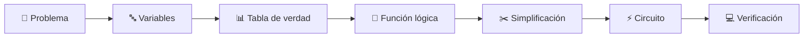
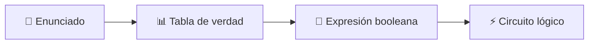
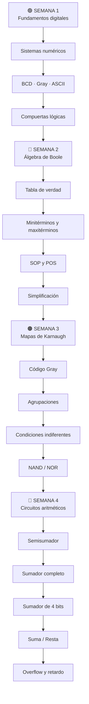
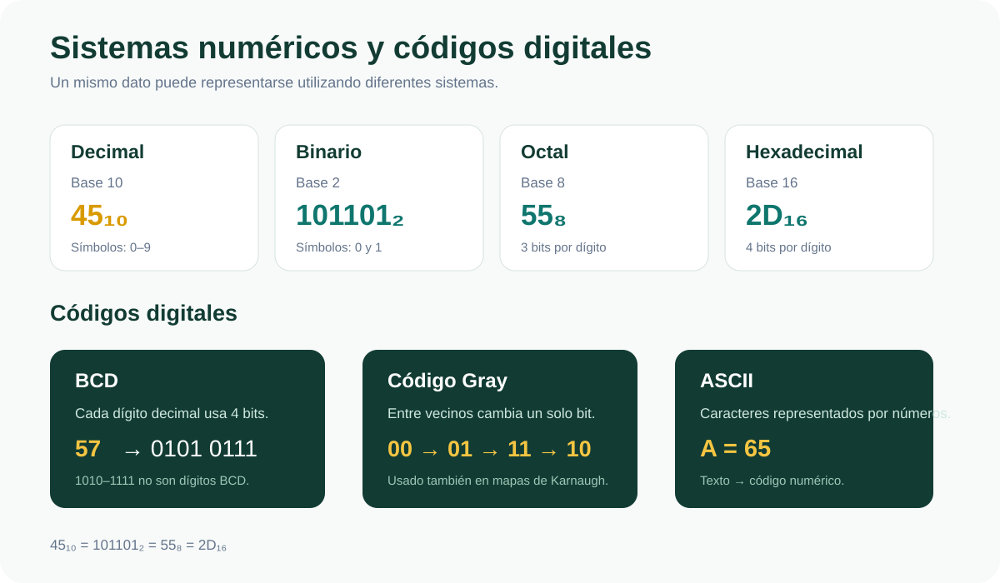
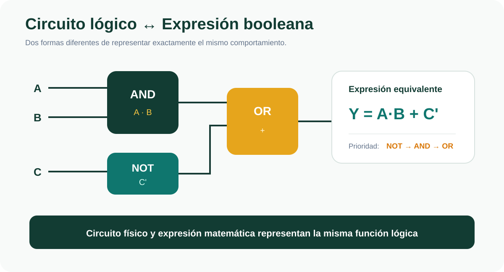
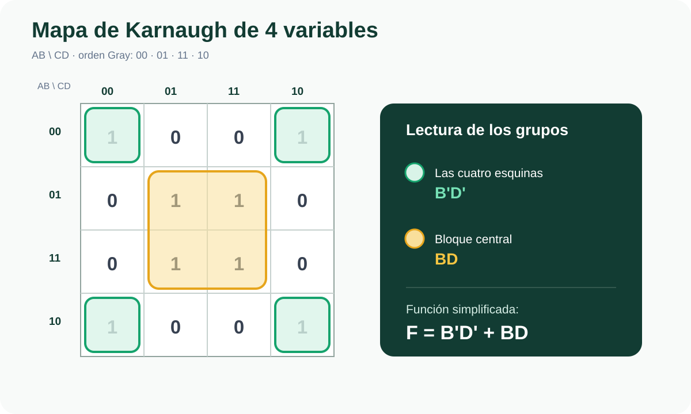
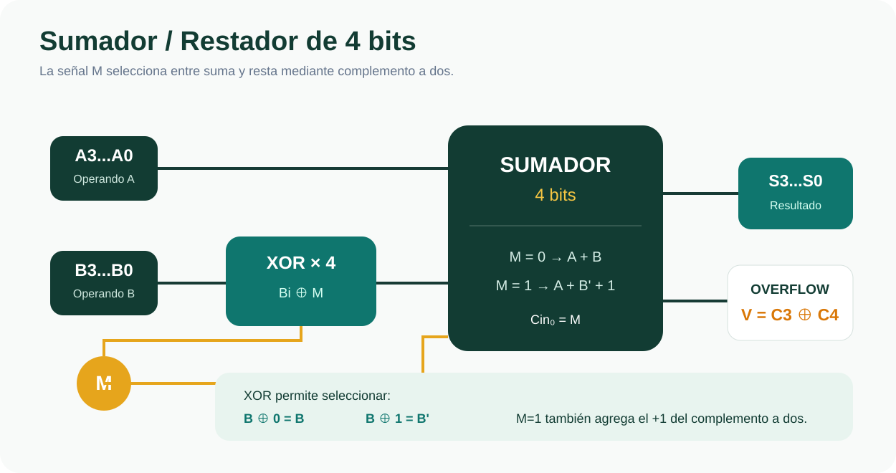
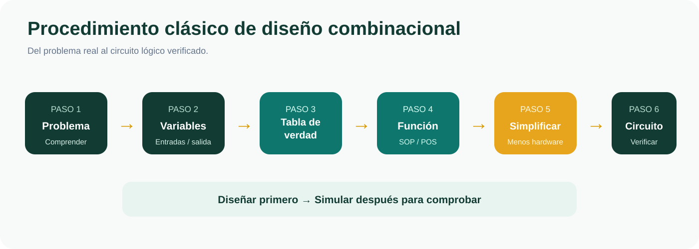
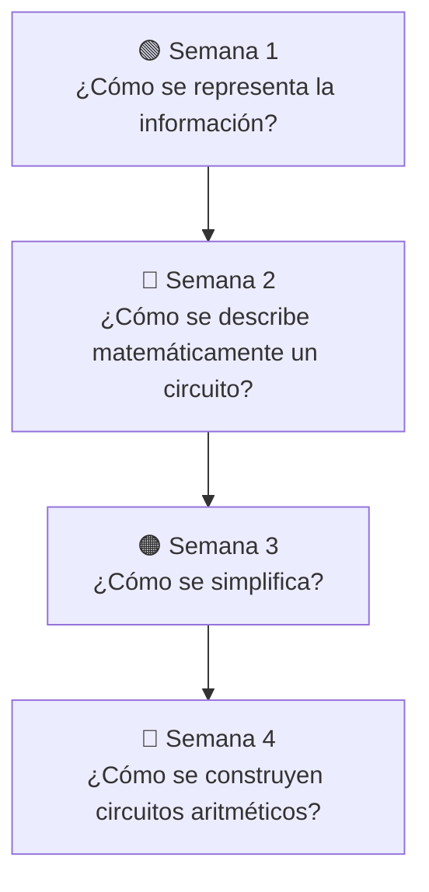

````markdown
<div align="center">


<br>

# 📘 CUADERNO DIGITAL DE SÍNTESIS

## DISEÑO DE CIRCUITOS

### Unidad 1 · Análisis de lógica combinacional con diseño clásico

<br>

**UNIVERSIDAD NACIONAL DE LOJA**  
**Carrera de Computación**  
**Segundo Ciclo · Paralelo A**

<br>

### 👨‍🎓 Sdier Emanuel Roblez Roblez

**Docente:** Ing. Luis Darío Sinche Cueva, Mg.  
**Período académico:** Septiembre 2026 – Marzo 2027

<br>

<p align="center">
  
</p>

---

> **Cuaderno académico digital de consulta, estudio y síntesis de la Unidad 1**

</div>

---

<a id="indice"></a>

# 📑 Índice general

Este cuaderno digital reúne y organiza los principales conocimientos
desarrollados durante la **Unidad 1 de Diseño de Circuitos**.

El contenido se encuentra estructurado por semanas y complementado con un
**resumen general** y una sección de **ejemplos resueltos paso a paso**.

---

## 📚 Contenido por semanas

| Semana | Tema principal | Contenidos | Acceso |
|:---:|---|---|:---:|
| 🟢 **Semana 1** | Sistemas digitales | Sistemas numéricos, códigos y compuertas lógicas | [**Abrir →**](semana-1/README.md) |
| 🔵 **Semana 2** | Álgebra de Boole | Tablas de verdad, leyes, SOP, POS y simplificación | [**Abrir →**](semana-2/README.md) |
| 🟠 **Semana 3** | Mapas de Karnaugh | Agrupaciones, condiciones indiferentes, NAND y NOR | [**Abrir →**](semana-3/README.md) |
| 🔴 **Semana 4** | Circuitos aritméticos | Semisumador, sumador completo, suma, resta y overflow | [**Abrir →**](semana-4/README.md) |

---

## 📖 Material complementario

| Sección | Contenido | Acceso |
|---|---|:---:|
| 📚 **Resumen de la Unidad** | Síntesis de las cuatro semanas, fórmulas y conceptos fundamentales | [**Abrir →**](resumen-unidad/README.md) |
| 🧩 **Ejemplos resueltos** | Ejercicios explicados paso a paso por cada semana | [**Abrir →**](ejemplos-resueltos/README.md) |

---

# 🎯 Propósito del cuaderno

El propósito de este cuaderno es sintetizar de manera clara, ordenada y visual
los conocimientos desarrollados durante la **Unidad 1: Análisis de lógica
combinacional con diseño clásico**.

No se busca únicamente memorizar fórmulas o tablas.

La finalidad es comprender el proceso mediante el cual un problema puede
transformarse en un circuito digital funcional.



---

# 🧠 ¿Qué es la lógica combinacional?

La lógica combinacional estudia circuitos cuya salida depende exclusivamente
de los valores presentes en las entradas en un determinado instante.

Esto significa que:

```text
SALIDA = función de las ENTRADAS ACTUALES
```

El circuito no necesita recordar estados anteriores.

---

## Ejemplo

Supongamos:

```text
Y = A·B
```

Si:

```text
A = 1
B = 1
```

entonces:

```text
Y = 1
```

Pero si una entrada cambia:

```text
A = 1
B = 0
```

la salida será:

```text
Y = 0
```

---

# 🔄 Diferentes formas de representar la misma función

Un mismo comportamiento lógico puede escribirse mediante:



Estas representaciones no describen sistemas distintos.

Representan:

```text
LA MISMA FUNCIÓN
```

de diferentes maneras.

---

## Ejemplo

La expresión:

```text
Y = A·B + C'
```

indica que:

1. `A` y `B` pasan por una compuerta AND.
2. `C` pasa por una compuerta NOT.
3. Los resultados anteriores pasan por una OR.

---

# 🗺️ Ruta de aprendizaje de la Unidad 1



---

# 🟢 Semana 1

## Sistemas numéricos, códigos y compuertas lógicas

La primera semana introduce los fundamentos necesarios para comprender la
representación de información dentro de los sistemas digitales.

### Contenidos principales

- representación binaria;
- estados lógicos `0` y `1`;
- niveles de voltaje;
- margen de ruido;
- sistema decimal;
- sistema binario;
- sistema octal;
- sistema hexadecimal;
- conversiones entre bases;
- complemento a dos;
- código BCD;
- código Gray;
- código ASCII;
- NOT;
- AND;
- OR;
- NAND;
- NOR;
- XOR;
- XNOR.

<p align="center">
  
</p>

### 📖 Acceso

➡️ [**Estudiar Semana 1**](semana-1/README.md)

---

# 🔵 Semana 2

## Álgebra de Boole y formas canónicas

En la segunda semana se aprende a representar matemáticamente el
comportamiento de un circuito.

### Contenidos principales

- variables booleanas;
- expresiones lógicas;
- tablas de verdad;
- leyes del álgebra de Boole;
- principio de dualidad;
- leyes de De Morgan;
- minitérminos;
- maxitérminos;
- SOP;
- POS;
- formas canónicas;
- simplificación algebraica;
- costo de implementación;
- procedimiento clásico de diseño.

<p align="center">
  
</p>

### 📖 Acceso

➡️ [**Estudiar Semana 2**](semana-2/README.md)

---

# 🟠 Semana 3

## Mapas de Karnaugh, condiciones indiferentes y NAND/NOR

La tercera semana introduce una herramienta gráfica que permite simplificar
funciones booleanas.

### Contenidos principales

- teorema de adyacencia;
- código Gray;
- mapas de tres variables;
- mapas de cuatro variables;
- grupos de `2ᵏ`;
- implicantes;
- implicantes primos;
- implicantes primos esenciales;
- SOP mínima;
- POS mínima;
- condiciones indiferentes;
- compuertas universales;
- NAND-NAND;
- NOR-NOR;
- costo lógico.

<p align="center">
  
</p>

### 📖 Acceso

➡️ [**Estudiar Semana 3**](semana-3/README.md)

---

# 🔴 Semana 4

## Circuitos aritméticos

La cuarta semana aplica los conocimientos anteriores a circuitos capaces de
realizar operaciones matemáticas.

### Contenidos principales

- suma binaria;
- acarreo;
- semisumador;
- sumador completo;
- sumador de 4 bits;
- Ripple Carry;
- retardo de propagación;
- complemento a dos;
- resta;
- sumador/restador;
- overflow;
- comparadores;
- relación con la ALU.

<p align="center">
  
</p>

### 📖 Acceso

➡️ [**Estudiar Semana 4**](semana-4/README.md)

---

# 📚 Resumen general de la Unidad

Después de estudiar las cuatro semanas se dispone de una sección especial que
reúne:

- conceptos esenciales;
- fórmulas;
- tablas;
- reglas;
- procedimientos;
- errores frecuentes;
- relaciones entre los temas;
- checklist de aprendizaje.

Esta sección permite consultar rápidamente toda la Unidad 1 sin tener que
recorrer nuevamente cada capítulo completo.

### 📖 Acceso

➡️ [**Abrir Resumen de la Unidad 1**](resumen-unidad/README.md)

---

# 🧩 Ejemplos resueltos

El cuaderno también contiene ejercicios desarrollados paso a paso.

Los ejemplos incluyen:

### Semana 1

- binario a decimal;
- decimal a binario;
- complemento a dos;
- identificación de compuertas.

### Semana 2

- evaluación de expresiones;
- construcción de tablas;
- alarma de tres sensores;
- simplificación booleana;
- SOP y POS.

### Semana 3

- agrupaciones de Karnaugh;
- simplificación;
- condiciones indiferentes.

### Semana 4

- suma binaria;
- semisumador;
- sumador completo;
- resta mediante complemento a dos;
- retardo;
- comparación.

Las soluciones pueden mantenerse ocultas mediante los elementos desplegables
de GitHub para intentar primero cada ejercicio.

### 📖 Acceso

➡️ [**Abrir Ejemplos Resueltos**](ejemplos-resueltos/README.md)

---

# ⚡ Procedimiento clásico de diseño

Una de las ideas fundamentales desarrolladas durante toda la Unidad 1 es el
procedimiento sistemático de diseño.

<p align="center">
  
</p>

El proceso puede resumirse como:

### 1. Comprender el problema

Determinar exactamente qué debe hacer el circuito.

### 2. Definir variables

Identificar:

```text
entradas
```

y:

```text
salidas
```

### 3. Construir la tabla de verdad

Representar:

```text
todas las combinaciones posibles
```

### 4. Obtener la función lógica

Utilizando:

```text
SOP
```

o:

```text
POS
```

### 5. Simplificar

Mediante:

```text
Álgebra de Boole
```

o:

```text
Mapas de Karnaugh
```

### 6. Implementar

Transformar la expresión simplificada en:

```text
compuertas lógicas
```

### 7. Verificar

Comprobar que el circuito reproduce correctamente la especificación inicial.

---

# 💻 Uso de Logisim-evolution

Durante las actividades prácticas puede utilizarse **Logisim-evolution** para
construir y verificar circuitos digitales.

Permite trabajar con:

- entradas;
- salidas;
- LED;
- sondas;
- compuertas;
- subcircuitos;
- componentes TTL;
- conexiones;
- simulación lógica.

La metodología importante es:

```text
DISEÑAR
   ↓
IMPLEMENTAR
   ↓
SIMULAR
   ↓
VERIFICAR
```

El simulador debe utilizarse principalmente para:

```text
comprobar el diseño
```

y no como sustituto del razonamiento previo.

---

# 🔗 Relación entre las cuatro semanas

Cada semana sirve como base para la siguiente.



---

# 🧠 Conceptos esenciales

| Concepto | Idea principal |
|---|---|
| **Bit** | Dígito binario que puede valer `0` o `1` |
| **Binario** | Sistema de numeración de base 2 |
| **Compuerta** | Elemento que realiza una operación lógica |
| **Variable booleana** | Variable que toma valores `0` o `1` |
| **Tabla de verdad** | Describe todas las combinaciones del sistema |
| **Minitérmino** | Se relaciona con una fila donde `F=1` |
| **Maxitérmino** | Se relaciona con una fila donde `F=0` |
| **SOP** | Suma de productos |
| **POS** | Producto de sumas |
| **Karnaugh** | Método gráfico de simplificación |
| **NAND/NOR** | Compuertas universales |
| **Semisumador** | Suma dos bits |
| **Sumador completo** | Suma `A`, `B` y `Cin` |
| **Carry** | Acarreo entre etapas |
| **Overflow** | Resultado fuera del rango representable |
| **ALU** | Unidad Aritmético-Lógica |

---

# 📐 Fórmulas esenciales

## Número de combinaciones

```text
2ⁿ
```

---

## Complemento a dos

```text
-N = N' + 1
```

---

## De Morgan

```text
(X·Y)' = X' + Y'
```

```text
(X+Y)' = X'·Y'
```

---

## Semisumador

```text
S = A⊕B
```

```text
C = A·B
```

---

## Sumador completo

```text
S = A⊕B⊕Cin
```

```text
Cout = AB + ACin + BCin
```

---

## Resta mediante complemento a dos

```text
A-B = A+B'+1
```

---

## Overflow

```text
V = C3⊕C4
```

---

# 🧭 Ruta recomendada de consulta

Si deseas estudiar toda la Unidad desde el comienzo:

```text
Semana 1
   ↓
Semana 2
   ↓
Semana 3
   ↓
Semana 4
   ↓
Resumen
   ↓
Ejemplos resueltos
```

---

# 📚 Accesos rápidos

### 🟢 Fundamentos

➡️ [Semana 1](semana-1/README.md)

### 🔵 Diseño lógico

➡️ [Semana 2](semana-2/README.md)

### 🟠 Simplificación

➡️ [Semana 3](semana-3/README.md)

### 🔴 Circuitos aritméticos

➡️ [Semana 4](semana-4/README.md)

### 📚 Repaso

➡️ [Resumen de la Unidad](resumen-unidad/README.md)

### 🧩 Aplicación

➡️ [Ejemplos Resueltos](ejemplos-resueltos/README.md)

---

# ✅ Conclusión

Durante la Unidad 1 se desarrolló progresivamente el proceso necesario para
comprender y diseñar circuitos combinacionales.

Se comenzó con la representación binaria y las compuertas lógicas, para
posteriormente estudiar su representación mediante álgebra de Boole.

Después se incorporaron formas canónicas y métodos de simplificación como los
mapas de Karnaugh.

Finalmente, estos conocimientos se aplicaron a circuitos capaces de realizar
operaciones aritméticas.

Todo el proceso puede resumirse mediante:

```text
REPRESENTAR
     ↓
DESCRIBIR
     ↓
SIMPLIFICAR
     ↓
IMPLEMENTAR
     ↓
VERIFICAR
```

---

<div align="center">

# 🎓 CUADERNO DIGITAL DE SÍNTESIS

### Unidad 1 · Diseño de Circuitos

**Universidad Nacional de Loja**  
**Carrera de Computación**

### Sdier Emanuel Roblez Roblez

<br>

[⬆️ Volver al índice](#indice)

</div>
````
