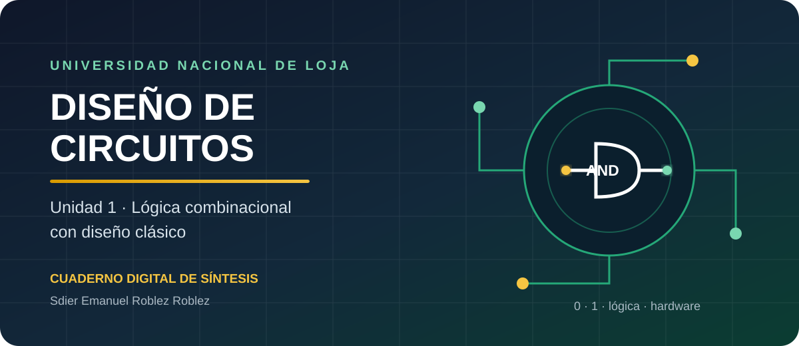
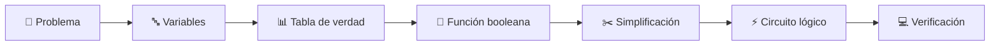
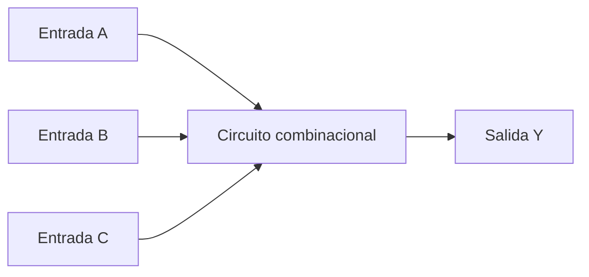
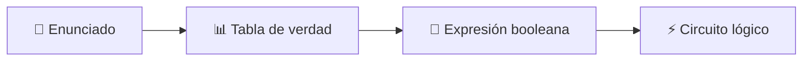
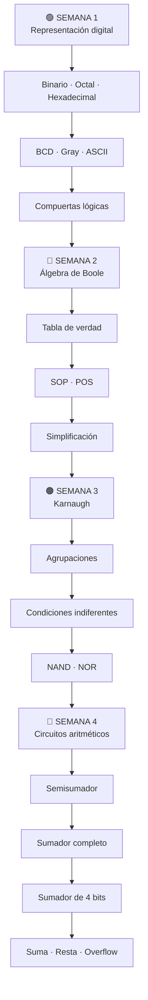
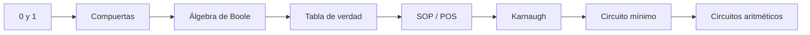
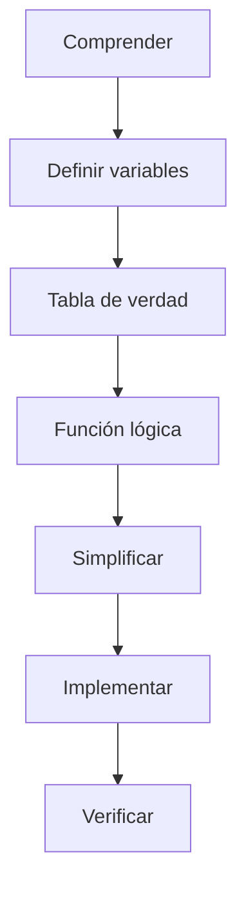

<div align="center">


<br>

# 📘 CUADERNO DIGITAL DE SÍNTESIS

## DISEÑO DE CIRCUITOS

### Unidad 1 · Análisis de lógica combinacional con diseño clásico

<br>

**UNIVERSIDAD NACIONAL DE LOJA**  
**Carrera de Computación**  
**Segundo Ciclo · Paralelo A**

<br>

### 👨‍🎓 Sdier Emanuel Roblez Roblez

**Docente:** Ing. Luis Darío Sinche Cueva, Mg.  
**Período académico:** Septiembre 2026 – Marzo 2027

<p align="center">
  
</p>

---

> **Cuaderno académico digital de consulta, estudio y síntesis de la Unidad 1**

</div>

---

<a id="indice"></a>

# 📑 Índice general

Este cuaderno organiza los principales conocimientos desarrollados durante la
**Unidad 1 de Diseño de Circuitos**.

El contenido está dividido por semanas para facilitar la consulta y permitir
una navegación progresiva entre los temas.

| Semana | Tema principal | Contenidos | Acceso |
|:---:|---|---|:---:|
| 🟢 **1** | Sistemas digitales | Binario, octal, hexadecimal, códigos y compuertas | [**Abrir →**](semana-1/README.md) |
| 🔵 **2** | Álgebra de Boole | Tabla de verdad, leyes, SOP, POS y simplificación | [**Abrir →**](semana-2/README.md) |
| 🟠 **3** | Mapas de Karnaugh | Agrupaciones, indiferentes, NAND y NOR | [**Abrir →**](semana-3/README.md) |
| 🔴 **4** | Circuitos aritméticos | Semisumador, sumador completo, resta y overflow | [**Abrir →**](semana-4/README.md) |

---

# 🎯 Propósito de la Unidad

La Unidad 1 introduce el proceso de **diseño clásico de circuitos
combinacionales**.

La finalidad no es únicamente aprender símbolos o fórmulas, sino desarrollar
un procedimiento para transformar una necesidad real en un circuito lógico.



---

# 🧠 ¿Qué es un circuito combinacional?

Un **circuito combinacional** es aquel cuya salida depende exclusivamente de
los valores que poseen sus entradas en ese instante.

No necesita recordar lo ocurrido anteriormente.

Por ejemplo:

```text
A = 1
B = 1

Y = A · B

Y = 1
```

Si una de las entradas cambia, el resultado puede cambiar inmediatamente.



---

# 🔍 La misma función puede representarse de varias formas

Una de las ideas fundamentales de la unidad es que el mismo comportamiento
lógico puede expresarse mediante:



Por ejemplo:

```text
Y = A·B + C'
```

puede interpretarse como:

1. `A` y `B` entran en una compuerta AND.
2. `C` pasa por una compuerta NOT.
3. Los dos resultados se conectan a una compuerta OR.

---

# 🗺️ Ruta de aprendizaje



---

# 📚 Contenido del cuaderno

## 🟢 Semana 1 · Fundamentos digitales

En la primera semana se estudia cómo representa información un sistema
digital.

### Temas

- estados lógicos `0` y `1`;
- niveles de voltaje;
- margen de ruido;
- sistema decimal;
- sistema binario;
- sistema octal;
- sistema hexadecimal;
- complemento a dos;
- código BCD;
- código Gray;
- código ASCII;
- compuerta NOT;
- compuerta AND;
- compuerta OR;
- compuerta NAND;
- compuerta NOR;
- compuerta XOR;
- compuerta XNOR.

### Acceso

➡️ **[Estudiar Semana 1](semana-1/README.md)**

---

## 🔵 Semana 2 · Álgebra de Boole

La segunda semana conecta los circuitos físicos con su representación
matemática.

### Temas

- variables booleanas;
- expresiones lógicas;
- tablas de verdad;
- postulados;
- teoremas;
- dualidad;
- leyes de De Morgan;
- minitérminos;
- maxitérminos;
- SOP;
- POS;
- formas canónicas;
- simplificación algebraica;
- costo de implementación.

### Acceso

➡️ **[Estudiar Semana 2](semana-2/README.md)**

---

## 🟠 Semana 3 · Mapas de Karnaugh

La tercera semana introduce una herramienta gráfica para simplificar
funciones booleanas.

### Temas

- principio de adyacencia;
- código Gray;
- mapas de 3 variables;
- mapas de 4 variables;
- agrupaciones;
- implicantes;
- implicantes primos;
- SOP mínima;
- POS mínima;
- condiciones indiferentes;
- NAND universal;
- NOR universal;
- implementación NAND-NAND;
- implementación NOR-NOR.

### Acceso

➡️ **[Estudiar Semana 3](semana-3/README.md)**

---

## 🔴 Semana 4 · Circuitos aritméticos

La cuarta semana aplica los conocimientos anteriores a circuitos capaces de
realizar operaciones matemáticas.

### Temas

- suma binaria;
- acarreo;
- semisumador;
- sumador completo;
- sumador de 4 bits;
- propagación de acarreo;
- resta mediante complemento a dos;
- sumador/restador;
- overflow;
- retardo de propagación;
- comparadores.

### Acceso

➡️ **[Estudiar Semana 4](semana-4/README.md)**

---

# 🔗 Cómo se relaciona toda la Unidad

Los temas no son independientes.

Cada uno proporciona herramientas necesarias para comprender el siguiente.



---

# ⚡ Procedimiento clásico de diseño

Cuando se desea resolver un problema mediante lógica combinacional se puede
seguir esta secuencia:

### 1. Comprender el problema

Determinar exactamente qué debe hacer el sistema.

### 2. Definir las variables

Asignar una variable a cada entrada y a cada salida.

### 3. Construir la tabla de verdad

Representar todas las combinaciones posibles.

### 4. Obtener la función

Identificar los minitérminos o maxitérminos correspondientes.

### 5. Simplificar

Utilizar:

- álgebra de Boole;
- mapas de Karnaugh.

### 6. Dibujar el circuito

Transformar la función simplificada en compuertas.

### 7. Verificar

Comprobar que el circuito reproduce exactamente la tabla de verdad.



---

# 💻 Simulación

Durante las actividades prácticas se emplea **Logisim-evolution**.

El simulador permite:

- colocar entradas y salidas;
- construir compuertas;
- observar niveles lógicos;
- crear subcircuitos;
- comprobar tablas de verdad;
- utilizar componentes TTL;
- comparar diseños.

> **Principio de trabajo:** primero se diseña y posteriormente se utiliza el
> simulador para comprobar el resultado.

---

# 🧩 Conceptos esenciales de toda la Unidad

| Concepto | Idea principal |
|---|---|
| **Bit** | Unidad binaria que puede valer 0 o 1 |
| **Compuerta** | Realiza una operación lógica |
| **Tabla de verdad** | Describe todas las combinaciones posibles |
| **Función booleana** | Representa matemáticamente el circuito |
| **SOP** | Suma de productos |
| **POS** | Producto de sumas |
| **Karnaugh** | Método gráfico de simplificación |
| **NAND/NOR** | Compuertas universales |
| **Acarreo** | Bit que pasa a la siguiente posición durante una suma |
| **Overflow** | Resultado fuera del rango representable |

---

# ✅ Resultado de aprendizaje esperado

Al terminar la Unidad 1 se debe poder recorrer de manera razonada el proceso:

> **problema → variables → tabla de verdad → expresión → simplificación →
> circuito → comprobación**

y comprender cómo esos principios permiten construir sistemas más complejos,
como los circuitos aritméticos de un procesador.

---

# 📝 Organización de este cuaderno

Cada semana incluye:

- explicación conceptual;
- fórmulas;
- tablas;
- ejemplos;
- esquemas;
- relaciones entre conceptos;
- síntesis final;
- navegación hacia la siguiente sección.

---

<div align="center">

## 🚀 Comenzar

### [🟢 Ir a Semana 1](semana-1/README.md)

---

**Universidad Nacional de Loja**  
**Carrera de Computación · Diseño de Circuitos**

**Sdier Emanuel Roblez Roblez**

</div>
