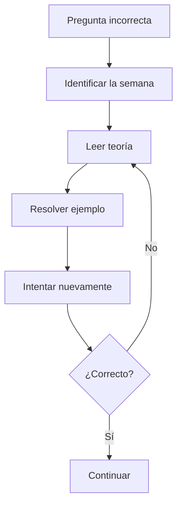

<div align="center">

# 🧠 AUTOEVALUACIÓN

## Unidad 1 · Diseño de Circuitos

### Comprueba cuánto has aprendido

**Universidad Nacional de Loja**  
**Carrera de Computación**

**Sdier Emanuel Roblez Roblez**

</div>

---

| ⬅️ Anterior | 🏠 Inicio |
|:---:|:---:|
| [**Ejemplos resueltos**](../ejemplos-resueltos/README.md) | [**Índice general**](../README.md) |

---

<a id="contenido"></a>

# 📑 Contenido

1. [Instrucciones](#instrucciones)
2. [Semana 1 · Sistemas digitales](#semana1)
3. [Semana 2 · Álgebra de Boole](#semana2)
4. [Semana 3 · Karnaugh](#semana3)
5. [Semana 4 · Circuitos aritméticos](#semana4)
6. [Desafío integrador](#integrador)
7. [Tabla de puntuación](#puntuacion)
8. [Diagnóstico final](#diagnostico)

---

<a id="instrucciones"></a>

# 📋 Instrucciones

Esta sección está diseñada para utilizarse como una prueba de repaso.

Para aprovecharla correctamente:

```text
1. Lee la pregunta.
2. Responde sin consultar los apuntes.
3. Anota tu respuesta.
4. Abre "Ver respuesta".
5. Comprueba tu resultado.
6. Suma tus puntos.
```

---

## 🎯 Sistema de puntuación

Cada pregunta vale:

```text
1 punto
```

La autoevaluación contiene:

```text
32 preguntas principales
```

más:

```text
4 desafíos integradores
```

Puntuación máxima:

```text
36 puntos
```

---

# ⚠️ Importante

No abras las respuestas antes de intentar resolver cada ejercicio.

El objetivo no es obtener una puntuación alta viendo las respuestas.

El objetivo es detectar:

```text
qué temas realmente comprendes
```

y:

```text
qué temas debes repasar
```

---

<a id="semana1"></a>

# 🟢 SEMANA 1

## Sistemas numéricos, códigos y compuertas

---

# Pregunta 1

¿Cuántos estados fundamentales utiliza un sistema digital binario?

- A) 1
- B) 2
- C) 8
- D) 10

<details>

<summary><b>✅ Ver respuesta</b></summary>

<br>

Respuesta:

```text
B) 2
```

Los estados son:

```text
0
1
```

</details>

---

# Pregunta 2

¿Cuánto vale:

```text
1011₂
```

en decimal?

- A) 9
- B) 10
- C) 11
- D) 13

<details>

<summary><b>✅ Ver respuesta</b></summary>

<br>

```text
1011₂
```

equivale a:

```text
8 + 0 + 2 + 1
```

```text
= 11
```

Respuesta:

```text
C) 11
```

</details>

---

# Pregunta 3

¿Cuántos bits representa un dígito hexadecimal?

- A) 2
- B) 3
- C) 4
- D) 8

<details>

<summary><b>✅ Ver respuesta</b></summary>

<br>

Respuesta:

```text
C) 4 bits
```

</details>

---

# Pregunta 4

¿Cuántos bits representa un dígito octal?

- A) 2
- B) 3
- C) 4
- D) 8

<details>

<summary><b>✅ Ver respuesta</b></summary>

<br>

Respuesta:

```text
B) 3 bits
```

</details>

---

# Pregunta 5

Para obtener el complemento a dos de un número debemos:

- A) Sumar 1 y después invertir
- B) Invertir los bits y sumar 1
- C) Restar 1
- D) Multiplicar por 2

<details>

<summary><b>✅ Ver respuesta</b></summary>

<br>

Respuesta:

```text
B) Invertir los bits y sumar 1
```

Regla:

```text
-N = N' + 1
```

</details>

---

# Pregunta 6

¿Cuál es la característica principal del código Gray?

- A) Utiliza base 8
- B) Utiliza solamente tres bits
- C) Entre estados consecutivos cambia un solo bit
- D) Representa únicamente letras

<details>

<summary><b>✅ Ver respuesta</b></summary>

<br>

Respuesta:

```text
C) Entre estados consecutivos cambia un solo bit
```

Ejemplo:

```text
00 → 01 → 11 → 10
```

</details>

---

# Pregunta 7

¿Qué compuerta produce `1` cuando sus dos entradas son diferentes?

- A) AND
- B) OR
- C) XOR
- D) XNOR

<details>

<summary><b>✅ Ver respuesta</b></summary>

<br>

Respuesta:

```text
C) XOR
```

Tabla característica:

```text
0 0 → 0
0 1 → 1
1 0 → 1
1 1 → 0
```

</details>

---

# Pregunta 8

¿Qué compuerta produce `1` cuando sus dos entradas son iguales?

- A) XOR
- B) XNOR
- C) NAND
- D) OR

<details>

<summary><b>✅ Ver respuesta</b></summary>

<br>

Respuesta:

```text
B) XNOR
```

</details>

---

## 🧮 Puntuación Semana 1

```text
____ / 8
```

---

[⬆️ Volver al contenido](#contenido)

---

<a id="semana2"></a>

# 🔵 SEMANA 2

## Álgebra de Boole y formas canónicas

---

# Pregunta 9

¿Cuántas filas tiene una tabla de verdad de:

```text
3 variables
```

- A) 3
- B) 6
- C) 8
- D) 16

<details>

<summary><b>✅ Ver respuesta</b></summary>

<br>

Utilizamos:

```text
2ⁿ
```

Entonces:

```text
2³ = 8
```

Respuesta:

```text
C) 8
```

</details>

---

# Pregunta 10

En álgebra de Boole:

```text
+
```

representa:

- A) AND
- B) OR
- C) NOT
- D) XOR

<details>

<summary><b>✅ Ver respuesta</b></summary>

<br>

Respuesta:

```text
B) OR
```

</details>

---

# Pregunta 11

En álgebra de Boole:

```text
A·B
```

representa:

- A) A OR B
- B) A XOR B
- C) A AND B
- D) NOT A

<details>

<summary><b>✅ Ver respuesta</b></summary>

<br>

Respuesta:

```text
C) A AND B
```

</details>

---

# Pregunta 12

Simplificar:

```text
X + X
```

<details>

<summary><b>✅ Ver respuesta</b></summary>

<br>

Aplicamos idempotencia:

```text
X + X = X
```

Respuesta:

```text
X
```

</details>

---

# Pregunta 13

Simplificar:

```text
X + X'
```

<details>

<summary><b>✅ Ver respuesta</b></summary>

<br>

Aplicamos complemento:

```text
X + X' = 1
```

Respuesta:

```text
1
```

</details>

---

# Pregunta 14

Aplicar De Morgan:

```text
(A·B)'
```

<details>

<summary><b>✅ Ver respuesta</b></summary>

<br>

Por De Morgan:

```text
(A·B)' = A' + B'
```

</details>

---

# Pregunta 15

SOP significa:

- A) Suma de operaciones parciales
- B) Suma de productos
- C) Sistema operacional primario
- D) Producto de sumas

<details>

<summary><b>✅ Ver respuesta</b></summary>

<br>

Respuesta:

```text
B) Suma de productos
```

En inglés:

```text
Sum of Products
```

</details>

---

# Pregunta 16

Una función tiene:

```text
F = Σm(3,5,6,7)
```

¿Cuáles son las filas correspondientes a `F=0`?

<details>

<summary><b>✅ Ver respuesta</b></summary>

<br>

Para tres variables existen:

```text
0 1 2 3 4 5 6 7
```

Las filas donde `F=1` son:

```text
3 5 6 7
```

Entonces las restantes son:

```text
0 1 2 4
```

Por tanto:

```text
F = ΠM(0,1,2,4)
```

</details>

---

## 🧮 Puntuación Semana 2

```text
____ / 8
```

---

[⬆️ Volver al contenido](#contenido)

---

<a id="semana3"></a>

# 🟠 SEMANA 3

## Mapas de Karnaugh, indiferentes y NAND/NOR

---

# Pregunta 17

¿Cuál es el orden correcto de código Gray utilizado en Karnaugh?

- A) `00 01 10 11`
- B) `00 10 01 11`
- C) `00 01 11 10`
- D) `00 11 01 10`

<details>

<summary><b>✅ Ver respuesta</b></summary>

<br>

Respuesta:

```text
C) 00 01 11 10
```

La razón es que entre celdas consecutivas cambia solamente:

```text
1 bit
```

</details>

---

# Pregunta 18

¿Cuál de los siguientes tamaños de grupo NO es válido?

- A) 2
- B) 4
- C) 6
- D) 8

<details>

<summary><b>✅ Ver respuesta</b></summary>

<br>

Los tamaños deben ser:

```text
2ᵏ
```

Es decir:

```text
1, 2, 4, 8, 16...
```

Respuesta:

```text
C) 6
```

</details>

---

# Pregunta 19

Verdadero o falso:

> En un mapa de Karnaugh es preferible formar grupos pequeños antes que grupos
> grandes.

<details>

<summary><b>✅ Ver respuesta</b></summary>

<br>

```text
FALSO
```

Se debe intentar formar:

```text
el grupo más grande posible
```

porque grupos mayores eliminan más variables.

</details>

---

# Pregunta 20

Verdadero o falso:

> Los bordes opuestos de un mapa de Karnaugh pueden ser adyacentes.

<details>

<summary><b>✅ Ver respuesta</b></summary>

<br>

```text
VERDADERO
```

El mapa se considera:

```text
enrollado
```

Por eso:

```text
izquierda ↔ derecha
```

y:

```text
arriba ↔ abajo
```

</details>

---

# Pregunta 21

Para obtener una expresión SOP mediante Karnaugh debemos agrupar:

- A) Los 0
- B) Los 1
- C) Solamente las X
- D) Todos los valores

<details>

<summary><b>✅ Ver respuesta</b></summary>

<br>

Respuesta:

```text
B) Los 1
```

</details>

---

# Pregunta 22

Para obtener una expresión POS debemos agrupar:

- A) Los 1
- B) Los 0
- C) Las X únicamente
- D) Ninguno

<details>

<summary><b>✅ Ver respuesta</b></summary>

<br>

Respuesta:

```text
B) Los 0
```

</details>

---

# Pregunta 23

¿Qué debe hacerse con una condición indiferente `X`?

- A) Siempre convertirla en 1
- B) Siempre convertirla en 0
- C) Utilizarla si permite simplificar mejor
- D) Crear siempre un grupo solo con X

<details>

<summary><b>✅ Ver respuesta</b></summary>

<br>

Respuesta:

```text
C) Utilizarla si permite simplificar mejor
```

Una `X` puede utilizarse como `1` si agranda un grupo, o ignorarse si no ayuda.

</details>

---

# Pregunta 24

¿Qué significa que NAND y NOR sean compuertas universales?

<details>

<summary><b>✅ Ver respuesta</b></summary>

<br>

Significa que utilizando únicamente NAND o únicamente NOR pueden construirse
las operaciones fundamentales:

```text
NOT
AND
OR
```

y, por tanto, implementar funciones lógicas completas.

</details>

---

## 🧮 Puntuación Semana 3

```text
____ / 8
```

---

[⬆️ Volver al contenido](#contenido)

---

<a id="semana4"></a>

# 🔴 SEMANA 4

## Circuitos aritméticos

---

# Pregunta 25

¿Cuál es el resultado de:

```text
1 + 1
```

en binario?

- A) `0`
- B) `1`
- C) `10`
- D) `11`

<details>

<summary><b>✅ Ver respuesta</b></summary>

<br>

Respuesta:

```text
C) 10₂
```

Por tanto:

```text
S = 0
C = 1
```

</details>

---

# Pregunta 26

¿Cuáles son las ecuaciones del semisumador?

<details>

<summary><b>✅ Ver respuesta</b></summary>

<br>

Suma:

```text
S = A⊕B
```

Acarreo:

```text
C = A·B
```

</details>

---

# Pregunta 27

¿Cuántas entradas posee un sumador completo?

- A) 1
- B) 2
- C) 3
- D) 4

<details>

<summary><b>✅ Ver respuesta</b></summary>

<br>

Respuesta:

```text
C) 3
```

Son:

```text
A
B
Cin
```

</details>

---

# Pregunta 28

En un sumador completo:

```text
A = 1
B = 1
Cin = 1
```

¿Cuáles son `Cout` y `S`?

<details>

<summary><b>✅ Ver respuesta</b></summary>

<br>

Existen:

```text
3 unos
```

Tres en binario es:

```text
11₂
```

Por tanto:

```text
Cout = 1
S = 1
```

</details>

---

# Pregunta 29

En un sumador/restador, ¿qué ocurre cuando:

```text
M = 0
```

?

- A) Se realiza una resta
- B) B se invierte
- C) Se realiza una suma
- D) Aparece overflow automáticamente

<details>

<summary><b>✅ Ver respuesta</b></summary>

<br>

Cuando:

```text
M = 0
```

tenemos:

```text
B⊕0 = B
```

y:

```text
Cin₀ = 0
```

Por tanto:

```text
A+B
```

Respuesta:

```text
C) Se realiza una suma
```

</details>

---

# Pregunta 30

Cuando:

```text
M = 1
```

la XOR aplicada a B produce:

- A) `B`
- B) `B'`
- C) `0`
- D) Siempre `1`

<details>

<summary><b>✅ Ver respuesta</b></summary>

<br>

Sabemos:

```text
B⊕1 = B'
```

Respuesta:

```text
B) B'
```

Además:

```text
Cin₀ = 1
```

produce el `+1` necesario para el complemento a dos.

</details>

---

# Pregunta 31

¿Qué expresión se utiliza para detectar overflow en el sumador/restador
estudiado?

- A) `V = C4`
- B) `V = C3+C4`
- C) `V = C3⊕C4`
- D) `V = C3·C4`

<details>

<summary><b>✅ Ver respuesta</b></summary>

<br>

Respuesta:

```text
C) V = C3⊕C4
```

</details>

---

# Pregunta 32

Estimar el retardo de un sumador Ripple Carry de:

```text
16 bits
```

considerando aproximadamente:

```text
2 compuertas por etapa
```

y:

```text
10 ns por compuerta
```

<details>

<summary><b>✅ Ver respuesta</b></summary>

<br>

Utilizamos:

```text
Retardo ≈ 2·n·10 ns
```

Entonces:

```text
2·16·10
```

```text
= 320 ns
```

Respuesta:

```text
≈ 320 ns
```

</details>

---

## 🧮 Puntuación Semana 4

```text
____ / 8
```

---

[⬆️ Volver al contenido](#contenido)

---

<a id="integrador"></a>

# 🏆 DESAFÍO INTEGRADOR

Estos ejercicios mezclan varios conocimientos de la Unidad 1.

Cada desafío vale:

```text
1 punto
```

---

# Desafío 1

Convertir:

```text
29₁₀
```

a binario.

<details>

<summary><b>🏆 Ver solución</b></summary>

<br>

Podemos descomponer:

```text
29 = 16 + 8 + 4 + 1
```

Potencias:

```text
16 8 4 2 1
```

Bits:

```text
1  1 1 0 1
```

Entonces:

```text
29₁₀ = 11101₂
```

</details>

---

# Desafío 2

Simplificar:

```text
F = A + AB
```

<details>

<summary><b>🏆 Ver solución</b></summary>

<br>

Aplicamos absorción:

```text
A + AB = A
```

Por tanto:

```text
F = A
```

</details>

---

# Desafío 3

En un mapa de Karnaugh, dos minitérminos son:

```text
AB'C'
```

y:

```text
AB'C
```

¿Qué término se obtiene al agruparlos?

<details>

<summary><b>🏆 Ver solución</b></summary>

<br>

Tenemos:

```text
AB'C' + AB'C
```

Factorizamos:

```text
AB'(C'+C)
```

Como:

```text
C'+C = 1
```

obtenemos:

```text
AB'
```

La variable:

```text
C
```

desaparece.

</details>

---

# Desafío 4

Realizar:

```text
0110 - 0011
```

mediante complemento a dos.

<details>

<summary><b>🏆 Ver solución</b></summary>

<br>

Número a restar:

```text
0011
```

Invertimos:

```text
1100
```

Sumamos 1:

```text
1101
```

Ahora:

```text
  0110
+ 1101
------
1 0011
```

Descartamos el acarreo adicional:

```text
0011
```

Por tanto:

```text
0110 - 0011 = 0011
```

o:

```text
6 - 3 = 3
```

</details>

---

<a id="puntuacion"></a>

# 📊 Tabla de puntuación

Anota tus resultados:

| Sección | Puntaje |
|---|:---:|
| 🟢 Semana 1 | `____ / 8` |
| 🔵 Semana 2 | `____ / 8` |
| 🟠 Semana 3 | `____ / 8` |
| 🔴 Semana 4 | `____ / 8` |
| 🏆 Integrador | `____ / 4` |
| **TOTAL** | **`____ / 36`** |

---

<a id="diagnostico"></a>

# 🎯 Diagnóstico final

## 🟢 32 – 36 puntos

### Dominio muy sólido

Comprendes la mayor parte de los contenidos de la Unidad 1.

Conviene concentrarte principalmente en:

```text
resolver ejercicios nuevos
```

y no solamente volver a leer teoría.

---

## 🔵 27 – 31 puntos

### Buen dominio

Comprendes los temas principales, pero existen algunos puntos que debes
reforzar.

Revisa las preguntas donde cometiste errores y vuelve a resolver ejemplos de
esas secciones.

---

## 🟠 20 – 26 puntos

### Dominio intermedio

Comprendes parte importante de la Unidad, pero todavía existen vacíos.

Identifica cuál de las cuatro semanas tiene el puntaje más bajo.

Después utiliza:

```text
Resumen
   ↓
Semana correspondiente
   ↓
Ejemplos resueltos
   ↓
Autoevaluación nuevamente
```

---

## 🔴 Menos de 20 puntos

### Es necesario reforzar la base

No conviene empezar memorizando las fórmulas más avanzadas.

Repasa en este orden:

```text
1. Compuertas
2. Tabla de verdad
3. Álgebra de Boole
4. SOP / POS
5. Karnaugh
6. Sumadores
```

Los temas posteriores dependen directamente de los anteriores.

---

# 🔍 Diagnóstico por semana

También es importante observar **dónde** fallaste.

### Si Semana 1 fue la más baja

Repasa:

- conversiones;
- códigos;
- complemento a dos;
- tablas de las compuertas.

➡️ [**Repasar Semana 1**](../semana-1/README.md)

---

### Si Semana 2 fue la más baja

Repasa:

- leyes booleanas;
- De Morgan;
- minitérminos;
- maxitérminos;
- SOP;
- POS.

➡️ [**Repasar Semana 2**](../semana-2/README.md)

---

### Si Semana 3 fue la más baja

Repasa:

- Gray;
- agrupaciones;
- bordes;
- SOP/POS;
- condiciones indiferentes;
- NAND/NOR.

➡️ [**Repasar Semana 3**](../semana-3/README.md)

---

### Si Semana 4 fue la más baja

Repasa:

- acarreo;
- semisumador;
- sumador completo;
- complemento a dos;
- suma/resta;
- overflow;
- retardo.

➡️ [**Repasar Semana 4**](../semana-4/README.md)

---

# 🔄 Ruta de recuperación



---

# ✅ Checklist final

Antes de considerar terminada la Unidad 1, deberías poder responder:

- [ ] ¿Puedo convertir entre decimal y binario?
- [ ] ¿Puedo obtener complemento a dos?
- [ ] ¿Reconozco las siete compuertas?
- [ ] ¿Puedo construir una tabla de verdad?
- [ ] ¿Puedo aplicar leyes booleanas?
- [ ] ¿Comprendo SOP y POS?
- [ ] ¿Puedo organizar correctamente Karnaugh?
- [ ] ¿Puedo formar grupos válidos?
- [ ] ¿Entiendo las condiciones indiferentes?
- [ ] ¿Comprendo por qué NAND y NOR son universales?
- [ ] ¿Puedo explicar un semisumador?
- [ ] ¿Puedo explicar un sumador completo?
- [ ] ¿Comprendo cómo se realiza una resta con el sumador?
- [ ] ¿Distingo acarreo de overflow?
- [ ] ¿Puedo estimar un retardo Ripple Carry?

---

# 🎓 Fin de la autoevaluación

Si existen preguntas que no pudiste resolver, el resultado no debe utilizarse
solamente como una calificación.

Debe utilizarse como:

```text
guía para saber qué estudiar
```

---

## 🧭 Navegación final

| ⬅️ | 🏠 | 📚 |
|:---:|:---:|:---:|
| [**Ejemplos resueltos**](../ejemplos-resueltos/README.md) | [**Índice principal**](../README.md) | [**Resumen Unidad 1**](../resumen-unidad/README.md) |

<div align="center">

# 🎉 CUADERNO DE SÍNTESIS

## Unidad 1 completada

**Diseño de Circuitos**

**Universidad Nacional de Loja**

**Sdier Emanuel Roblez Roblez**

<br>

[⬆️ Volver al contenido](#contenido)

</div>
