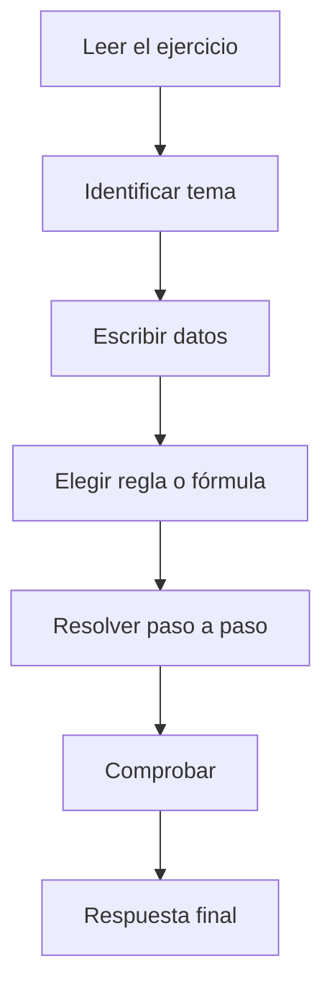

<div align="center">

# 🧩 EJEMPLOS RESUELTOS

## Unidad 1 · Diseño de Circuitos

### De la teoría a la resolución paso a paso

**Universidad Nacional de Loja**  
**Carrera de Computación**

**Sdier Emanuel Roblez Roblez**

</div>

---

| ⬅️ Anterior | 🏠 Inicio | 📚 Volver al contenido |
|:---:|:---:|:---:|
| [**Resumen de la Unidad**](../resumen-unidad/README.md) | [**Índice general**](../README.md) | [**Semana 1**](../semana-1/README.md) |
---

<a id="contenido"></a>

# 📑 Contenido

### 🟢 Semana 1

1. [Binario → Decimal](#ejemplo1)
2. [Decimal → Binario](#ejemplo2)
3. [Complemento a dos](#ejemplo3)
4. [Identificar una compuerta](#ejemplo4)

### 🔵 Semana 2

5. [Evaluar una expresión lógica](#ejemplo5)
6. [Alarma de tres sensores](#ejemplo6)
7. [Simplificación booleana](#ejemplo7)
8. [SOP y POS](#ejemplo8)

### 🟠 Semana 3

9. [Simplificación mediante Karnaugh](#ejemplo9)
10. [Condiciones indiferentes](#ejemplo10)

### 🔴 Semana 4

11. [Suma binaria](#ejemplo11)
12. [Semisumador](#ejemplo12)
13. [Sumador completo](#ejemplo13)
14. [Resta mediante complemento a dos](#ejemplo14)
15. [Retardo de propagación](#ejemplo15)
16. [Comparador](#ejemplo16)

---

# 💡 Cómo utilizar esta sección

Para aprovechar estos ejercicios:

```text
1. Lee solamente el problema.
2. Intenta resolverlo en papel.
3. Abre la solución.
4. Compara tu procedimiento.
5. Corrige cualquier diferencia.
```

No memorices únicamente la respuesta.

Debes comprender:

```text
POR QUÉ
```

se realiza cada paso.

---

# 🟢 SEMANA 1

## Sistemas numéricos, códigos y compuertas

---

<a id="ejemplo1"></a>

# Ejemplo 1 · Binario → Decimal

## 📝 Problema

Convertir:

```text
1011₂
```

a decimal.

<details>

<summary><b>🔍 Ver solución paso a paso</b></summary>

<br>

### Paso 1 · Identificar las posiciones

Para cuatro bits utilizamos:

```text
8   4   2   1
```

que corresponden a:

```text
2³  2²  2¹  2⁰
```

Colocamos el número:

```text
8   4   2   1
1   0   1   1
```

---

### Paso 2 · Multiplicar cada bit

```text
1×8 = 8
```

```text
0×4 = 0
```

```text
1×2 = 2
```

```text
1×1 = 1
```

---

### Paso 3 · Sumar

```text
8 + 0 + 2 + 1
```

```text
= 11
```

---

### ✅ Respuesta

```text
1011₂ = 11₁₀
```

</details>

---

### 🧠 Regla utilizada

```text
Valor decimal = Σ(bit × potencia de 2)
```

---

[⬆️ Volver al contenido](#contenido)

---

<a id="ejemplo2"></a>

# Ejemplo 2 · Decimal → Binario

## 📝 Problema

Convertir:

```text
25₁₀
```

a binario.

<details>

<summary><b>🔍 Ver solución paso a paso</b></summary>

<br>

### Paso 1 · Dividir sucesivamente entre 2

```text
25 ÷ 2 = 12   residuo 1
12 ÷ 2 =  6   residuo 0
 6 ÷ 2 =  3   residuo 0
 3 ÷ 2 =  1   residuo 1
 1 ÷ 2 =  0   residuo 1
```

---

### Paso 2 · Leer los residuos

Los residuos se leen:

```text
de abajo hacia arriba
```

Entonces:

```text
11001
```

---

### Paso 3 · Comprobar

```text
11001₂
```

representa:

```text
16 + 8 + 0 + 0 + 1
```

```text
= 25
```

---

### ✅ Respuesta

```text
25₁₀ = 11001₂
```

</details>

---

<a id="ejemplo3"></a>

# Ejemplo 3 · Complemento a dos

## 📝 Problema

Representar:

```text
-3
```

utilizando 4 bits.

<details>

<summary><b>🔍 Ver solución paso a paso</b></summary>

<br>

### Paso 1 · Representar +3

```text
3 = 0011
```

---

### Paso 2 · Invertir todos los bits

```text
0011
↓
1100
```

---

### Paso 3 · Sumar 1

```text
  1100
+ 0001
------
  1101
```

---

### ✅ Respuesta

```text
-3 = 1101
```

en complemento a dos de 4 bits.

---

### Regla

```text
-N = N' + 1
```

</details>

---

<a id="ejemplo4"></a>

# Ejemplo 4 · Identificar una compuerta

## 📝 Problema

¿Qué compuerta describe la frase?

> Una alarma se activa únicamente si las dos puertas están abiertas.

<details>

<summary><b>🔍 Ver solución razonada</b></summary>

<br>

Definimos:

```text
A = puerta 1 abierta
B = puerta 2 abierta
```

La alarma solamente debe activarse si:

```text
A = 1
```

y:

```text
B = 1
```

Tabla:

| A | B | Alarma |
|:---:|:---:|:---:|
| 0 | 0 | 0 |
| 0 | 1 | 0 |
| 1 | 0 | 0 |
| 1 | 1 | 1 |

Esta tabla corresponde a:

```text
AND
```

Por tanto:

```text
Y = A·B
```

### ✅ Respuesta

```text
Compuerta AND
```

</details>

---

# 🔵 SEMANA 2

## Álgebra de Boole y formas canónicas

---

<a id="ejemplo5"></a>

# Ejemplo 5 · Evaluar una expresión lógica

## 📝 Problema

Evaluar:

```text
Y = A·B + C'
```

cuando:

```text
A = 1
B = 0
C = 0
```

<details>

<summary><b>🔍 Ver solución paso a paso</b></summary>

<br>

Debemos respetar:

```text
NOT → AND → OR
```

---

### Paso 1 · NOT

```text
C = 0
```

Entonces:

```text
C' = 1
```

---

### Paso 2 · AND

```text
A·B
```

```text
1·0 = 0
```

---

### Paso 3 · OR

```text
Y = 0 + 1
```

```text
Y = 1
```

---

### ✅ Respuesta

```text
Y = 1
```

</details>

---

<a id="ejemplo6"></a>

# Ejemplo 6 · Alarma de tres sensores

## 📝 Problema

Una bodega tiene tres sensores:

```text
A = puerta
B = ventana
C = movimiento
```

La alarma debe activarse cuando:

```text
al menos dos sensores
```

se encuentren activos.

Construir la tabla de verdad y obtener la forma SOP canónica.

<details>

<summary><b>🔍 Ver solución paso a paso</b></summary>

<br>

### Paso 1 · Número de combinaciones

Tenemos:

```text
3 variables
```

Por tanto:

```text
2³ = 8 combinaciones
```

---

### Paso 2 · Construir la tabla

| i | A | B | C | F |
|:---:|:---:|:---:|:---:|:---:|
| 0 | 0 | 0 | 0 | 0 |
| 1 | 0 | 0 | 1 | 0 |
| 2 | 0 | 1 | 0 | 0 |
| 3 | 0 | 1 | 1 | 1 |
| 4 | 1 | 0 | 0 | 0 |
| 5 | 1 | 0 | 1 | 1 |
| 6 | 1 | 1 | 0 | 1 |
| 7 | 1 | 1 | 1 | 1 |

---

### Paso 3 · Identificar F = 1

La alarma se activa en:

```text
3
5
6
7
```

Entonces:

```text
F = Σm(3,5,6,7)
```

---

### Paso 4 · Obtener los minitérminos

Fila 3:

```text
011 → A'BC
```

Fila 5:

```text
101 → AB'C
```

Fila 6:

```text
110 → ABC'
```

Fila 7:

```text
111 → ABC
```

---

### Forma SOP canónica

```text
F = A'BC + AB'C + ABC' + ABC
```

---

### ✅ Respuesta

```text
F = Σm(3,5,6,7)
```

y:

```text
F = A'BC + AB'C + ABC' + ABC
```

</details>

---

<a id="ejemplo7"></a>

# Ejemplo 7 · Simplificación booleana

## 📝 Problema

Simplificar:

```text
F = AB + AB'
```

<details>

<summary><b>🔍 Ver solución paso a paso</b></summary>

<br>

### Paso 1 · Factor común

Ambos términos contienen:

```text
A
```

Entonces:

```text
F = A(B+B')
```

---

### Paso 2 · Complemento

Sabemos:

```text
B+B' = 1
```

Entonces:

```text
F = A·1
```

---

### Paso 3 · Identidad

```text
A·1 = A
```

---

### ✅ Resultado

```text
F = A
```

</details>

---

<a id="ejemplo8"></a>

# Ejemplo 8 · SOP y POS

## 📝 Problema

Una función de tres variables cumple:

```text
F = Σm(3,5,6,7)
```

Obtener su representación POS compacta.

<details>

<summary><b>🔍 Ver solución</b></summary>

<br>

Para tres variables las filas son:

```text
0 1 2 3 4 5 6 7
```

Los minitérminos utilizados son:

```text
3 5 6 7
```

Entonces las filas donde:

```text
F = 0
```

son:

```text
0 1 2 4
```

Por tanto:

```text
F = ΠM(0,1,2,4)
```

---

### ✅ Respuesta

```text
F = Σm(3,5,6,7)
```

es equivalente a:

```text
F = ΠM(0,1,2,4)
```

</details>

---

# 🟠 SEMANA 3

## Mapas de Karnaugh

---

<a id="ejemplo9"></a>

# Ejemplo 9 · Karnaugh de 4 variables

## 📝 Problema

Tenemos el siguiente mapa:

| AB \ CD | 00 | 01 | 11 | 10 |
|:---:|:---:|:---:|:---:|:---:|
| 00 | 1 | 0 | 0 | 1 |
| 01 | 0 | 1 | 1 | 0 |
| 11 | 0 | 1 | 1 | 0 |
| 10 | 1 | 0 | 0 | 1 |

Simplificar la función.

<details>

<summary><b>🔍 Ver solución paso a paso</b></summary>

<br>

Observamos dos agrupaciones principales.

---

### Grupo 1 · Las cuatro esquinas

Las cuatro esquinas son adyacentes porque los bordes del mapa se conectan.

En esas posiciones permanecen constantes:

```text
B = 0
D = 0
```

Por tanto:

```text
B'D'
```

---

### Grupo 2 · Bloque central

Las cuatro celdas centrales forman otro grupo.

En ellas permanecen constantes:

```text
B = 1
D = 1
```

Entonces:

```text
BD
```

---

### Función final

Sumamos ambos implicantes:

```text
F = B'D' + BD
```

---

### ✅ Respuesta

```text
F = B'D' + BD
```

---

### 🧠 Observación

Esta función también describe una condición de igualdad entre:

```text
B
```

y:

```text
D
```

</details>

---

<a id="ejemplo10"></a>

# Ejemplo 10 · Condiciones indiferentes

## 📝 Problema

Tenemos:

```text
F = Σm(5,6,7,8,9) + d(10,11,12,13,14,15)
```

¿Qué representan los términos:

```text
d(...)
```

y cómo deben utilizarse?

<details>

<summary><b>🔍 Ver explicación</b></summary>

<br>

Los valores:

```text
10
11
12
13
14
15
```

son:

```text
condiciones indiferentes
```

En un sistema BCD solamente son válidas las combinaciones:

```text
0 → 9
```

Por tanto las combinaciones binarias:

```text
1010
1011
1100
1101
1110
1111
```

no representan dígitos BCD válidos.

---

### Regla

Una condición indiferente puede tratarse como:

```text
1
```

si permite formar un grupo mayor.

También puede tratarse como:

```text
0
```

si no resulta útil.

---

### Lo que NO debe hacerse

No debemos crear un grupo formado exclusivamente por:

```text
X
```

si ese grupo no ayuda a cubrir ningún `1` necesario.

---

### ✅ Idea final

```text
Usar X solo cuando simplifique la función.
```

</details>

---

# 🔴 SEMANA 4

## Circuitos aritméticos

---

<a id="ejemplo11"></a>

# Ejemplo 11 · Suma binaria

## 📝 Problema

Realizar:

```text
0110
+
0111
```

<details>

<summary><b>🔍 Ver solución columna por columna</b></summary>

<br>

Tenemos:

```text
  0110
+ 0111
------
```

Trabajamos desde la derecha.

---

### Columna 0

```text
0 + 1 = 1
```

Escribimos:

```text
1
```

Acarreo:

```text
0
```

---

### Columna 1

```text
1 + 1 = 10₂
```

Escribimos:

```text
0
```

Llevamos:

```text
1
```

---

### Columna 2

Tenemos:

```text
1 + 1 + 1
```

En decimal:

```text
3
```

En binario:

```text
11₂
```

Escribimos:

```text
1
```

Llevamos:

```text
1
```

---

### Columna 3

```text
0 + 0 + 1
```

```text
= 1
```

---

### Resultado

```text
  0110
+ 0111
------
  1101
```

Comprobación decimal:

```text
6 + 7 = 13
```

y:

```text
1101₂ = 13₁₀
```

---

### ✅ Respuesta

```text
0110 + 0111 = 1101
```

</details>

---

<a id="ejemplo12"></a>

# Ejemplo 12 · Semisumador

## 📝 Problema

Determinar las salidas del semisumador cuando:

```text
A = 1
B = 1
```

<details>

<summary><b>🔍 Ver solución</b></summary>

<br>

Las ecuaciones son:

```text
S = A⊕B
```

```text
C = A·B
```

Sustituimos:

```text
S = 1⊕1
```

XOR vale `0` cuando las entradas son iguales:

```text
S = 0
```

Para el acarreo:

```text
C = 1·1
```

```text
C = 1
```

---

### ✅ Respuesta

```text
S = 0
C = 1
```

Esto representa:

```text
1 + 1 = 10₂
```

</details>

---

<a id="ejemplo13"></a>

# Ejemplo 13 · Sumador completo

## 📝 Problema

Calcular:

```text
A = 1
B = 0
Cin = 1
```

<details>

<summary><b>🔍 Ver solución razonada</b></summary>

<br>

Contamos los unos:

```text
A    = 1
B    = 0
Cin  = 1
```

Tenemos:

```text
2 unos
```

El número decimal 2 en binario es:

```text
10
```

El primer bit representa:

```text
Cout
```

y el segundo:

```text
S
```

Entonces:

```text
Cout = 1
```

```text
S = 0
```

---

### Comprobación mediante ecuaciones

```text
S = A⊕B⊕Cin
```

```text
S = 1⊕0⊕1
```

```text
S = 0
```

Y:

```text
Cout = AB + ACin + BCin
```

```text
Cout = (1·0) + (1·1) + (0·1)
```

```text
Cout = 0 + 1 + 0
```

```text
Cout = 1
```

---

### ✅ Respuesta

```text
Cout = 1
S = 0
```

</details>

---

<a id="ejemplo14"></a>

# Ejemplo 14 · Resta con complemento a dos

## 📝 Problema

Realizar:

```text
0110 - 0011
```

utilizando suma y complemento a dos.

<details>

<summary><b>🔍 Ver solución paso a paso</b></summary>

<br>

Tenemos:

```text
0110 = 6
```

y:

```text
0011 = 3
```

Queremos:

```text
6 - 3
```

---

### Paso 1 · Obtener -3

Partimos de:

```text
0011
```

Invertimos:

```text
1100
```

Sumamos 1:

```text
  1100
+ 0001
------
  1101
```

Entonces:

```text
-3 = 1101
```

---

### Paso 2 · Sumar

```text
  0110
+ 1101
------
1 0011
```

El bit adicional de la izquierda se descarta en esta operación de 4 bits.

Queda:

```text
0011
```

---

### Paso 3 · Interpretar

```text
0011₂ = 3₁₀
```

---

### ✅ Respuesta

```text
0110 - 0011 = 0011
```

es decir:

```text
6 - 3 = 3
```

</details>

---

<a id="ejemplo15"></a>

# Ejemplo 15 · Retardo de propagación

## 📝 Problema

Estimar el retardo de un sumador Ripple Carry de:

```text
16 bits
```

si cada compuerta tarda aproximadamente:

```text
10 ns
```

y el acarreo atraviesa aproximadamente dos compuertas por etapa.

<details>

<summary><b>🔍 Ver solución</b></summary>

<br>

Utilizamos:

```text
Retardo ≈ 2 · n · 10 ns
```

Para:

```text
n = 16
```

tenemos:

```text
Retardo ≈ 2 · 16 · 10 ns
```

```text
Retardo ≈ 320 ns
```

---

### ✅ Respuesta

```text
≈ 320 ns
```

---

### ¿Por qué aumenta?

Porque el acarreo debe propagarse:

```text
etapa → etapa → etapa → etapa...
```

El resultado completo no está disponible hasta que el acarreo haya atravesado
las etapas necesarias.

</details>

---

<a id="ejemplo16"></a>

# Ejemplo 16 · Comparador

## 📝 Problema

Comparar:

```text
A = 10₂
```

con:

```text
B = 01₂
```

Determinar:

```text
A > B
A = B
A < B
```

<details>

<summary><b>🔍 Ver solución</b></summary>

<br>

Primero convertimos mentalmente:

```text
10₂ = 2₁₀
```

```text
01₂ = 1₁₀
```

Entonces:

```text
2 > 1
```

Por tanto:

```text
A > B = 1
```

```text
A = B = 0
```

```text
A < B = 0
```

---

### ✅ Respuesta

| Comparación | Salida |
|---|:---:|
| `A>B` | 1 |
| `A=B` | 0 |
| `A<B` | 0 |

</details>

---

# 🧠 Resumen de estrategias

## Conversiones

```text
Binario → decimal
```

Usar:

```text
potencias de 2
```

```text
Decimal → binario
```

Usar:

```text
divisiones sucesivas entre 2
```

---

## Álgebra de Boole

Buscar:

```text
factor común
```

```text
complementos
```

```text
identidades
```

```text
absorción
```

---

## Karnaugh

Recordar:

```text
00 01 11 10
```

y:

```text
grupos de 2ᵏ
```

Siempre intentar:

```text
grupo más grande posible
```

---

## Sumador completo

No memorizar toda la tabla.

Pensar:

```text
0 unos → 00
1 uno  → 01
2 unos → 10
3 unos → 11
```

Donde:

```text
primer bit = Cout
segundo bit = S
```

---

# 🎯 Método recomendado para ejercicios



---

#  Después de estudiar los ejemplos

Si puedes resolver nuevamente los ejercicios anteriores sin abrir las
soluciones, significa que ya comprendes una parte importante de los contenidos
de la Unidad 1.

Si encuentras dificultades en algún ejercicio, utiliza la navegación del
cuaderno para volver directamente al tema correspondiente:

- 🟢 [**Repasar Semana 1**](../semana-1/README.md)
- 🔵 [**Repasar Semana 2**](../semana-2/README.md)
- 🟠 [**Repasar Semana 3**](../semana-3/README.md)
- 🔴 [**Repasar Semana 4**](../semana-4/README.md)
- 📚 [**Consultar Resumen de la Unidad**](../resumen-unidad/README.md)

La finalidad de estos ejemplos es relacionar la teoría con procedimientos
concretos de resolución y facilitar la consulta de los temas más importantes.

---

## 🧭 Navegación

| ⬅️ | 🏠 | ➡️ |
|:---:|:---:|:---:|
| [**Resumen de la Unidad**](../resumen-unidad/README.md) | [**Índice principal**](../README.md) | [**Autoevaluación**](../autoevaluacion/README.md) |

<div align="center">

#  EJEMPLOS COMPLETADOS

### Unidad 1 · Diseño de Circuitos

**Sdier Emanuel Roblez Roblez**

[⬆️ Volver al contenido](#contenido)

</div>
