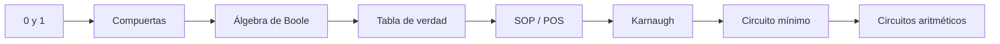
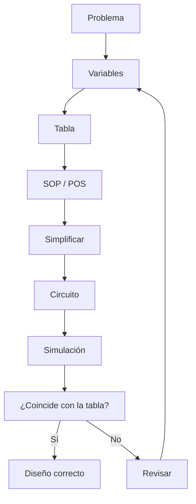
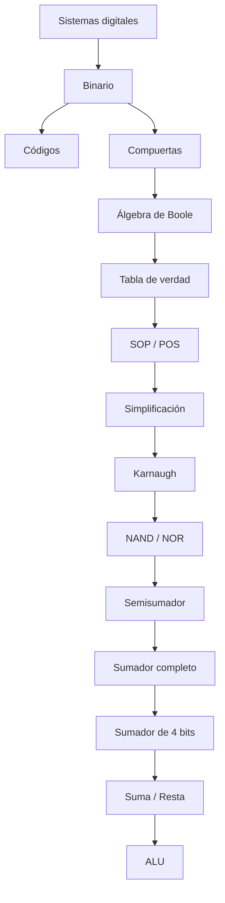

<div align="center">

# 📚 RESUMEN GENERAL

## Unidad 1 · Diseño de Circuitos

### Análisis de lógica combinacional con diseño clásico

**Universidad Nacional de Loja**

**Sdier Emanuel Roblez Roblez**

</div>

---

| ⬅️ Volver | 🏠 Inicio | ➡️ Continuar |
|:---:|:---:|:---:|
| [**Semana 4**](../semana-4/README.md) | [**Índice general**](../README.md) | [**Ejemplos resueltos**](../ejemplos-resueltos/README.md) |

---

<a id="contenido"></a>

# 📑 Contenido

1. [Visión general](#vision)
2. [Semana 1](#semana1)
3. [Semana 2](#semana2)
4. [Semana 3](#semana3)
5. [Semana 4](#semana4)
6. [Fórmulas fundamentales](#formulas)
7. [Procedimiento de diseño](#procedimiento)
8. [Errores frecuentes](#errores)
9. [Mapa general](#mapa)
10. [Checklist de aprendizaje](#checklist)

---

<a id="vision"></a>

# 1. 🧠 Visión general

La Unidad 1 estudia cómo diseñar circuitos combinacionales partiendo de
conceptos básicos de representación binaria hasta llegar a circuitos capaces
de realizar operaciones aritméticas.

El recorrido completo puede resumirse así:



---

# 🎯 Idea principal de toda la Unidad

El objetivo no consiste únicamente en memorizar compuertas.

El proceso importante es:

```text
PROBLEMA
   ↓
VARIABLES
   ↓
TABLA DE VERDAD
   ↓
FUNCIÓN LÓGICA
   ↓
SIMPLIFICACIÓN
   ↓
CIRCUITO
   ↓
VERIFICACIÓN
```

---

<a id="semana1"></a>

# 2. 🟢 Semana 1 · Sistemas digitales

La primera semana establece las bases necesarias para comprender cómo una
computadora representa información.

---

## Sistemas numéricos

### Binario

```text
Base 2
```

Símbolos:

```text
0
1
```

Las posiciones representan:

```text
2⁰, 2¹, 2², 2³...
```

Ejemplo:

```text
1011₂
```

```text
= 1×8 + 0×4 + 1×2 + 1×1
```

```text
= 11₁₀
```

---

## Octal

```text
Base 8
```

Cada dígito representa:

```text
3 bits
```

---

## Hexadecimal

```text
Base 16
```

Cada dígito representa:

```text
4 bits
```

Utiliza:

```text
0–9
A–F
```

---

## Complemento a dos

Permite representar números negativos.

Procedimiento:

```text
1. Invertir los bits
2. Sumar 1
```

Regla:

```text
-N = N' + 1
```

---

## Código BCD

Cada dígito decimal utiliza:

```text
4 bits
```

Ejemplo:

```text
57
```

se representa:

```text
0101 0111
```

---

## Código Gray

Entre estados consecutivos cambia:

```text
1 bit
```

Orden característico:

```text
00
01
11
10
```

---

## ASCII

Relaciona:

```text
caracteres ↔ valores numéricos
```

Ejemplo:

```text
A = 65
```

---

# 🚪 Compuertas lógicas

| Compuerta | Expresión | Idea |
|---|---|---|
| NOT | `A'` | Invierte |
| AND | `A·B` | Todas |
| OR | `A+B` | Al menos una |
| NAND | `(A·B)'` | AND negada |
| NOR | `(A+B)'` | OR negada |
| XOR | `A⊕B` | Diferentes |
| XNOR | `(A⊕B)'` | Iguales |

---

### Regla mental rápida

```text
AND  → TODAS
OR   → AL MENOS UNA
XOR  → DIFERENTES
XNOR → IGUALES
```

---

[⬆️ Volver al contenido](#contenido)

---

<a id="semana2"></a>

# 3. 🔵 Semana 2 · Álgebra de Boole

Durante esta semana se aprende a representar matemáticamente un circuito
lógico.

---

# Circuito ↔ expresión

Correspondencia:

| Circuito | Álgebra |
|---|---|
| AND | `·` |
| OR | `+` |
| NOT | `'` |

Ejemplo:

```text
Y = A·B + C'
```

---

# Orden de operaciones

```text
NOT → AND → OR
```

---

# Tabla de verdad

Con:

```text
n variables
```

tenemos:

```text
2ⁿ combinaciones
```

Ejemplos:

```text
2 variables → 4 filas
3 variables → 8 filas
4 variables → 16 filas
```

---

# Leyes fundamentales

## Identidad

```text
X+0 = X
X·1 = X
```

---

## Elemento nulo

```text
X+1 = 1
X·0 = 0
```

---

## Complemento

```text
X+X' = 1
X·X' = 0
```

---

## Idempotencia

```text
X+X = X
X·X = X
```

---

## Absorción

```text
X+XY = X
```

```text
X(X+Y) = X
```

---

# De Morgan

```text
(XY)' = X' + Y'
```

```text
(X+Y)' = X'Y'
```

---

# Minitérminos

Representan principalmente:

```text
F = 1
```

Ejemplo:

```text
A=1
B=0
C=1
```

produce:

```text
AB'C
```

---

# Maxitérminos

Representan principalmente:

```text
F = 0
```

---

# SOP

```text
Sum of Products
```

```text
Suma de Productos
```

Relacionada con:

```text
minitérminos
```

Ejemplo:

```text
F = A'BC + AB'C + ABC
```

---

# POS

```text
Product of Sums
```

```text
Producto de Sumas
```

Relacionada con:

```text
maxitérminos
```

Ejemplo:

```text
F = (A+B)(A'+C)(B+C')
```

---

[⬆️ Volver al contenido](#contenido)

---

<a id="semana3"></a>

# 4. 🟠 Semana 3 · Mapas de Karnaugh

Karnaugh permite simplificar visualmente funciones booleanas.

---

# Orden Gray

```text
00
01
11
10
```

La razón es:

```text
entre vecinos cambia una sola variable
```

---

# Tamaños válidos

Los grupos deben tener:

```text
2ᵏ celdas
```

Por tanto:

```text
1
2
4
8
16
```

son válidos.

---

# Regla principal

```text
FORMAR EL GRUPO MÁS GRANDE POSIBLE
```

Porque:

```text
grupo mayor
     ↓
menos variables
     ↓
expresión más simple
```

---

# SOP

Para SOP:

```text
AGRUPAR LOS 1
```

---

# POS

Para POS:

```text
AGRUPAR LOS 0
```

---

# Bordes

Los bordes del mapa:

```text
son vecinos
```

Por eso:

```text
izquierda ↔ derecha
```

```text
arriba ↔ abajo
```

y las:

```text
4 esquinas
```

también pueden formar un grupo.

---

# Condiciones indiferentes

Se representan mediante:

```text
X
```

Una X:

```text
puede utilizarse
```

si ayuda a crear un grupo mayor.

También:

```text
puede ignorarse
```

si no resulta útil.

---

# NAND universal

Con NAND podemos construir:

```text
NOT
AND
OR
```

Por tanto:

```text
cualquier función lógica
```

puede implementarse únicamente con NAND.

---

# NOR universal

Lo mismo ocurre con NOR.

```text
NOT
AND
OR
```

pueden construirse utilizando exclusivamente NOR.

---

# Conversión típica

```text
SOP → NAND-NAND
```

```text
POS → NOR-NOR
```

---

[⬆️ Volver al contenido](#contenido)

---

<a id="semana4"></a>

# 5. 🔴 Semana 4 · Circuitos aritméticos

Los conceptos anteriores se aplican ahora a circuitos capaces de realizar
operaciones matemáticas.

---

# Suma binaria básica

| Operación | S | C |
|:---:|:---:|:---:|
| 0+0 | 0 | 0 |
| 0+1 | 1 | 0 |
| 1+0 | 1 | 0 |
| 1+1 | 0 | 1 |

Donde:

```text
S = suma
```

y:

```text
C = acarreo
```

---

# Semisumador

Entradas:

```text
A
B
```

Salidas:

```text
S
C
```

Ecuaciones:

```text
S = A ⊕ B
```

```text
C = A·B
```

---

# Sumador completo

Entradas:

```text
A
B
Cin
```

Salidas:

```text
S
Cout
```

---

## Regla para entenderlo

```text
S = 1 si hay una cantidad impar de unos
```

```text
Cout = 1 si existen al menos dos unos
```

---

## Ecuaciones

```text
S = A ⊕ B ⊕ Cin
```

```text
Cout = AB + ACin + BCin
```

---

# Sumador de varios bits

La regla fundamental es:

```text
Cout de una etapa → Cin de la siguiente
```

---

# Ripple Carry

El acarreo avanza:

```text
etapa por etapa
```

Por eso:

```text
más bits → mayor retardo
```

---

# Estimación del retardo

Si:

```text
tpd ≈ 10 ns
```

y el acarreo atraviesa aproximadamente dos compuertas por etapa:

```text
Retardo ≈ 2 · n · 10 ns
```

---

# Resta

```text
A-B
```

puede convertirse en:

```text
A + (-B)
```

y:

```text
-B = B' + 1
```

Por tanto:

```text
A-B = A+B'+1
```

---

# Sumador / Restador

Se utiliza:

```text
M
```

como señal de control.

| M | Operación |
|:---:|---|
| 0 | Suma |
| 1 | Resta |

Con XOR:

```text
B ⊕ 0 = B
```

```text
B ⊕ 1 = B'
```

---

# Overflow

La condición estudiada es:

```text
V = C3 ⊕ C4
```

Entonces:

```text
V = 0 → sin overflow
```

```text
V = 1 → overflow
```

---

[⬆️ Volver al contenido](#contenido)

---

<a id="formulas"></a>

# 6. 📐 Formulario rápido

## Sistemas numéricos

```text
Valor decimal = Σ(bit × potencia de 2)
```

---

## Complemento a dos

```text
-N = N' + 1
```

---

## Número de combinaciones

```text
2ⁿ
```

---

## De Morgan

```text
(XY)' = X' + Y'
```

```text
(X+Y)' = X'Y'
```

---

## Semisumador

```text
S = A⊕B
```

```text
C = AB
```

---

## Sumador completo

```text
S = A⊕B⊕Cin
```

```text
Cout = AB + ACin + BCin
```

---

## Resta

```text
A-B = A+B'+1
```

---

## Overflow

```text
V = C3⊕C4
```

---

## Retardo aproximado

```text
Retardo ≈ 2·n·10 ns
```

---

<a id="procedimiento"></a>

# 7. 🛠️ Procedimiento de diseño

Ante un problema de circuitos combinacionales:

### 1

```text
Leer cuidadosamente el enunciado
```

### 2

```text
Definir entradas y salida
```

### 3

```text
Definir qué significa 0 y 1
```

### 4

```text
Construir tabla de verdad
```

### 5

```text
Obtener SOP o POS
```

### 6

```text
Simplificar
```

mediante:

```text
Álgebra de Boole
```

o:

```text
Karnaugh
```

### 7

```text
Implementar con compuertas
```

### 8

```text
Comprobar mediante simulación
```

---



---

<a id="errores"></a>

# 8. ⚠️ Errores frecuentes

## Confundir XOR con OR

OR:

```text
1 OR 1 = 1
```

XOR:

```text
1 XOR 1 = 0
```

---

## Confundir BCD con binario

BCD representa:

```text
cada dígito por separado
```

---

## Usar orden incorrecto en Karnaugh

Incorrecto:

```text
00 01 10 11
```

Correcto:

```text
00 01 11 10
```

---

## Formar grupos de 3

Incorrecto.

Los grupos deben ser:

```text
2ᵏ
```

---

## Confundir Cout con overflow

Para operaciones con signo:

```text
Overflow ≠ simplemente Cout
```

La condición estudiada es:

```text
V = C3⊕C4
```

---

## Utilizar el simulador antes de diseñar

La secuencia adecuada es:

```text
DISEÑAR
   ↓
SIMULAR
   ↓
COMPROBAR
```

---

<a id="mapa"></a>

# 9. 🗺️ Mapa general de conocimientos



---

<a id="checklist"></a>

# 10. ✅ Checklist de aprendizaje

Marca mentalmente cada punto que puedas realizar sin ayuda.

### Semana 1

- [ ] Puedo convertir binario a decimal.
- [ ] Puedo convertir decimal a binario.
- [ ] Entiendo octal y hexadecimal.
- [ ] Sé obtener complemento a dos.
- [ ] Distingo BCD de binario natural.
- [ ] Entiendo el código Gray.
- [ ] Reconozco las siete compuertas.
- [ ] Puedo construir sus tablas de verdad.

### Semana 2

- [ ] Puedo definir variables lógicas.
- [ ] Puedo construir una tabla de verdad.
- [ ] Conozco las principales leyes booleanas.
- [ ] Puedo aplicar De Morgan.
- [ ] Sé identificar minitérminos.
- [ ] Sé identificar maxitérminos.
- [ ] Distingo SOP de POS.
- [ ] Puedo simplificar expresiones sencillas.

### Semana 3

- [ ] Sé organizar un mapa utilizando Gray.
- [ ] Puedo formar grupos válidos.
- [ ] Recuerdo que los bordes son vecinos.
- [ ] Puedo obtener SOP mediante Karnaugh.
- [ ] Puedo obtener POS mediante Karnaugh.
- [ ] Entiendo las condiciones indiferentes.
- [ ] Sé por qué NAND es universal.
- [ ] Sé por qué NOR es universal.

### Semana 4

- [ ] Sé sumar números binarios.
- [ ] Comprendo qué es el acarreo.
- [ ] Conozco el semisumador.
- [ ] Comprendo el sumador completo.
- [ ] Sé cómo se conectan varios sumadores.
- [ ] Comprendo Ripple Carry.
- [ ] Sé convertir una resta en suma.
- [ ] Entiendo el funcionamiento de M.
- [ ] Sé distinguir Cout de overflow.
- [ ] Comprendo por qué aumenta el retardo.

---

# 🎯 Meta final

Si puedes completar todos los puntos anteriores sin consultar el cuaderno,
deberías manejar los conceptos fundamentales desarrollados durante la Unidad 1.

---

## 🧭 Navegación

| ⬅️ | 🏠 | ➡️ |
|:---:|:---:|:---:|
| [**Semana 4**](../semana-4/README.md) | [**Índice principal**](../README.md) | [**Ejemplos resueltos**](../ejemplos-resueltos/README.md) |

<div align="center">

# 📚 RESUMEN COMPLETADO

### Unidad 1 · Diseño de Circuitos

**Sdier Emanuel Roblez Roblez**

[⬆️ Volver al contenido](#contenido)

</div>
