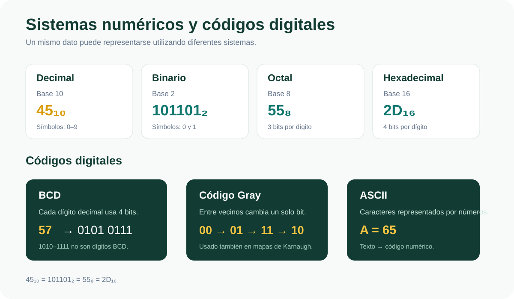
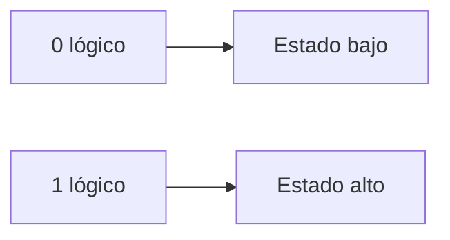
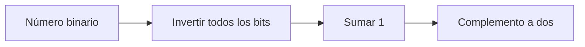
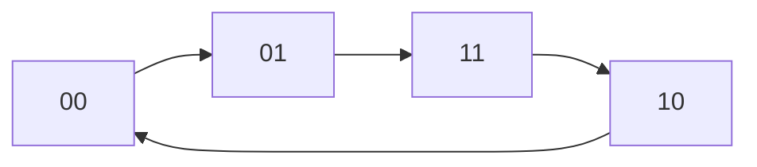
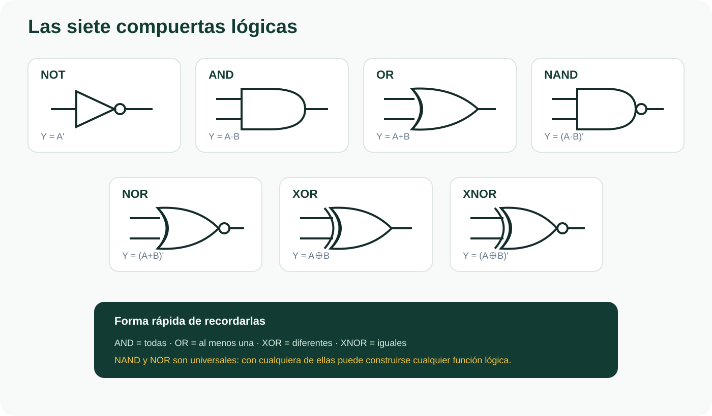
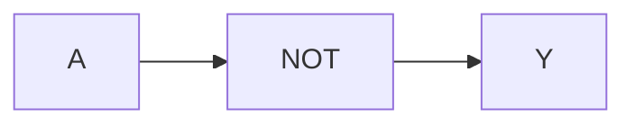
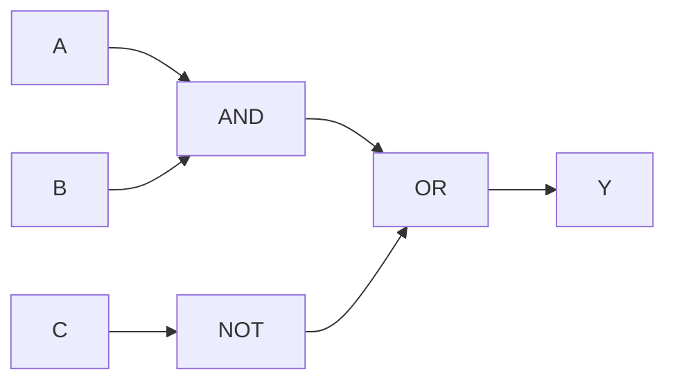
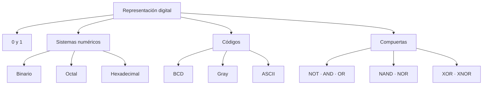

<div align="center">

# 🟢 SEMANA 1

## Sistemas numéricos, códigos y compuertas lógicas

**Unidad 1 · Diseño de Circuitos**

</div>

---

| ⬅️ Anterior | 🏠 Inicio | ➡️ Siguiente |
|:---:|:---:|:---:|
| — | [**Índice general**](../README.md) | [**Semana 2**](../semana-2/README.md) |

---

<a id="contenido"></a>

# 📑 Contenido

1. [Representación digital](#representacion)
2. [Niveles lógicos](#niveles)
3. [Sistemas numéricos](#sistemas)
4. [Conversión entre bases](#conversiones)
5. [Complemento a dos](#complemento)
6. [Código BCD](#bcd)
7. [Código Gray](#gray)
8. [Código ASCII](#ascii)
9. [Compuertas lógicas](#compuertas)
10. [Tabla comparativa](#comparacion)
11. [Síntesis de la semana](#sintesis)

---

# 🎯 Objetivo de la Semana 1

Comprender cómo los sistemas digitales representan información mediante dos
estados lógicos, aprender a convertir números entre diferentes sistemas de
numeración, representar números negativos mediante complemento a dos,
reconocer códigos digitales y comprender el funcionamiento de las principales
compuertas lógicas.

<p align="center">
  
</p>

---

<a id="representacion"></a>

# 1. 💻 Representación digital

Los sistemas digitales trabajan principalmente utilizando dos estados:

```text
0
1
```

Estos estados reciben el nombre de:

```text
niveles lógicos
```

Conceptualmente pueden interpretarse como:



En electrónica digital, un transistor puede funcionar como un interruptor
controlado mediante voltaje.

De forma simplificada:

```text
0 → interruptor abierto
1 → interruptor cerrado
```

El uso de solamente dos estados facilita la construcción de sistemas digitales
capaces de diferenciar correctamente las señales incluso cuando existe cierto
nivel de ruido eléctrico.

---

## 🔹 Bit

Un **bit** es la unidad mínima de información digital.

La palabra proviene de:

```text
Binary Digit
```

Un bit solamente puede almacenar:

```text
0
```

o:

```text
1
```

---

## 🔹 Byte

Un byte está formado por:

```text
8 bits
```

Ejemplo:

```text
01000001
```

Un conjunto de bits puede representar:

- números;
- letras;
- instrucciones;
- imágenes;
- sonidos;
- información de control.

---

[⬆️ Volver al contenido](#contenido)

---

<a id="niveles"></a>

# 2. ⚡ Niveles lógicos

Un concepto importante es que un `0` o un `1` lógico no representa
necesariamente un único voltaje exacto.

Representa un **rango de voltajes**.

En la familia lógica TTL 74LS estudiada:

| Situación | Nivel aproximado |
|---|---:|
| Una salida garantiza `0` | ≤ 0,5 V |
| Una entrada reconoce `0` | ≤ 0,8 V |
| Zona no garantizada | 0,8 V – 2,0 V |
| Una entrada reconoce `1` | ≥ 2,0 V |
| Una salida garantiza `1` | ≥ 2,7 V |

---

## ⚠️ Zona indefinida

Entre:

```text
0,8 V
```

y:

```text
2,0 V
```

el circuito no garantiza una interpretación correcta.

Una señal situada en esta región podría ser interpretada como:

```text
0
```

o:

```text
1
```

Por esta razón deben evitarse las entradas sin conectar y las señales
eléctricamente inestables.

---

## 🛡️ Margen de ruido

El margen de ruido representa una especie de zona de seguridad frente a
pequeñas alteraciones eléctricas.

### Margen alto

```text
2,7 V - 2,0 V = 0,7 V
```

Esto significa que una señal alta puede perder aproximadamente:

```text
0,7 V
```

y todavía ser reconocida correctamente como `1`.

---

### Margen bajo

```text
0,8 V - 0,5 V = 0,3 V
```

Una señal baja puede aumentar aproximadamente:

```text
0,3 V
```

y todavía ser reconocida correctamente como `0`.

---

[⬆️ Volver al contenido](#contenido)

---

<a id="sistemas"></a>

# 3. 🔢 Sistemas numéricos

Un sistema numérico posicional asigna valor a cada cifra dependiendo de:

1. el símbolo utilizado;
2. la posición;
3. la base del sistema.

---

## 🔟 Sistema decimal

El sistema decimal utiliza:

```text
Base 10
```

Sus símbolos son:

```text
0 1 2 3 4 5 6 7 8 9
```

Ejemplo:

```text
555
```

se puede desarrollar como:

```text
5×10² + 5×10¹ + 5×10⁰
```

Entonces:

```text
500 + 50 + 5 = 555
```

---

## 0️⃣1️⃣ Sistema binario

El sistema binario utiliza:

```text
Base 2
```

Sus únicos símbolos son:

```text
0
1
```

Cada posición corresponde a una potencia de 2.

| Potencia | 2⁷ | 2⁶ | 2⁵ | 2⁴ | 2³ | 2² | 2¹ | 2⁰ |
|---|---:|---:|---:|---:|---:|---:|---:|---:|
| Valor | 128 | 64 | 32 | 16 | 8 | 4 | 2 | 1 |

---

### Ejemplo

```text
1011₂
```

Se desarrolla como:

```text
1×2³ + 0×2² + 1×2¹ + 1×2⁰
```

Por tanto:

```text
8 + 0 + 2 + 1 = 11
```

Entonces:

```text
1011₂ = 11₁₀
```

---

## 8️⃣ Sistema octal

El sistema octal utiliza:

```text
Base 8
```

Sus símbolos son:

```text
0 1 2 3 4 5 6 7
```

Cada dígito octal puede representar:

```text
3 bits
```

Ejemplo:

```text
111 010 101
```

Separamos:

```text
111 = 7
010 = 2
101 = 5
```

Entonces:

```text
111010101₂ = 725₈
```

---

## 1️⃣6️⃣ Sistema hexadecimal

El sistema hexadecimal utiliza:

```text
Base 16
```

Sus símbolos son:

```text
0 1 2 3 4 5 6 7 8 9 A B C D E F
```

Correspondencia:

| Hexadecimal | Decimal |
|:---:|---:|
| A | 10 |
| B | 11 |
| C | 12 |
| D | 13 |
| E | 14 |
| F | 15 |

Cada dígito hexadecimal representa:

```text
4 bits
```

Ejemplo:

```text
1010 1111
```

Tenemos:

```text
1010 = A
1111 = F
```

Entonces:

```text
10101111₂ = AF₁₆
```

---

[⬆️ Volver al contenido](#contenido)

---

<a id="conversiones"></a>

# 4. 🔄 Conversión entre bases

## Decimal → Binario

Se realizan divisiones sucesivas para 2.

Ejemplo:

Convertir:

```text
13₁₀
```

a binario.

```text
13 ÷ 2 = 6    residuo 1
 6 ÷ 2 = 3    residuo 0
 3 ÷ 2 = 1    residuo 1
 1 ÷ 2 = 0    residuo 1
```

Se leen los residuos desde abajo hacia arriba:

```text
1101
```

Por tanto:

```text
13₁₀ = 1101₂
```

---

## Binario → Decimal

Ejemplo:

```text
1101₂
```

Se utilizan las potencias de 2:

```text
1×8 + 1×4 + 0×2 + 1×1
```

Entonces:

```text
8 + 4 + 0 + 1 = 13
```

Por tanto:

```text
1101₂ = 13₁₀
```

---

## Binario ↔ Octal

Para convertir rápidamente entre binario y octal se agrupan los bits:

```text
de 3 en 3
```

desde la derecha.

Ejemplo:

```text
111 010 101
```

produce:

```text
7 2 5
```

---

## Binario ↔ Hexadecimal

Para convertir entre binario y hexadecimal se agrupan:

```text
4 bits
```

desde la derecha.

Ejemplo:

```text
1010 1111
```

produce:

```text
A F
```

---

<a id="complemento"></a>

# 5. ➖ Complemento a dos

El complemento a dos permite representar números negativos en sistemas
digitales.

El procedimiento general es:



---

## Ejemplo: representar -5

En 4 bits:

```text
5 = 0101
```

Primero invertimos todos los bits:

```text
0101
↓
1010
```

Después sumamos:

```text
1
```

```text
  1010
+ 0001
------
  1011
```

Entonces:

```text
-5 = 1011
```

en complemento a dos de 4 bits.

---

## Regla general

```text
-N = invertir N + 1
```

Este procedimiento será utilizado nuevamente durante la Semana 4 para construir
un circuito capaz de realizar restas.

---

[⬆️ Volver al contenido](#contenido)

---

<a id="bcd"></a>

# 6. 🔟 Código BCD

BCD significa:

```text
Binary Coded Decimal
```

En BCD cada dígito decimal se representa independientemente mediante:

```text
4 bits
```

| Decimal | BCD |
|:---:|:---:|
| 0 | 0000 |
| 1 | 0001 |
| 2 | 0010 |
| 3 | 0011 |
| 4 | 0100 |
| 5 | 0101 |
| 6 | 0110 |
| 7 | 0111 |
| 8 | 1000 |
| 9 | 1001 |

Las combinaciones:

```text
1010
1011
1100
1101
1110
1111
```

no representan ningún dígito BCD válido.

---

## Ejemplo

El número:

```text
157
```

en BCD se representa dígito por dígito.

```text
1 → 0001
5 → 0101
7 → 0111
```

Entonces:

```text
157₁₀ → 0001 0101 0111 BCD
```

---

## ⚠️ BCD no es binario natural

Representar `157` mediante BCD no es lo mismo que convertir directamente:

```text
157₁₀
```

a binario.

BCD codifica cada cifra decimal por separado.

---

<a id="gray"></a>

# 7. 🔁 Código Gray

El código Gray posee una característica importante:

> Entre dos valores consecutivos cambia solamente un bit.

Ejemplo de dos bits:

```text
00
01
11
10
```



---

## ¿Por qué es útil?

En binario normal, por ejemplo:

```text
3 = 011
4 = 100
```

cambian tres bits al mismo tiempo.

Durante una transición física podría producirse temporalmente una lectura
incorrecta.

Con Gray solamente cambia un bit entre estados vecinos.

---

## Aplicaciones

El código Gray puede utilizarse en:

- encoders rotativos;
- sensores de posición;
- dispositivos donde deben evitarse transiciones ambiguas;
- mapas de Karnaugh.

El orden:

```text
00 → 01 → 11 → 10
```

será fundamental durante la Semana 3.

---

<a id="ascii"></a>

# 8. 🔤 Código ASCII

ASCII permite representar caracteres mediante números.

Algunos ejemplos:

| Carácter | Decimal | Hexadecimal |
|:---:|---:|:---:|
| A | 65 | 41 |
| H | 72 | 48 |
| L | 76 | 4C |
| O | 79 | 4F |

Por ejemplo:

```text
A = 65
```

Una computadora no almacena directamente la letra dibujada, sino el valor
numérico asociado a ella.

---

[⬆️ Volver al contenido](#contenido)

---

<a id="compuertas"></a>

# 9. 🚪 Compuertas lógicas

Las compuertas lógicas son los bloques fundamentales utilizados para construir
circuitos digitales.

Las siete compuertas estudiadas son:

```text
NOT
AND
OR
NAND
NOR
XOR
XNOR
```

<p align="center">
  
</p>

---

## 🔺 NOT

La compuerta NOT invierte la entrada.

```text
Y = A'
```

| A | Y |
|:---:|:---:|
| 0 | 1 |
| 1 | 0 |



---

## 🔵 AND

La salida vale `1` solamente cuando todas las entradas valen `1`.

```text
Y = A·B
```

| A | B | Y |
|:---:|:---:|:---:|
| 0 | 0 | 0 |
| 0 | 1 | 0 |
| 1 | 0 | 0 |
| 1 | 1 | 1 |

Palabra clave:

```text
TODAS
```

---

## 🟡 OR

La salida vale `1` cuando al menos una entrada vale `1`.

```text
Y = A+B
```

| A | B | Y |
|:---:|:---:|:---:|
| 0 | 0 | 0 |
| 0 | 1 | 1 |
| 1 | 0 | 1 |
| 1 | 1 | 1 |

Palabra clave:

```text
AL MENOS UNA
```

---

## 🟠 NAND

NAND es la negación de AND.

```text
Y = (A·B)'
```

| A | B | Y |
|:---:|:---:|:---:|
| 0 | 0 | 1 |
| 0 | 1 | 1 |
| 1 | 0 | 1 |
| 1 | 1 | 0 |

---

## 🔴 NOR

NOR es la negación de OR.

```text
Y = (A+B)'
```

| A | B | Y |
|:---:|:---:|:---:|
| 0 | 0 | 1 |
| 0 | 1 | 0 |
| 1 | 0 | 0 |
| 1 | 1 | 0 |

---

## 🟣 XOR

La salida vale `1` cuando las entradas son diferentes.

```text
Y = A ⊕ B
```

| A | B | Y |
|:---:|:---:|:---:|
| 0 | 0 | 0 |
| 0 | 1 | 1 |
| 1 | 0 | 1 |
| 1 | 1 | 0 |

Palabra clave:

```text
DIFERENTES
```

---

## 🟤 XNOR

La salida vale `1` cuando las entradas son iguales.

```text
Y = (A ⊕ B)'
```

| A | B | Y |
|:---:|:---:|:---:|
| 0 | 0 | 1 |
| 0 | 1 | 0 |
| 1 | 0 | 0 |
| 1 | 1 | 1 |

Palabra clave:

```text
IGUALES
```

---

<a id="comparacion"></a>

# 10. 📊 Tabla comparativa de compuertas

| Compuerta | Expresión | Resultado `1` cuando... |
|---|---|---|
| NOT | `A'` | A vale 0 |
| AND | `A·B` | Todas las entradas son 1 |
| OR | `A+B` | Al menos una entrada es 1 |
| NAND | `(A·B)'` | No todas las entradas son 1 |
| NOR | `(A+B)'` | Todas las entradas son 0 |
| XOR | `A⊕B` | Las entradas son diferentes |
| XNOR | `(A⊕B)'` | Las entradas son iguales |

---

# 🧠 Ejemplo integrado

Consideremos:

```text
Y = A·B + C'
```

El circuito debe realizar:

1. una AND entre `A` y `B`;
2. una NOT sobre `C`;
3. una OR entre ambos resultados.



El orden de evaluación es:

```text
NOT → AND → OR
```

---

<a id="sintesis"></a>

# 11. ✅ Síntesis de la Semana 1



---

## 📌 Ideas fundamentales

Al finalizar esta semana debemos recordar:

- un sistema digital trabaja con estados lógicos `0` y `1`;
- esos estados representan rangos de voltaje;
- el sistema binario utiliza potencias de 2;
- octal agrupa bits de 3 en 3;
- hexadecimal agrupa bits de 4 en 4;
- el complemento a dos permite representar números negativos;
- BCD representa cada dígito decimal de manera independiente;
- Gray cambia un solo bit entre valores consecutivos;
- ASCII relaciona caracteres con valores numéricos;
- las compuertas lógicas constituyen la base de los circuitos digitales.

---

# 🔗 Conexión con la siguiente semana

Durante esta semana aprendimos qué hacen las compuertas.

La siguiente pregunta será:

> ¿Cómo podemos representar matemáticamente un circuito construido con estas
> compuertas?

La respuesta será:

```text
ÁLGEBRA DE BOOLE
```

---

## 🧭 Navegación

| ⬅️ | 🏠 | ➡️ |
|:---:|:---:|:---:|
| — | [**Índice principal**](../README.md) | [**Semana 2**](../semana-2/README.md) |

<div align="center">

### 🟢 Fin de la Semana 1

[⬆️ Volver al contenido](#contenido)

</div>
