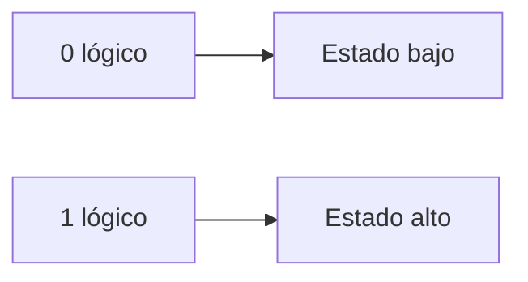
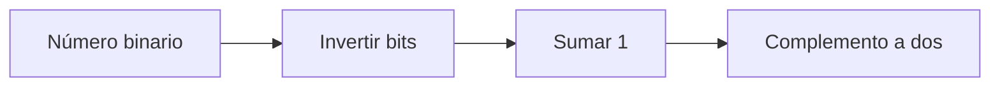
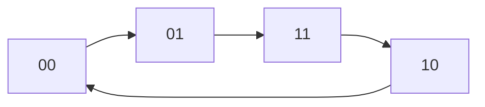
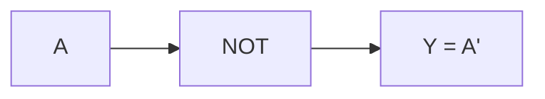
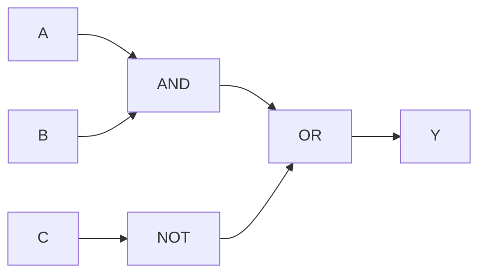
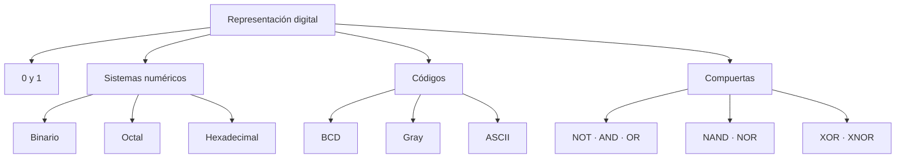

<div align="center">

# 🟢 SEMANA 1

## Sistemas numéricos, códigos y compuertas lógicas

**Unidad 1 · Diseño de Circuitos**

</div>

---

| ⬅️ Anterior | 🏠 Inicio | ➡️ Siguiente |
|:---:|:---:|:---:|
| — | [**Índice general**](../README.md) | [**Semana 2**](../semana-2/README.md) |

---

<a id="contenido"></a>

# 📑 Contenido

1. [Representación digital](#representacion)
2. [Niveles lógicos](#niveles)
3. [Sistemas numéricos](#sistemas)
4. [Conversión entre bases](#conversiones)
5. [Complemento a dos](#complemento)
6. [Código BCD](#bcd)
7. [Código Gray](#gray)
8. [Código ASCII](#ascii)
9. [Compuertas lógicas](#compuertas)
10. [Tabla comparativa](#comparacion)
11. [Síntesis](#sintesis)

---

<a id="representacion"></a>

# 1. 💻 Representación digital

Los computadores trabajan internamente con señales que pueden interpretarse
mediante dos estados lógicos:

```text
0
1
```

De forma conceptual:



Un transistor puede comportarse como un interruptor controlado por voltaje.

Por esta razón, utilizar dos estados claramente diferenciados permite construir
sistemas digitales confiables.

---

## Bit y byte

Un **bit** es un dígito binario.

```text
bit = binary digit
```

Puede almacenar:

```text
0
```

o:

```text
1
```

Un **byte** está formado por:

```text
8 bits
```

Ejemplo:

```text
01000001
```

---

<a id="niveles"></a>

# 2. ⚡ Niveles lógicos

Es importante comprender que un `0` y un `1` no necesariamente representan
un único valor exacto de voltaje.

Representan **rangos**.

Para la familia TTL 74LS estudiada:

| Situación | Nivel aproximado |
|---|---:|
| Una salida garantiza `0` | ≤ 0,5 V |
| Una entrada reconoce `0` | ≤ 0,8 V |
| Zona no garantizada | 0,8 V – 2,0 V |
| Una entrada reconoce `1` | ≥ 2,0 V |
| Una salida garantiza `1` | ≥ 2,7 V |

La región intermedia es problemática:

```text
0,8 V < señal < 2,0 V
```

porque el circuito no garantiza interpretar correctamente un `0` o un `1`.

---

## Margen de ruido

Existe una separación entre lo que una compuerta garantiza a su salida y lo que
la siguiente exige en su entrada.

### Margen alto

```text
2,7 V - 2,0 V = 0,7 V
```

### Margen bajo

```text
0,8 V - 0,5 V = 0,3 V
```

Esta diferencia proporciona tolerancia frente al ruido eléctrico.

---

[⬆️ Volver al contenido](#contenido)

---

<a id="sistemas"></a>

# 3. 🔢 Sistemas numéricos

Un **sistema posicional** asigna a cada cifra un valor que depende de:

1. el símbolo;
2. la posición;
3. la base.

Ejemplo decimal:

```text
555

= 5×10² + 5×10¹ + 5×10⁰

= 500 + 50 + 5
```

---

## Sistema decimal

Base:

```text
10
```

Símbolos:

```text
0 1 2 3 4 5 6 7 8 9
```

---

## Sistema binario

Base:

```text
2
```

Símbolos:

```text
0 1
```

Cada posición representa una potencia de 2.

| Potencia | 2⁷ | 2⁶ | 2⁵ | 2⁴ | 2³ | 2² | 2¹ | 2⁰ |
|---|---:|---:|---:|---:|---:|---:|---:|---:|
| Valor | 128 | 64 | 32 | 16 | 8 | 4 | 2 | 1 |

Ejemplo:

```text
1011₂
```

Desarrollo:

```text
1×2³ + 0×2² + 1×2¹ + 1×2⁰
```

```text
8 + 0 + 2 + 1 = 11
```

Por tanto:

```text
1011₂ = 11₁₀
```

---

## Sistema octal

Base:

```text
8
```

Símbolos:

```text
0 1 2 3 4 5 6 7
```

Cada dígito octal equivale a:

```text
3 bits
```

Ejemplo:

```text
111 010 101
```

se agrupa:

```text
111 = 7
010 = 2
101 = 5
```

Entonces:

```text
111010101₂ = 725₈
```

---

## Sistema hexadecimal

Base:

```text
16
```

Símbolos:

```text
0 1 2 3 4 5 6 7 8 9 A B C D E F
```

| Hexadecimal | Decimal |
|:---:|---:|
| A | 10 |
| B | 11 |
| C | 12 |
| D | 13 |
| E | 14 |
| F | 15 |

Cada dígito hexadecimal equivale a:

```text
4 bits
```

Ejemplo:

```text
1010 1111
```

```text
1010 = A
1111 = F
```

Entonces:

```text
10101111₂ = AF₁₆
```

---

<a id="conversiones"></a>

# 4. 🔄 Conversión entre bases

## Decimal → Binario

Se realizan divisiones sucesivas para 2.

Ejemplo:

```text
13 ÷ 2 = 6    residuo 1
 6 ÷ 2 = 3    residuo 0
 3 ÷ 2 = 1    residuo 1
 1 ÷ 2 = 0    residuo 1
```

Se leen los residuos de abajo hacia arriba:

```text
13₁₀ = 1101₂
```

---

## Binario → Decimal

Ejemplo:

```text
1101₂
```

```text
1×8 + 1×4 + 0×2 + 1×1
```

```text
8 + 4 + 0 + 1 = 13
```

Entonces:

```text
1101₂ = 13₁₀
```

---

## Binario ↔ Octal

Agrupar de:

```text
3 en 3 bits
```

desde la derecha.

---

## Binario ↔ Hexadecimal

Agrupar de:

```text
4 en 4 bits
```

desde la derecha.

---

[⬆️ Volver al contenido](#contenido)

---

<a id="complemento"></a>

# 5. ➖ Complemento a dos

El complemento a dos permite representar números negativos y realizar restas
utilizando circuitos sumadores.

Para obtener el negativo de un número:



---

## Ejemplo: representar -5 en 4 bits

Número positivo:

```text
5 = 0101
```

Invertimos:

```text
0101
↓
1010
```

Sumamos uno:

```text
  1010
+ 0001
------
  1011
```

Por tanto:

```text
-5 = 1011
```

en complemento a dos de 4 bits.

---

## Regla fundamental

```text
-N = invertir N + 1
```

Esto será importante nuevamente durante la Semana 4.

---

<a id="bcd"></a>

# 6. 🔟 Código BCD

BCD significa:

```text
Binary Coded Decimal
```

Cada **dígito decimal** se representa independientemente mediante 4 bits.

| Decimal | BCD |
|:---:|:---:|
| 0 | 0000 |
| 1 | 0001 |
| 2 | 0010 |
| 3 | 0011 |
| 4 | 0100 |
| 5 | 0101 |
| 6 | 0110 |
| 7 | 0111 |
| 8 | 1000 |
| 9 | 1001 |

Las combinaciones:

```text
1010
1011
1100
1101
1110
1111
```

no corresponden a ningún dígito decimal BCD.

Esta característica será importante al trabajar posteriormente con
**condiciones indiferentes**.

---

## BCD no es lo mismo que binario natural

Por ejemplo, el número decimal:

```text
157
```

en BCD se representa dígito por dígito:

```text
1    5    7

0001 0101 0111
```

Esto es diferente de convertir `157` directamente a binario.

---

<a id="gray"></a>

# 7. 🔁 Código Gray

El código Gray posee una característica especial:

> Entre dos valores consecutivos cambia solamente un bit.

Ejemplo de dos bits:

```text
00
01
11
10
```



Esto disminuye la posibilidad de lecturas incorrectas durante una transición.

---

## Aplicación

Puede utilizarse en:

- encoders;
- sensores de posición;
- sistemas donde varias señales no deberían cambiar simultáneamente.

El mismo orden:

```text
00 → 01 → 11 → 10
```

aparecerá nuevamente en los **mapas de Karnaugh**.

---

<a id="ascii"></a>

# 8. 🔤 Código ASCII

ASCII establece una correspondencia entre caracteres y valores numéricos.

Ejemplo:

| Carácter | Decimal | Hexadecimal |
|:---:|---:|:---:|
| A | 65 | 41 |
| H | 72 | 48 |
| L | 76 | 4C |
| O | 79 | 4F |

Por tanto:

```text
A = 65₁₀
```

Una computadora no almacena directamente una letra dibujada, sino un valor
numérico asociado a ella.

---

[⬆️ Volver al contenido](#contenido)

---

<a id="compuertas"></a>

# 9. 🚪 Compuertas lógicas

Las siete compuertas estudiadas son:

```text
NOT
AND
OR
NAND
NOR
XOR
XNOR
```

---

## NOT

Invierte una señal.

```text
Y = A'
```

| A | Y |
|:---:|:---:|
| 0 | 1 |
| 1 | 0 |



---

## AND

La salida es `1` únicamente cuando **todas** las entradas son `1`.

```text
Y = A·B
```

| A | B | Y |
|:---:|:---:|:---:|
| 0 | 0 | 0 |
| 0 | 1 | 0 |
| 1 | 0 | 0 |
| 1 | 1 | 1 |

Idea:

```text
TODAS
```

---

## OR

La salida es `1` cuando **al menos una** entrada es `1`.

```text
Y = A+B
```

| A | B | Y |
|:---:|:---:|:---:|
| 0 | 0 | 0 |
| 0 | 1 | 1 |
| 1 | 0 | 1 |
| 1 | 1 | 1 |

Idea:

```text
AL MENOS UNA
```

---

## NAND

Es la negación de AND.

```text
Y = (A·B)'
```

| A | B | Y |
|:---:|:---:|:---:|
| 0 | 0 | 1 |
| 0 | 1 | 1 |
| 1 | 0 | 1 |
| 1 | 1 | 0 |

---

## NOR

Es la negación de OR.

```text
Y = (A+B)'
```

| A | B | Y |
|:---:|:---:|:---:|
| 0 | 0 | 1 |
| 0 | 1 | 0 |
| 1 | 0 | 0 |
| 1 | 1 | 0 |

---

## XOR

La salida es `1` cuando las entradas son diferentes.

```text
Y = A ⊕ B
```

| A | B | Y |
|:---:|:---:|:---:|
| 0 | 0 | 0 |
| 0 | 1 | 1 |
| 1 | 0 | 1 |
| 1 | 1 | 0 |

Idea:

```text
DIFERENTES
```

---

## XNOR

La salida es `1` cuando las entradas son iguales.

```text
Y = (A ⊕ B)'
```

| A | B | Y |
|:---:|:---:|:---:|
| 0 | 0 | 1 |
| 0 | 1 | 0 |
| 1 | 0 | 0 |
| 1 | 1 | 1 |

Idea:

```text
IGUALES
```

---

<a id="comparacion"></a>

# 10. 📊 Tabla comparativa

| Compuerta | Expresión | ¿Cuándo vale 1? |
|---|---|---|
| NOT | `A'` | Cuando A = 0 |
| AND | `A·B` | Cuando todas son 1 |
| OR | `A+B` | Cuando al menos una es 1 |
| NAND | `(A·B)'` | Excepto cuando todas son 1 |
| NOR | `(A+B)'` | Solo cuando todas son 0 |
| XOR | `A⊕B` | Cuando son diferentes |
| XNOR | `(A⊕B)'` | Cuando son iguales |

---

# 🧠 Ejemplo integrado

Para:

```text
Y = A·B + C'
```

primero se resuelven las operaciones intermedias.



La prioridad es:

```text
NOT → AND → OR
```

---

<a id="sintesis"></a>

# 11. ✅ Síntesis de la Semana 1



### Ideas que deben quedar claras

- `0` y `1` representan estados lógicos.
- El sistema binario utiliza potencias de 2.
- Octal agrupa bits de 3 en 3.
- Hexadecimal agrupa bits de 4 en 4.
- El complemento a dos permite representar números negativos.
- BCD representa cada dígito decimal por separado.
- Gray cambia un solo bit entre posiciones consecutivas.
- ASCII relaciona caracteres con números.
- Las compuertas constituyen los bloques básicos de los circuitos digitales.

---

## 🧭 Navegación

| ⬅️ | 🏠 | ➡️ |
|:---:|:---:|:---:|
| — | [**Índice principal**](../README.md) | [**Semana 2**](../semana-2/README.md) |

<div align="center">

**Fin de la Semana 1**

[⬆️ Volver al contenido](#contenido)

</div>
