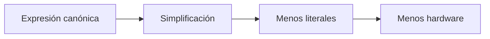
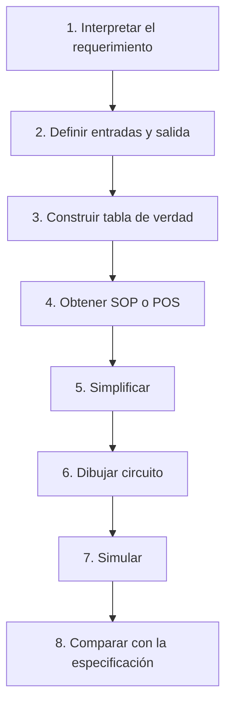
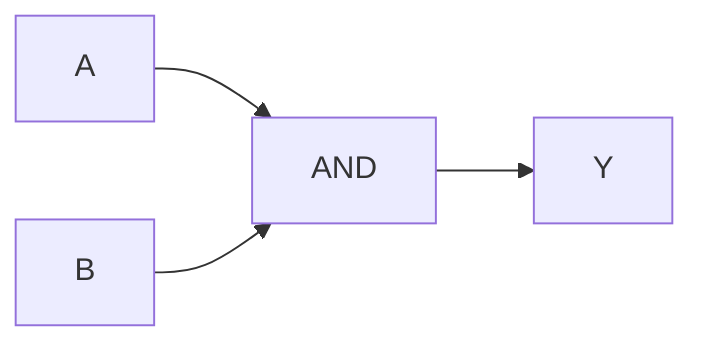
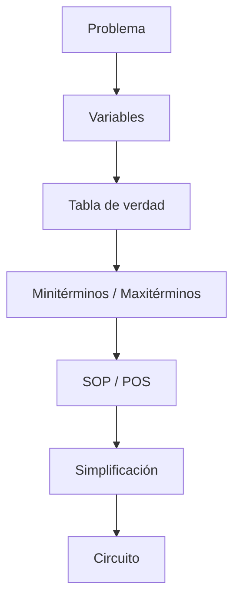

<div align="center">

# 🔵 SEMANA 2

## Álgebra de Boole y formas canónicas

**Unidad 1 · Diseño de Circuitos**

</div>

---

| ⬅️ Anterior | 🏠 Inicio | ➡️ Siguiente |
|:---:|:---:|:---:|
| [**Semana 1**](../semana-1/README.md) | [**Índice general**](../README.md) | [**Semana 3**](../semana-3/README.md) |

---

<a id="contenido"></a>

# 📑 Contenido

1. [Circuito y expresión](#circuito-expresion)
2. [Variables booleanas](#variables)
3. [Tabla de verdad](#tabla)
4. [Álgebra de Boole](#algebra)
5. [Leyes fundamentales](#leyes)
6. [De Morgan](#demorgan)
7. [Minitérminos](#miniterminos)
8. [Maxitérminos](#maxiterminos)
9. [SOP y POS](#soppos)
10. [Simplificación](#simplificacion)
11. [Proceso de diseño](#diseno)
12. [Síntesis](#sintesis)

---

<a id="circuito-expresion"></a>

# 1. ⚡ Circuito y expresión lógica

Un circuito lógico y una expresión booleana son dos maneras de representar
la misma función.

Ejemplo:

```text
Y = A·B + C'
```

Correspondencia:

| Elemento físico | Representación algebraica |
|---|---|
| Cable de entrada | Variable |
| AND | Producto `·` |
| OR | Suma `+` |
| NOT | Complemento `'` |
| Salida | Resultado de la expresión |

---

## Precedencia

Al evaluar una expresión:

```text
NOT → AND → OR
```

Por ejemplo:

```text
Y = A·B + C'
```

Primero:

```text
C'
```

Luego:

```text
A·B
```

Finalmente:

```text
(A·B) + C'
```

---

<a id="variables"></a>

# 2. 🔤 Variables booleanas

Una variable booleana puede tomar solamente dos valores:

```text
0
1
```

Pero debemos definir qué significa cada valor.

Ejemplo:

```text
A = sensor de puerta
```

podría definirse:

```text
A = 0 → puerta cerrada
A = 1 → puerta abierta
```

Definir correctamente las variables evita ambigüedades posteriores.

---

<a id="tabla"></a>

# 3. 📊 Tabla de verdad

La tabla de verdad muestra todas las combinaciones posibles de las entradas.

Si existen `n` variables:

```text
Número de filas = 2ⁿ
```

Ejemplos:

| Variables | Filas |
|:---:|:---:|
| 1 | 2 |
| 2 | 4 |
| 3 | 8 |
| 4 | 16 |

---

## Ejemplo con 3 variables

| A | B | C |
|:---:|:---:|:---:|
| 0 | 0 | 0 |
| 0 | 0 | 1 |
| 0 | 1 | 0 |
| 0 | 1 | 1 |
| 1 | 0 | 0 |
| 1 | 0 | 1 |
| 1 | 1 | 0 |
| 1 | 1 | 1 |

---

# 🧠 Una frase puede ser ambigua

Supongamos:

> La sirena suena cuando se activan dos sensores.

Podría interpretarse como:

### Exactamente dos sensores

```text
011
101
110
```

o como:

### Al menos dos sensores

```text
011
101
110
111
```

Antes de diseñar el circuito hay que determinar cuál interpretación representa
correctamente el requisito.

---

<a id="algebra"></a>

# 4. 🧮 Álgebra de Boole

El álgebra booleana utiliza principalmente:

```text
+  → OR
·  → AND
'  → NOT
```

Las variables toman valores pertenecientes al conjunto:

```text
{0,1}
```

---

<a id="leyes"></a>

# 5. 📐 Leyes y teoremas fundamentales

## Identidad

```text
X + 0 = X
X · 1 = X
```

---

## Elemento nulo

```text
X + 1 = 1
X · 0 = 0
```

---

## Idempotencia

```text
X + X = X
X · X = X
```

---

## Complemento

```text
X + X' = 1
X · X' = 0
```

---

## Involución

```text
(X')' = X
```

---

## Conmutativa

```text
X + Y = Y + X
```

```text
XY = YX
```

---

## Asociativa

```text
X + (Y + Z) = (X + Y) + Z
```

```text
X(YZ) = (XY)Z
```

---

## Distributiva

```text
X(Y + Z) = XY + XZ
```

Su forma dual:

```text
X + YZ = (X + Y)(X + Z)
```

---

## Absorción

```text
X + XY = X
```

```text
X(X + Y) = X
```

---

## Absorción con complemento

Una forma útil es:

```text
X + X'Y = X + Y
```

Su dual:

```text
X(X' + Y) = XY
```

---

# 🔁 Principio de dualidad

En una identidad booleana se puede intercambiar:

```text
+ ↔ ·
```

y:

```text
0 ↔ 1
```

sin complementar automáticamente las variables.

Ejemplo:

```text
X + 0 = X
```

dual:

```text
X · 1 = X
```

---

<a id="demorgan"></a>

# 6. 🔄 Leyes de De Morgan

## Primera

```text
(X·Y)' = X' + Y'
```

En palabras:

> La negación de un producto es la suma de las negaciones.

---

## Segunda

```text
(X+Y)' = X'·Y'
```

En palabras:

> La negación de una suma es el producto de las negaciones.

---

## Utilidad

Las leyes de De Morgan serán esenciales para:

- transformar expresiones;
- convertir circuitos;
- implementar funciones únicamente con NAND;
- implementar funciones únicamente con NOR.

---

[⬆️ Volver al contenido](#contenido)

---

<a id="miniterminos"></a>

# 7. 🔹 Minitérminos

Un **minitérmino** representa una combinación concreta de variables y
corresponde normalmente a una fila donde:

```text
F = 1
```

Ejemplo:

```text
A = 1
B = 0
C = 1
```

El minitérmino es:

```text
AB'C
```

Regla:

```text
Variable = 1 → aparece normal
Variable = 0 → aparece complementada
```

---

## Notación compacta

Si una función vale `1` en:

```text
m1
m3
m5
m7
```

puede escribirse:

```text
F = Σm(1,3,5,7)
```

---

<a id="maxiterminos"></a>

# 8. 🔸 Maxitérminos

Un **maxitérmino** corresponde normalmente a una fila donde:

```text
F = 0
```

Los maxitérminos se utilizan para construir la forma POS.

---

<a id="soppos"></a>

# 9. 📦 Formas SOP y POS

## SOP

SOP significa:

```text
Sum of Products
```

o:

```text
Suma de Productos
```

Ejemplo:

```text
F = A'BC + AB'C + ABC
```

Cada término es un producto y los términos se suman mediante OR.

---

## POS

POS significa:

```text
Product of Sums
```

o:

```text
Producto de Sumas
```

Ejemplo:

```text
F = (A+B)(A'+C)(B+C')
```

Cada término es una suma y posteriormente los términos se multiplican.

---

## Comparación

| Característica | SOP | POS |
|---|---|---|
| Se construye normalmente con | Filas `F=1` | Filas `F=0` |
| Elemento básico | Minitérmino | Maxitérmino |
| Estructura | Suma de productos | Producto de sumas |
| Implementación típica | AND → OR | OR → AND |

---

# 10. 📚 Forma canónica

Una función canónica representa explícitamente todas las combinaciones
necesarias de la tabla.

Sin embargo:

> Una forma correcta no necesariamente es una forma eficiente.

Por ello se busca simplificar.

---

<a id="simplificacion"></a>

# 11. ✂️ Simplificación algebraica

Ejemplo:

```text
F = AB + AB'
```

Sacamos factor común:

```text
F = A(B + B')
```

Sabemos que:

```text
B + B' = 1
```

entonces:

```text
F = A·1
```

Finalmente:

```text
F = A
```

---

## ¿Por qué simplificar?

Un circuito simplificado puede utilizar:

- menos compuertas;
- menos conexiones;
- menos entradas por compuerta;
- menos circuitos integrados;
- menos espacio;
- menor consumo;
- menor costo.



---

<a id="diseno"></a>

# 12. 🛠️ Procedimiento clásico de diseño



---

# 🧪 Ejemplo completo

Problema:

> Una lámpara debe encenderse únicamente cuando los dos interruptores estén
> activos.

Variables:

```text
A = interruptor 1
B = interruptor 2
Y = lámpara
```

Tabla:

| A | B | Y |
|:---:|:---:|:---:|
| 0 | 0 | 0 |
| 0 | 1 | 0 |
| 1 | 0 | 0 |
| 1 | 1 | 1 |

Función:

```text
Y = A·B
```

Circuito:



---

<a id="sintesis"></a>

# 13. ✅ Síntesis de la Semana 2



### Ideas fundamentales

- Circuito y expresión representan el mismo comportamiento.
- Una tabla de verdad tiene `2ⁿ` combinaciones.
- SOP se relaciona con minitérminos.
- POS se relaciona con maxitérminos.
- Las leyes booleanas permiten transformar expresiones.
- Simplificar reduce hardware sin cambiar el comportamiento.
- El simulador debe comprobar el diseño, no sustituirlo.

---

## 🧭 Navegación

| ⬅️ | 🏠 | ➡️ |
|:---:|:---:|:---:|
| [**Semana 1**](../semana-1/README.md) | [**Índice principal**](../README.md) | [**Semana 3**](../semana-3/README.md) |

<div align="center">

**Fin de la Semana 2**

[⬆️ Volver al contenido](#contenido)

</div>
