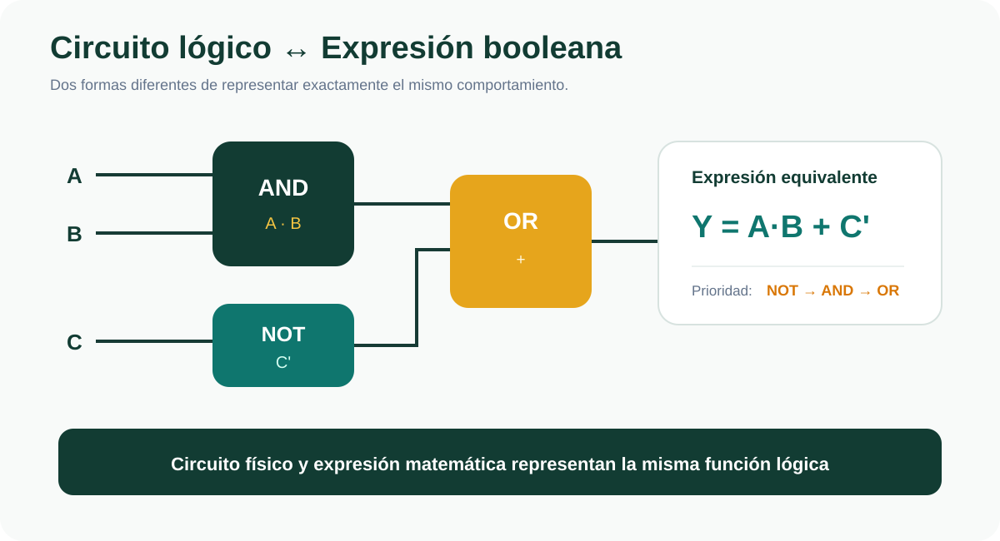
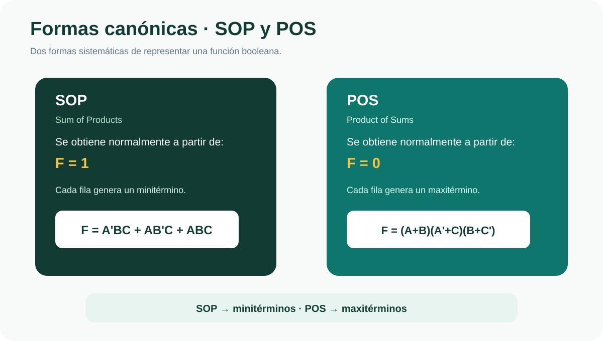
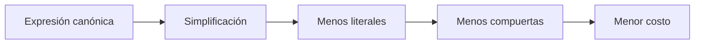
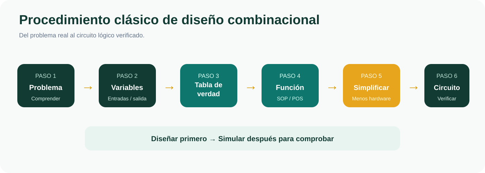
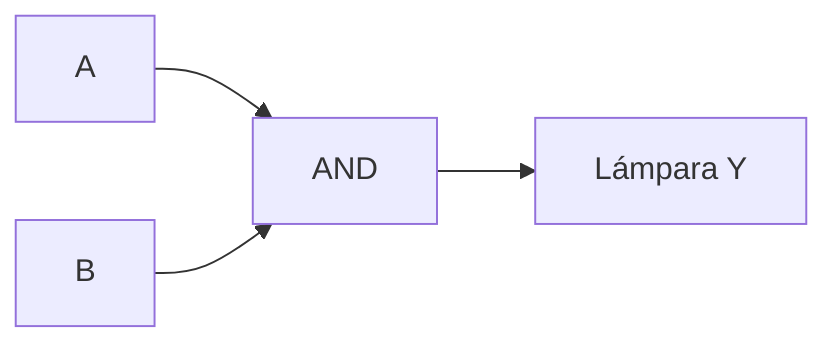
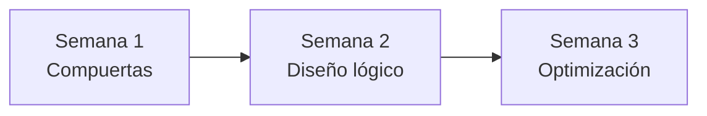
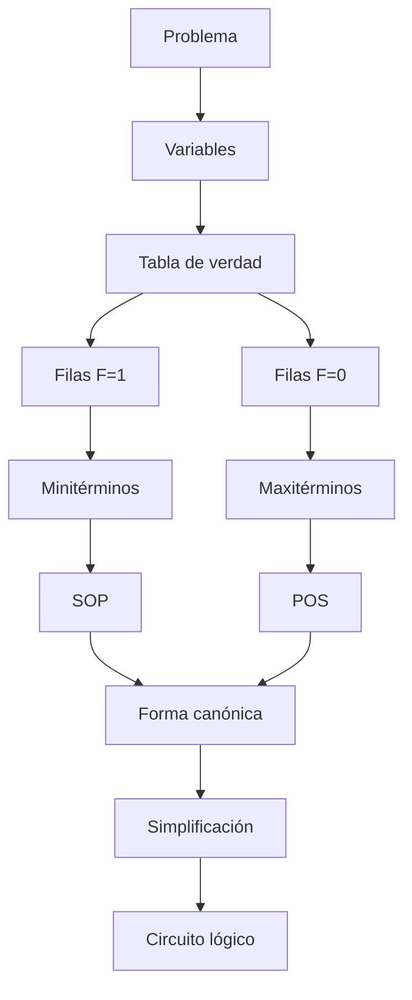
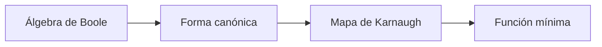

<div align="center">

# 🔵 SEMANA 2

## Álgebra de Boole y formas canónicas

**Unidad 1 · Diseño de Circuitos**

</div>

---

| ⬅️ Anterior | 🏠 Inicio | ➡️ Siguiente |
|:---:|:---:|:---:|
| [**Semana 1**](../semana-1/README.md) | [**Índice general**](../README.md) | [**Semana 3**](../semana-3/README.md) |

---

<a id="contenido"></a>

# 📑 Contenido

1. [Circuito y expresión lógica](#circuito-expresion)
2. [Variables booleanas](#variables)
3. [Tabla de verdad](#tabla)
4. [Álgebra de Boole](#algebra)
5. [Leyes fundamentales](#leyes)
6. [Principio de dualidad](#dualidad)
7. [Leyes de De Morgan](#demorgan)
8. [Minitérminos](#miniterminos)
9. [Maxitérminos](#maxiterminos)
10. [SOP y POS](#soppos)
11. [Formas canónicas](#canonicas)
12. [Simplificación algebraica](#simplificacion)
13. [Costo de implementación](#costo)
14. [Procedimiento clásico de diseño](#diseno)
15. [Ejemplo integrado](#ejemplo)
16. [Síntesis](#sintesis)

---

# 🎯 Objetivo de la Semana 2

Aprender a transformar un requerimiento expresado mediante lenguaje natural en
una representación lógica precisa.

Durante esta semana se desarrolla el proceso:

```text
ENUNCIADO
   ↓
VARIABLES
   ↓
TABLA DE VERDAD
   ↓
FORMA CANÓNICA
   ↓
SIMPLIFICACIÓN
   ↓
CIRCUITO
```

El objetivo no es únicamente obtener una expresión correcta.

También debemos buscar una implementación:

```text
más sencilla
```

```text
más económica
```

y:

```text
más fácil de construir
```

---

<a id="circuito-expresion"></a>

# 1. ⚡ Circuito y expresión lógica

Una idea fundamental de esta semana es:

> Un circuito lógico y una expresión booleana representan el mismo
> comportamiento de dos maneras diferentes.

Por ejemplo:

```text
Y = A·B + C'
```

puede representarse mediante compuertas.

<p align="center">
  
</p>

---

## Correspondencia entre circuito y álgebra

| Circuito | Representación algebraica |
|---|---|
| Cable de entrada | Variable |
| AND | Producto `·` |
| OR | Suma `+` |
| NOT | Complemento `'` |
| Salida | Resultado de la expresión |

---

## Ejemplo

Consideremos:

```text
Y = A·B + C'
```

El circuito realiza tres operaciones:

### Paso 1

```text
A·B
```

mediante una compuerta:

```text
AND
```

### Paso 2

```text
C'
```

mediante:

```text
NOT
```

### Paso 3

Se combinan ambos resultados:

```text
A·B + C'
```

mediante:

```text
OR
```

---

## Prioridad de las operaciones

Al evaluar expresiones booleanas utilizamos:

```text
NOT → AND → OR
```

Por tanto, para:

```text
Y = A·B + C'
```

primero se obtiene:

```text
C'
```

después:

```text
A·B
```

y finalmente:

```text
(A·B) + C'
```

---

[⬆️ Volver al contenido](#contenido)

---

<a id="variables"></a>

# 2. 🔤 Variables booleanas

Una variable booleana solamente puede tomar dos valores:

```text
0
1
```

Sin embargo, antes de construir un circuito debemos especificar qué significa
cada valor.

---

## Ejemplo

Supongamos:

```text
A = sensor de puerta
```

Podemos definir:

```text
A = 0 → puerta cerrada
```

```text
A = 1 → puerta abierta
```

De la misma forma:

```text
Y = alarma
```

podría definirse:

```text
Y = 0 → alarma apagada
```

```text
Y = 1 → alarma encendida
```

---

# ⚠️ Importancia de definir bien las variables

Una mala definición puede provocar que toda la tabla de verdad sea incorrecta.

Antes de empezar debemos responder:

```text
¿Qué significa cada entrada?
```

```text
¿Qué significa 0?
```

```text
¿Qué significa 1?
```

```text
¿Qué condición debe activar la salida?
```

---

<a id="tabla"></a>

# 3. 📊 Tabla de verdad

Una tabla de verdad representa todas las combinaciones posibles de las
entradas y el valor correspondiente de la salida.

Si tenemos:

```text
n variables
```

entonces:

```text
Número de combinaciones = 2ⁿ
```

---

## Ejemplos

| Variables | Filas |
|:---:|:---:|
| 1 | 2 |
| 2 | 4 |
| 3 | 8 |
| 4 | 16 |

---

## Tabla de 3 variables

Para:

```text
A
B
C
```

tenemos:

```text
2³ = 8
```

combinaciones.

| Decimal | A | B | C |
|:---:|:---:|:---:|:---:|
| 0 | 0 | 0 | 0 |
| 1 | 0 | 0 | 1 |
| 2 | 0 | 1 | 0 |
| 3 | 0 | 1 | 1 |
| 4 | 1 | 0 | 0 |
| 5 | 1 | 0 | 1 |
| 6 | 1 | 1 | 0 |
| 7 | 1 | 1 | 1 |

---

# 🧠 El enunciado puede ser ambiguo

Supongamos el siguiente requerimiento:

> La sirena suena cuando se activan dos sensores.

Podría interpretarse de dos maneras.

---

## Interpretación 1 · Exactamente dos

Con tres sensores:

```text
011
101
110
```

La combinación:

```text
111
```

no activaría la alarma.

---

## Interpretación 2 · Al menos dos

Entonces se consideran:

```text
011
101
110
111
```

Por eso, antes de construir una tabla debemos comprender exactamente qué exige
el problema.

---

[⬆️ Volver al contenido](#contenido)

---

<a id="algebra"></a>

# 4. 🧮 Álgebra de Boole

El álgebra de Boole permite representar matemáticamente el comportamiento de
los circuitos lógicos.

Las variables pertenecen al conjunto:

```text
{0,1}
```

Las operaciones principales son:

```text
+ → OR
```

```text
· → AND
```

```text
' → NOT
```

---

## Ejemplo

```text
A+B
```

significa:

```text
A OR B
```

Mientras:

```text
A·B
```

significa:

```text
A AND B
```

Y:

```text
A'
```

significa:

```text
NOT A
```

---

<a id="leyes"></a>

# 5. 📐 Leyes fundamentales del Álgebra de Boole

Las leyes booleanas permiten transformar y simplificar expresiones sin cambiar
su comportamiento lógico.

---

## Identidad

```text
X + 0 = X
```

```text
X·1 = X
```

---

## Elemento nulo

```text
X + 1 = 1
```

```text
X·0 = 0
```

---

## Idempotencia

```text
X + X = X
```

```text
X·X = X
```

---

## Complemento

```text
X + X' = 1
```

```text
X·X' = 0
```

---

## Involución

```text
(X')' = X
```

Una doble negación devuelve el valor original.

---

## Conmutativa

```text
X + Y = Y + X
```

```text
XY = YX
```

---

## Asociativa

```text
X + (Y + Z) = (X + Y) + Z
```

```text
X(YZ) = (XY)Z
```

---

## Distributiva

```text
X(Y + Z) = XY + XZ
```

También existe su forma dual:

```text
X + YZ = (X + Y)(X + Z)
```

---

## Absorción

```text
X + XY = X
```

```text
X(X + Y) = X
```

---

## Absorción con complemento

Una identidad útil es:

```text
X + X'Y = X + Y
```

Su forma dual es:

```text
X(X' + Y) = XY
```

---

# 📋 Tabla rápida de consulta

| Ley | Forma OR | Forma AND |
|---|---|---|
| Identidad | `X+0=X` | `X·1=X` |
| Elemento nulo | `X+1=1` | `X·0=0` |
| Idempotencia | `X+X=X` | `X·X=X` |
| Complemento | `X+X'=1` | `X·X'=0` |
| Absorción | `X+XY=X` | `X(X+Y)=X` |

---

[⬆️ Volver al contenido](#contenido)

---

<a id="dualidad"></a>

# 6. 🔁 Principio de dualidad

El álgebra de Boole posee un principio denominado:

```text
DUALIDAD
```

Permite obtener una identidad equivalente intercambiando:

```text
+ ↔ ·
```

y:

```text
0 ↔ 1
```

---

## Ejemplo

Partimos de:

```text
X + 0 = X
```

Intercambiamos:

```text
+ → ·
```

y:

```text
0 → 1
```

Obtenemos:

```text
X·1 = X
```

Ambas expresiones son válidas.

---

<a id="demorgan"></a>

# 7. 🔄 Leyes de De Morgan

Las leyes de De Morgan permiten transformar expresiones que contienen
negaciones.

Son especialmente importantes porque posteriormente permitirán convertir
circuitos a NAND y NOR.

---

## Primera ley

```text
(X·Y)' = X' + Y'
```

En palabras:

> La negación de un producto es igual a la suma de las negaciones.

---

## Segunda ley

```text
(X+Y)' = X'·Y'
```

En palabras:

> La negación de una suma es igual al producto de las negaciones.

---

## Forma visual de recordarlas

```text
AND negada → OR de entradas negadas
```

```text
OR negada → AND de entradas negadas
```

---

## Ejemplo

Tenemos:

```text
(A+B)'
```

Aplicamos De Morgan:

```text
A'B'
```

Por tanto:

```text
(A+B)' = A'B'
```

---

[⬆️ Volver al contenido](#contenido)

---

<a id="miniterminos"></a>

# 8. 🔹 Minitérminos

Un minitérmino representa una combinación específica de las variables de una
función.

Se utiliza principalmente para representar filas donde:

```text
F = 1
```

---

## Ejemplo

Supongamos:

```text
A = 1
B = 0
C = 1
```

Para construir el minitérmino:

- si una variable vale `1`, aparece normal;
- si una variable vale `0`, aparece complementada.

Entonces:

```text
A → A
```

```text
B = 0 → B'
```

```text
C → C
```

Por tanto:

```text
AB'C
```

---

## Notación compacta

Si una función vale `1` en las filas:

```text
1
3
5
7
```

podemos escribir:

```text
F = Σm(1,3,5,7)
```

El símbolo:

```text
Σm
```

indica:

```text
suma de minitérminos
```

---

<a id="maxiterminos"></a>

# 9. 🔸 Maxitérminos

Los maxitérminos se utilizan principalmente para representar las filas donde:

```text
F = 0
```

Mientras los minitérminos se relacionan con SOP, los maxitérminos se relacionan
con:

```text
POS
```

---

# 🧠 Relación básica

```text
F = 1 → minitérmino
```

```text
F = 0 → maxitérmino
```

---

<a id="soppos"></a>

# 10. 📦 SOP y POS

Existen dos formas fundamentales de representar funciones booleanas.

<p align="center">
  
</p>

---

## 🟢 SOP

SOP significa:

```text
Sum of Products
```

o:

```text
Suma de Productos
```

Una expresión SOP tiene una estructura como:

```text
F = A'BC + AB'C + ABC
```

Cada término contiene productos:

```text
A'BC
AB'C
ABC
```

y posteriormente esos términos se suman mediante OR.

---

## Relación con la tabla de verdad

SOP se construye normalmente utilizando las filas donde:

```text
F = 1
```

Por eso utiliza:

```text
minitérminos
```

---

## Ejemplo de notación compacta

```text
F = Σm(3,5,7)
```

---

## 🔵 POS

POS significa:

```text
Product of Sums
```

o:

```text
Producto de Sumas
```

Ejemplo:

```text
F = (A+B)(A'+C)(B+C')
```

Cada paréntesis contiene una suma.

Después estos términos se multiplican mediante AND.

---

## Relación con la tabla

POS se obtiene normalmente utilizando las filas donde:

```text
F = 0
```

Por eso utiliza:

```text
maxitérminos
```

---

## Comparación

| Característica | SOP | POS |
|---|---|---|
| Nombre | Suma de productos | Producto de sumas |
| Se obtiene de | `F=1` | `F=0` |
| Utiliza | Minitérminos | Maxitérminos |
| Primera operación | AND | OR |
| Segunda operación | OR | AND |
| Karnaugh | Agrupa `1` | Agrupa `0` |

---

[⬆️ Volver al contenido](#contenido)

---

<a id="canonicas"></a>

# 11. 📚 Formas canónicas

Una forma canónica representa completamente la tabla de verdad de una función.

Esto significa que incluye todos los minitérminos o maxitérminos necesarios para
describir exactamente su comportamiento.

---

## Ventaja

La forma canónica puede obtenerse directamente desde una tabla de verdad.

---

## Desventaja

Puede contener:

```text
muchos términos
```

y:

```text
muchos literales
```

Por tanto, aunque sea correcta:

```text
no necesariamente es eficiente
```

---

# 🔎 Correcto no significa mínimo

Dos circuitos pueden producir exactamente la misma salida pero utilizar
diferente cantidad de hardware.

Por ejemplo:

```text
F = AB + AB'
```

es correcta.

Pero puede simplificarse.

---

<a id="simplificacion"></a>

# 12. ✂️ Simplificación algebraica

Consideremos:

```text
F = AB + AB'
```

Sacamos factor común:

```text
F = A(B+B')
```

Sabemos:

```text
B+B' = 1
```

Entonces:

```text
F = A·1
```

Aplicando identidad:

```text
F = A
```

---

## Comparación

Expresión original:

```text
AB + AB'
```

Expresión simplificada:

```text
A
```

Ambas tienen exactamente el mismo comportamiento.

Pero:

```text
A
```

requiere mucho menos hardware.

---

# 🧠 Objetivo de simplificar

No simplificamos solamente para obtener una expresión bonita.

Buscamos:

```text
menos compuertas
```

```text
menos entradas
```

```text
menos cableado
```

```text
menos circuitos integrados
```

```text
menor complejidad
```

---

<a id="costo"></a>

# 13. 💰 Costo de implementación

El costo lógico puede analizarse utilizando diferentes criterios.

---

## Literales

Un literal es una variable que aparece dentro de la expresión.

Por ejemplo:

```text
A'BC
```

contiene:

```text
3 literales
```

---

## Compuertas

También podemos contar:

- NOT;
- AND;
- OR;
- NAND;
- NOR.

---

## Circuitos integrados

Una implementación física puede necesitar varios chips.

Por ejemplo, dentro de la familia 74LS pueden utilizarse circuitos específicos
para:

- inversores;
- AND;
- OR.

Por eso una expresión con menos términos puede reducir el número de integrados
necesarios.

---

## Idea fundamental



---

<a id="diseno"></a>

# 14. 🛠️ Procedimiento clásico de diseño

Esta es una de las ideas más importantes de toda la Unidad 1.

<p align="center">
  
</p>

---

## Paso 1 · Comprender el requerimiento

Antes de construir cualquier circuito debemos entender:

```text
¿Qué debe hacer?
```

---

## Paso 2 · Definir variables

Identificamos:

```text
entradas
```

y:

```text
salida
```

Además definimos qué significa:

```text
0
```

y:

```text
1
```

en cada señal.

---

## Paso 3 · Construir la tabla de verdad

Incluimos:

```text
todas las combinaciones posibles
```

---

## Paso 4 · Obtener la función canónica

Podemos utilizar:

```text
SOP
```

o:

```text
POS
```

---

## Paso 5 · Simplificar

En esta semana podemos utilizar:

```text
Álgebra de Boole
```

Posteriormente utilizaremos:

```text
Mapas de Karnaugh
```

---

## Paso 6 · Implementar

Convertimos la expresión en:

```text
compuertas lógicas
```

---

## Paso 7 · Verificar

Finalmente comparamos el comportamiento del circuito con:

```text
la tabla de verdad original
```

---

# ⚠️ Diseñar antes de simular

El procedimiento académico correcto es:

```text
DISEÑAR
   ↓
SIMULAR
   ↓
VERIFICAR
```

No:

```text
SIMULAR
   ↓
ADIVINAR EL CIRCUITO
```

El simulador sirve para comprobar el diseño.

---

[⬆️ Volver al contenido](#contenido)

---

<a id="ejemplo"></a>

# 15. 🧪 Ejemplo integrado

Supongamos el siguiente problema:

> Una lámpara se enciende solamente cuando dos interruptores están activos.

---

## Paso 1 · Variables

Definimos:

```text
A = interruptor 1
```

```text
B = interruptor 2
```

```text
Y = lámpara
```

---

## Paso 2 · Estados

```text
0 = inactivo
```

```text
1 = activo
```

---

## Paso 3 · Tabla de verdad

| A | B | Y |
|:---:|:---:|:---:|
| 0 | 0 | 0 |
| 0 | 1 | 0 |
| 1 | 0 | 0 |
| 1 | 1 | 1 |

---

## Paso 4 · Identificar la fila Y=1

Tenemos:

```text
A = 1
B = 1
```

Por tanto el minitérmino es:

```text
AB
```

---

## Paso 5 · Función

```text
Y = A·B
```

---

## Paso 6 · Circuito

Necesitamos una:

```text
AND
```



---

## Paso 7 · Verificación

Comprobamos:

```text
00 → 0
01 → 0
10 → 0
11 → 1
```

El circuito reproduce exactamente la tabla.

Por tanto:

```text
el diseño es correcto
```

---

# 🔗 Relación con la Semana 1

En Semana 1 aprendimos:

```text
qué hace cada compuerta
```

En Semana 2 aprendemos:

```text
cómo obtener qué compuertas necesitamos
```

Es decir:



---

<a id="sintesis"></a>

# 16. ✅ Síntesis de la Semana 2

| Concepto | Idea principal |
|---|---|
| Variable booleana | Puede valer `0` o `1` |
| Tabla de verdad | Describe todas las combinaciones |
| Número de filas | `2ⁿ` |
| AND | Producto |
| OR | Suma |
| NOT | Complemento |
| Minitérmino | Se relaciona con `F=1` |
| Maxitérmino | Se relaciona con `F=0` |
| SOP | Suma de productos |
| POS | Producto de sumas |
| Forma canónica | Representa toda la especificación |
| Simplificación | Reduce hardware |
| De Morgan | Transforma operaciones negadas |
| Dualidad | Intercambia `+ ↔ ·` y `0 ↔ 1` |

---

# 🧠 Mapa conceptual de la Semana 2



---

# 📌 Lo que debemos recordar

Al finalizar la Semana 2 debemos ser capaces de:

- interpretar un problema lógico;
- definir correctamente sus variables;
- construir la tabla de verdad;
- traducir un circuito a una expresión;
- traducir una expresión a un circuito;
- identificar minitérminos;
- identificar maxitérminos;
- construir SOP;
- construir POS;
- utilizar leyes booleanas;
- aplicar De Morgan;
- simplificar expresiones;
- comparar el costo de distintas implementaciones.

---

# 🔗 Conexión con la siguiente semana

El álgebra permite simplificar expresiones.

Sin embargo, cuando existen muchas variables la simplificación algebraica puede
volverse difícil.

La siguiente semana introducirá una herramienta visual:

```text
MAPAS DE KARNAUGH
```

que permitirá identificar simplificaciones mediante agrupaciones.



---

## 🧭 Navegación

| ⬅️ | 🏠 | ➡️ |
|:---:|:---:|:---:|
| [**Semana 1**](../semana-1/README.md) | [**Índice principal**](../README.md) | [**Semana 3**](../semana-3/README.md) |

<div align="center">

### 🔵 Fin de la Semana 2

[⬆️ Volver al contenido](#contenido)

</div>
