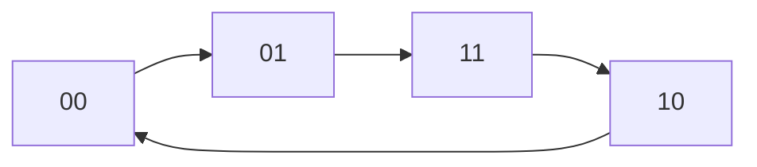
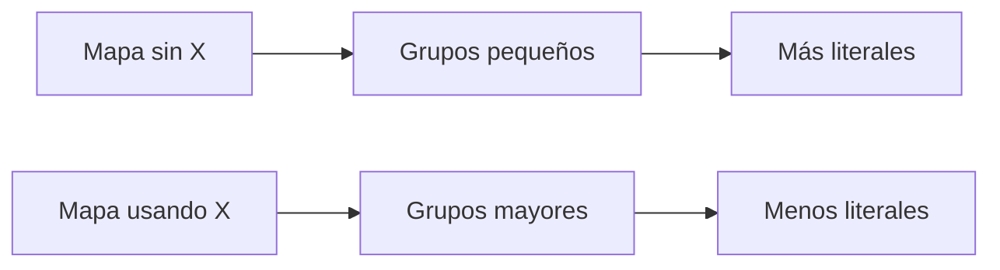
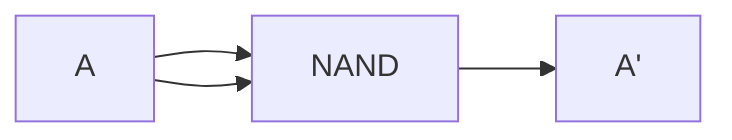
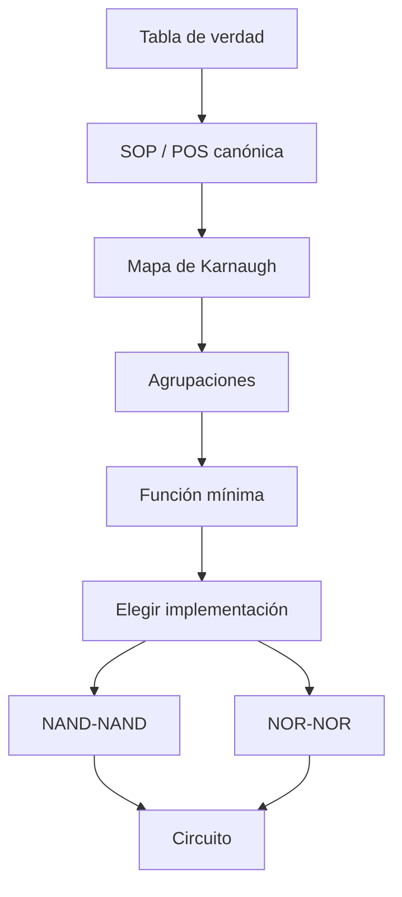

<div align="center">

# 🟠 SEMANA 3

## Mapas de Karnaugh, indiferentes y NAND/NOR

**Unidad 1 · Diseño de Circuitos**

</div>

---

| ⬅️ Anterior | 🏠 Inicio | ➡️ Siguiente |
|:---:|:---:|:---:|
| [**Semana 2**](../semana-2/README.md) | [**Índice general**](../README.md) | [**Semana 4**](../semana-4/README.md) |

---

<a id="contenido"></a>

# 📑 Contenido

1. [¿Qué es Karnaugh?](#karnaugh)
2. [Adyacencia](#adyacencia)
3. [Código Gray](#gray)
4. [Mapa de 3 variables](#k3)
5. [Mapa de 4 variables](#k4)
6. [Reglas de agrupación](#grupos)
7. [SOP mínima](#sop)
8. [POS mínima](#pos)
9. [Implicantes](#implicantes)
10. [Condiciones indiferentes](#indiferentes)
11. [NAND universal](#nand)
12. [NOR universal](#nor)
13. [Costo de implementación](#costo)
14. [Síntesis](#sintesis)

---

<a id="karnaugh"></a>

# 1. 🗺️ ¿Qué es un mapa de Karnaugh?

Un mapa de Karnaugh, también conocido como **K-map**, es una herramienta
gráfica utilizada para simplificar funciones booleanas.

Permite observar qué minitérminos o maxitérminos son lógicamente adyacentes y
eliminar variables que dejan de afectar al resultado.

La idea principal es:

```text
agrupar → eliminar variables → simplificar
```

---

<a id="adyacencia"></a>

# 2. 🔗 Teorema de adyacencia

Consideremos:

```text
X·Y + X·Y'
```

Sacamos factor común:

```text
X(Y + Y')
```

Como:

```text
Y + Y' = 1
```

obtenemos:

```text
X
```

Por tanto:

```text
XY + XY' = X
```

---

## Ejemplo con tres variables

```text
AB'C' + AB'C
```

Factorizamos:

```text
AB'(C' + C)
```

```text
AB'·1
```

Resultado:

```text
AB'
```

La variable:

```text
C
```

desaparece porque cambia entre `0` y `1` mientras el resto permanece igual.

---

<a id="gray"></a>

# 3. 🔁 ¿Por qué se utiliza código Gray?

El orden habitual binario:

```text
00
01
10
11
```

no sirve para organizar Karnaugh porque entre `01` y `10` cambian dos bits.

En su lugar se utiliza:

```text
00
01
11
10
```



Entre cada posición vecina cambia únicamente una variable.

---

<a id="k3"></a>

# 4. 3️⃣ Mapa de Karnaugh de 3 variables

Para tres variables:

```text
A, B, C
```

puede organizarse así:

| A \ BC | 00 | 01 | 11 | 10 |
|:---:|:---:|:---:|:---:|:---:|
| 0 |  |  |  |  |
| 1 |  |  |  |  |

Las columnas están organizadas mediante código Gray.

---

## Número de celdas

Para `n` variables:

```text
Número de celdas = 2ⁿ
```

Entonces:

```text
3 variables → 2³ = 8 celdas
```

---

<a id="k4"></a>

# 5. 4️⃣ Mapa de Karnaugh de 4 variables

Para:

```text
A B C D
```

el mapa contiene:

```text
2⁴ = 16 celdas
```

Estructura:

| AB \ CD | 00 | 01 | 11 | 10 |
|:---:|:---:|:---:|:---:|:---:|
| 00 |  |  |  |  |
| 01 |  |  |  |  |
| 11 |  |  |  |  |
| 10 |  |  |  |  |

Tanto filas como columnas siguen código Gray.

---

<a id="grupos"></a>

# 6. 🟩 Reglas de agrupación

Los grupos deben contener una cantidad de celdas equivalente a una potencia
de dos.

Son válidos:

```text
1
2
4
8
16
```

No son válidos:

```text
3
5
6
7
```

---

## Regla 1 · Grupos rectangulares

Los grupos deben formar rectángulos.

---

## Regla 2 · Formar grupos grandes

Siempre se intenta utilizar el grupo más grande posible.

```text
8 celdas → mejor que 4
4 celdas → mejor que 2
2 celdas → mejor que 1
```

---

## Regla 3 · Puede existir superposición

Una celda puede pertenecer a más de un grupo si esto permite simplificar mejor
la función.

---

## Regla 4 · Los bordes son vecinos

El mapa debe imaginarse como una superficie que se enrolla.

```text
borde izquierdo ↔ borde derecho
```

y:

```text
borde superior ↔ borde inferior
```

Por eso las cuatro esquinas son adyacentes.


---

## Regla 5 · Cubrir los términos necesarios

En SOP deben quedar cubiertos todos los `1`.

En POS deben quedar cubiertos todos los `0`.

---

<a id="sop"></a>

# 7. 🟢 SOP mínima

Para obtener una expresión SOP mínima:

```text
se agrupan los 1
```

Cada grupo genera un producto.

Ejemplo conceptual:

```text
Grupo 1 → A'B

Grupo 2 → CD'
```

Entonces:

```text
F = A'B + CD'
```

---

## ¿Qué variables permanecen?

Una variable permanece en el término solamente si su valor se mantiene
constante dentro de todo el grupo.

Si cambia:

```text
0 ↔ 1
```

desaparece.

---

<a id="pos"></a>

# 8. 🔵 POS mínima

Para POS:

```text
se agrupan los 0
```

Cada agrupación produce un término suma.

Después los términos se multiplican:

```text
F = (A+B)(C'+D)
```

---

## Diferencia esencial

```text
SOP → agrupar 1
POS → agrupar 0
```

---

<a id="implicantes"></a>

# 9. 🧩 Implicantes

Un grupo válido del mapa representa un **implicante**.

Un grupo que no puede ampliarse sin incluir valores inválidos se denomina:

```text
Implicante primo
```

Un implicante primo que cubre al menos un término que ningún otro implicante
puede cubrir se denomina:

```text
Implicante primo esencial
```

Los esenciales deben incluirse en la solución.

---

## ¿Existe siempre una única solución?

No necesariamente.

Puede haber más de una expresión mínima con el mismo costo lógico.

Por eso no basta con comparar únicamente la apariencia de las expresiones.

---

<a id="indiferentes"></a>

# 10. ❌ Condiciones indiferentes

Las condiciones indiferentes se representan mediante:

```text
X
```

También pueden aparecer como:

```text
d
```

de:

```text
don't care
```

---

## Ejemplo BCD

BCD utiliza solamente:

```text
0000 → 0
...
1001 → 9
```

Las combinaciones:

```text
1010
1011
1100
1101
1110
1111
```

no corresponden a teclas decimales válidas.

Si el sistema nunca recibe esas entradas, su salida puede considerarse
indiferente.

---

## Regla fundamental

Una `X` puede tratarse como:

```text
1
```

si permite formar un grupo mayor.

También puede tratarse como:

```text
0
```

si no resulta útil.

---

## Tres reglas

### Puede usarse

Si agranda un grupo.

### Puede ignorarse

Si no produce simplificación.

### No debe formar un grupo inútil

No se crea un grupo exclusivamente con `X` si no ayuda a cubrir una salida
requerida.

---

## Notación

Ejemplo:

```text
F = Σm(5,6,7,8,9) + d(10,11,12,13,14,15)
```

---

# 📉 Efecto de las condiciones indiferentes

Sin aprovechar las `X`, una función puede requerir numerosos literales.

Al aprovecharlas, pueden formarse agrupaciones mayores.



---

[⬆️ Volver al contenido](#contenido)

---

<a id="nand"></a>

# 11. 🟨 NAND como compuerta universal

Una compuerta es **universal** cuando puede utilizarse para construir las
operaciones lógicas fundamentales.

Con NAND podemos construir:

```text
NOT
AND
OR
```

Por lo tanto, cualquier función booleana puede implementarse utilizando NAND.

---

## NOT con NAND

Conectamos la misma entrada a ambos terminales:

```text
(A·A)' = A'
```



---

## AND con NAND

Primero:

```text
X = (AB)'
```

Después negamos nuevamente:

```text
AB = (X·X)'
```

Por tanto:

```text
AB = ((AB)'·(AB)')'
```

---

## OR con NAND

Por De Morgan:

```text
A+B = (A'B')'
```

Por tanto, negando previamente `A` y `B` con NAND se puede obtener OR.

---

## Estructura NAND-NAND

Una función SOP puede transformarse naturalmente a una implementación:

```text
NAND → NAND
```

---

<a id="nor"></a>

# 12. 🟥 NOR como compuerta universal

NOR también permite construir:

```text
NOT
AND
OR
```

---

## NOT con NOR

```text
(A+A)' = A'
```

---

## OR con NOR

Primero:

```text
X = (A+B)'
```

Después:

```text
A+B = (X+X)'
```

---

## AND con NOR

Utilizando De Morgan:

```text
AB = (A'+B')'
```

---

## Estructura NOR-NOR

Una expresión POS puede adaptarse de forma natural a:

```text
NOR → NOR
```

---

<a id="costo"></a>

# 13. 💰 Costo de implementación

La expresión algebraicamente más corta no siempre produce necesariamente la
implementación física más económica.

Conviene analizar:

- número de literales;
- cantidad de compuertas;
- entradas utilizadas;
- número de circuitos integrados;
- familia lógica disponible.

Por ejemplo, si ya se dispone de circuitos `74LS00`, una solución NAND puede
ser preferible incluso frente a otra expresión aparentemente más pequeña.

---

# 🧠 Proceso completo de la Semana 3



---

<a id="sintesis"></a>

# 14. ✅ Síntesis de la Semana 3

| Concepto | Regla |
|---|---|
| Código Gray | `00, 01, 11, 10` |
| Tamaño de grupo | `2ᵏ` |
| SOP | Agrupar `1` |
| POS | Agrupar `0` |
| Bordes | Son adyacentes |
| X | Se utiliza solo cuando ayuda |
| NAND | Compuerta universal |
| NOR | Compuerta universal |
| SOP → hardware | NAND-NAND |
| POS → hardware | NOR-NOR |

---

### Idea fundamental

> El mapa de Karnaugh no cambia la función lógica. Solamente encuentra una
> representación más sencilla del mismo comportamiento.

---

## 🧭 Navegación

| ⬅️ | 🏠 | ➡️ |
|:---:|:---:|:---:|
| [**Semana 2**](../semana-2/README.md) | [**Índice principal**](../README.md) | [**Semana 4**](../semana-4/README.md) |

<div align="center">

**Fin de la Semana 3**

[⬆️ Volver al contenido](#contenido)

</div>
