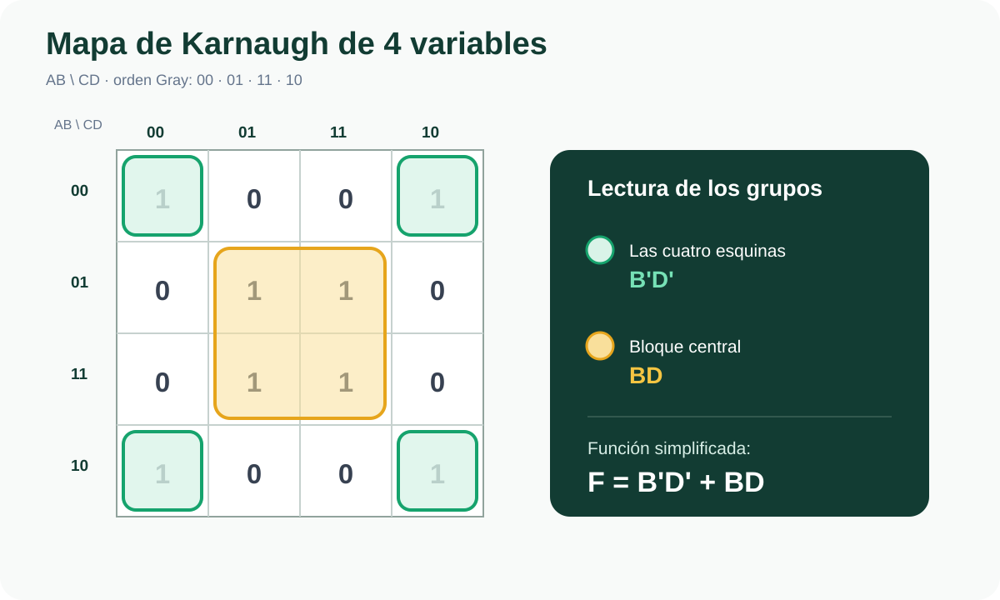
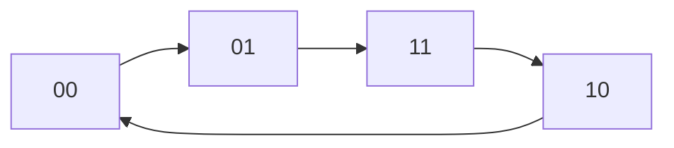
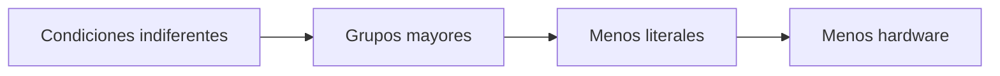
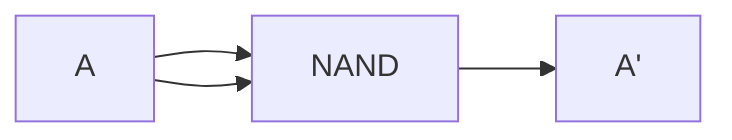
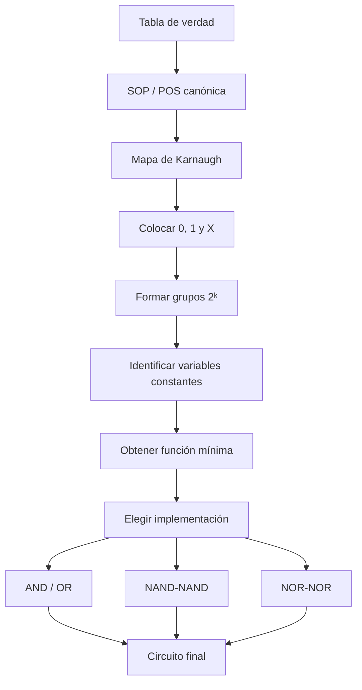

<div align="center">

# 🟠 SEMANA 3

## Mapas de Karnaugh, condiciones indiferentes y NAND/NOR

**Unidad 1 · Diseño de Circuitos**

</div>

---

| ⬅️ Anterior | 🏠 Inicio | ➡️ Siguiente |
|:---:|:---:|:---:|
| [**Semana 2**](../semana-2/README.md) | [**Índice general**](../README.md) | [**Semana 4**](../semana-4/README.md) |

---

<a id="contenido"></a>

# 📑 Contenido

1. [¿Qué es un mapa de Karnaugh?](#karnaugh)
2. [Teorema de adyacencia](#adyacencia)
3. [Código Gray](#gray)
4. [Mapa de 3 variables](#k3)
5. [Mapa de 4 variables](#k4)
6. [Reglas de agrupación](#grupos)
7. [SOP mínima](#sop)
8. [POS mínima](#pos)
9. [Implicantes](#implicantes)
10. [Condiciones indiferentes](#indiferentes)
11. [NAND universal](#nand)
12. [NOR universal](#nor)
13. [Costo de implementación](#costo)
14. [Procedimiento completo](#procedimiento)
15. [Síntesis](#sintesis)

---

# 🎯 Objetivo de la Semana 3

Utilizar mapas de Karnaugh para obtener expresiones booleanas simplificadas,
comprender el uso de condiciones indiferentes y aprender a implementar
funciones lógicas utilizando exclusivamente compuertas NAND o NOR.

---

<a id="karnaugh"></a>

# 1. 🗺️ ¿Qué es un mapa de Karnaugh?

Un mapa de Karnaugh, también llamado:

```text
K-map
```

es una herramienta gráfica utilizada para simplificar funciones booleanas.

Permite observar visualmente cuáles combinaciones de la tabla de verdad son
lógicamente adyacentes.

La idea general es:

```text
TABLA DE VERDAD
       ↓
MAPA DE KARNAUGH
       ↓
AGRUPACIONES
       ↓
EXPRESIÓN SIMPLIFICADA
```

<p align="center">
  
</p>

La simplificación no modifica el comportamiento del circuito.

Solamente obtiene otra expresión equivalente utilizando menos variables o
menos términos.

---

<a id="adyacencia"></a>

# 2. 🔗 Teorema de adyacencia

La simplificación de Karnaugh se fundamenta en el principio de adyacencia.

Consideremos:

```text
X·Y + X·Y'
```

Sacamos factor común:

```text
X(Y + Y')
```

Sabemos que:

```text
Y + Y' = 1
```

Entonces:

```text
X·1 = X
```

Por tanto:

```text
XY + XY' = X
```

---

## Ejemplo con tres variables

Consideremos:

```text
AB'C' + AB'C
```

Factorizamos:

```text
AB'(C' + C)
```

Sabemos:

```text
C' + C = 1
```

Entonces:

```text
AB'·1
```

Resultado:

```text
AB'
```

La variable:

```text
C
```

desaparece.

---

## 🧠 Idea fundamental

Si dos minitérminos solamente difieren en una variable:

```text
esa variable puede eliminarse
```

Esto es precisamente lo que visualizan las agrupaciones de Karnaugh.

---

<a id="gray"></a>

# 3. 🔁 Código Gray en Karnaugh

Los mapas de Karnaugh no utilizan el orden binario tradicional:

```text
00
01
10
11
```

En su lugar utilizan código Gray:

```text
00
01
11
10
```

La razón es que entre posiciones consecutivas cambia únicamente:

```text
1 bit
```



---

## Comparación

### Orden binario

```text
01 → 10
```

Cambian:

```text
2 bits
```

---

### Código Gray

```text
01 → 11
```

Cambia:

```text
1 bit
```

Por esta razón Gray permite representar correctamente las adyacencias lógicas.

---

[⬆️ Volver al contenido](#contenido)

---

<a id="k3"></a>

# 4. 3️⃣ Mapa de Karnaugh de 3 variables

Si tenemos:

```text
A
B
C
```

existen:

```text
2³ = 8 combinaciones
```

El mapa puede organizarse así:

| A \ BC | 00 | 01 | 11 | 10 |
|:---:|:---:|:---:|:---:|:---:|
| 0 |  |  |  |  |
| 1 |  |  |  |  |

Las columnas:

```text
BC
```

siguen:

```text
00
01
11
10
```

---

<a id="k4"></a>

# 5. 4️⃣ Mapa de Karnaugh de 4 variables

Para cuatro variables:

```text
A B C D
```

existen:

```text
2⁴ = 16 combinaciones
```

El mapa se organiza:

| AB \ CD | 00 | 01 | 11 | 10 |
|:---:|:---:|:---:|:---:|:---:|
| 00 |  |  |  |  |
| 01 |  |  |  |  |
| 11 |  |  |  |  |
| 10 |  |  |  |  |

Tanto las filas como las columnas utilizan código Gray.

---

## Número general de celdas

Para:

```text
n variables
```

tenemos:

```text
2ⁿ celdas
```

Ejemplos:

| Variables | Celdas |
|:---:|---:|
| 2 | 4 |
| 3 | 8 |
| 4 | 16 |

---

<a id="grupos"></a>

# 6. 🟩 Reglas de agrupación

Las agrupaciones son la parte fundamental del método.

---

## Regla 1 · Potencias de dos

Los grupos deben contener:

```text
2ᵏ celdas
```

Por tanto son válidos:

```text
1
2
4
8
16
```

No son válidos:

```text
3
5
6
7
```

---

## Regla 2 · Forma rectangular

Los grupos deben formar:

```text
rectángulos
```

No pueden formarse figuras arbitrarias.

---

## Regla 3 · Crear grupos grandes

Siempre debe intentarse formar el grupo más grande posible.

Prioridad:

```text
16
↓
8
↓
4
↓
2
↓
1
```

Cuanto mayor sea el grupo:

```text
menos variables tendrá el término resultante
```

---

## Regla 4 · Se permite superposición

Una celda puede pertenecer a más de un grupo si eso permite obtener una
simplificación mejor.

---

## Regla 5 · Los bordes son vecinos

El mapa debe imaginarse como si estuviera enrollado.

Por tanto:

```text
izquierda ↔ derecha
```

y:

```text
arriba ↔ abajo
```

También significa que:

```text
las cuatro esquinas son vecinas
```


---

## Regla 6 · Cubrir todos los valores necesarios

Para SOP:

```text
todos los 1 deben estar cubiertos
```

Para POS:

```text
todos los 0 deben estar cubiertos
```

---

[⬆️ Volver al contenido](#contenido)

---

<a id="sop"></a>

# 7. 🟢 SOP mínima

SOP significa:

```text
Sum of Products
```

Para obtener una expresión SOP mediante Karnaugh:

```text
AGRUPAMOS LOS 1
```

Cada agrupación produce un término producto.

---

## Regla para leer un grupo

Dentro de un grupo:

- una variable que permanece en `1` aparece normal;
- una variable que permanece en `0` aparece complementada;
- una variable que cambia desaparece.

---

## Ejemplo conceptual

Supongamos que una agrupación genera:

```text
A'B
```

y otra:

```text
CD'
```

Entonces:

```text
F = A'B + CD'
```

---

<a id="pos"></a>

# 8. 🔵 POS mínima

POS significa:

```text
Product of Sums
```

Para obtener POS:

```text
AGRUPAMOS LOS 0
```

Cada grupo produce un término suma.

Ejemplo:

```text
(A+B)
```

y:

```text
(C'+D)
```

Entonces:

```text
F = (A+B)(C'+D)
```

---

## Diferencia fundamental

```text
SOP → agrupa 1
```

```text
POS → agrupa 0
```

---

<a id="implicantes"></a>

# 9. 🧩 Implicantes

Cada grupo válido del mapa representa un:

```text
Implicante
```

---

## Implicante primo

Es un grupo que no puede ampliarse más sin incluir valores que no corresponden.

---

## Implicante primo esencial

Un implicante primo es esencial cuando cubre al menos un valor que ningún otro
grupo puede cubrir.

Por tanto:

```text
los implicantes primos esenciales deben formar parte de la solución
```

---

## ⚠️ Una función puede tener varias soluciones mínimas

No siempre existe una única forma simplificada.

Dos soluciones diferentes podrían:

- representar exactamente la misma función;
- utilizar el mismo número de literales;
- tener un costo lógico equivalente.

---

<a id="indiferentes"></a>

# 10. ❌ Condiciones indiferentes

Las condiciones indiferentes se representan mediante:

```text
X
```

o mediante:

```text
d
```

de:

```text
don't care
```

---

## ¿Qué significa?

Una condición indiferente representa una combinación que:

- nunca ocurre;
- no puede presentarse físicamente;
- o cuyo resultado no importa.

---

## Ejemplo: BCD

BCD representa:

```text
0 → 0000
1 → 0001
...
9 → 1001
```

Las combinaciones:

```text
1010
1011
1100
1101
1110
1111
```

no corresponden a ningún dígito decimal.

Si el circuito recibe información exclusivamente desde un teclado decimal,
estas combinaciones nunca deberían aparecer.

Por tanto pueden marcarse:

```text
X
```

---

## ¿Cómo se utilizan?

Una `X` puede utilizarse como:

```text
1
```

si ayuda a crear una agrupación mayor.

También puede ignorarse y tratarse como:

```text
0
```

si no resulta útil.

---

## Regla fundamental

> Una condición indiferente se utiliza únicamente cuando ayuda a simplificar.

---

## Tres situaciones

### ✅ Utilizar como 1

Cuando permite ampliar una agrupación.

### ✅ Ignorar

Cuando no aporta ninguna mejora.

### ❌ Crear un grupo únicamente con X

No tiene sentido formar un grupo compuesto exclusivamente por condiciones
indiferentes si no cubre ningún valor necesario.

---

## Notación

Ejemplo:

```text
F = Σm(5,6,7,8,9) + d(10,11,12,13,14,15)
```

Aquí:

```text
Σm(...)
```

representa los minitérminos donde la función debe valer `1`.

Mientras:

```text
d(...)
```

representa condiciones indiferentes.

---

# 📉 Beneficio de utilizar las X

Sin condiciones indiferentes:

```text
grupos más pequeños
```

pueden provocar:

```text
más variables
```

y por tanto:

```text
más hardware
```

Al utilizar correctamente las X:



---

[⬆️ Volver al contenido](#contenido)

---

<a id="nand"></a>

# 11. 🟨 NAND como compuerta universal

Una compuerta universal es aquella que permite construir las operaciones
fundamentales:

```text
NOT
AND
OR
```

La compuerta NAND es universal.

Por tanto:

> Cualquier función booleana puede implementarse únicamente utilizando NAND.

---

## NOT utilizando NAND

Conectamos la misma entrada a ambos terminales:

```text
(A·A)' = A'
```



---

## AND utilizando NAND

Primero:

```text
X = (AB)'
```

Después invertimos nuevamente:

```text
AB = (X·X)'
```

Por tanto:

```text
AB = ((AB)'·(AB)')'
```

---

## OR utilizando NAND

Utilizamos De Morgan:

```text
A+B = (A'·B')'
```

Primero obtenemos:

```text
A'
B'
```

mediante NAND.

Después aplicamos otra NAND.

---

## Implementación NAND-NAND

Una función en forma:

```text
SOP
```

puede transformarse naturalmente en una estructura:

```text
NAND
  ↓
NAND
```

---

<a id="nor"></a>

# 12. 🟥 NOR como compuerta universal

NOR también es una compuerta universal.

Con NOR podemos construir:

```text
NOT
AND
OR
```

---

## NOT utilizando NOR

```text
(A+A)' = A'
```

---

## OR utilizando NOR

Primero:

```text
X = (A+B)'
```

Después invertimos:

```text
A+B = (X+X)'
```

---

## AND utilizando NOR

Por De Morgan:

```text
AB = (A'+B')'
```

---

## Implementación NOR-NOR

Las expresiones:

```text
POS
```

pueden adaptarse naturalmente a una estructura:

```text
NOR
 ↓
NOR
```

---

<a id="costo"></a>

# 13. 💰 Costo de implementación

Una expresión algebraicamente pequeña no necesariamente representa siempre la
implementación física más económica.

También deben analizarse factores como:

- número de literales;
- cantidad de compuertas;
- número de entradas;
- circuitos integrados necesarios;
- familia lógica disponible;
- cableado;
- complejidad física.

---

## Ejemplo conceptual

Supongamos que una función puede implementarse utilizando:

```text
AND + OR + NOT
```

pero también utilizando únicamente:

```text
NAND
```

Si ya tenemos disponible un integrado:

```text
74LS00
```

que contiene compuertas NAND, podría resultar más conveniente utilizar una
implementación NAND.

---

<a id="procedimiento"></a>

# 14. 🛠️ Procedimiento completo de simplificación



---

# 🧠 Estrategia rápida para resolver Karnaugh

Cuando tengas un ejercicio:

### Paso 1

Construye correctamente el mapa usando:

```text
00 01 11 10
```

### Paso 2

Coloca los valores:

```text
0
1
X
```

### Paso 3

Forma primero los grupos más grandes posibles.

### Paso 4

Busca implicantes primos esenciales.

### Paso 5

Comprueba que todos los valores necesarios estén cubiertos.

### Paso 6

Lee únicamente las variables que permanecen constantes.

---

<a id="sintesis"></a>

# 15. ✅ Síntesis de la Semana 3

| Concepto | Regla principal |
|---|---|
| Código Gray | `00, 01, 11, 10` |
| Adyacencia | Entre vecinos cambia una variable |
| Tamaño de grupo | `2ᵏ` |
| SOP | Agrupar `1` |
| POS | Agrupar `0` |
| Bordes | Son adyacentes |
| Esquinas | También son vecinas |
| X | Se utiliza solamente cuando ayuda |
| Implicante primo | Grupo que no puede ampliarse |
| Implicante esencial | Debe incluirse |
| NAND | Compuerta universal |
| NOR | Compuerta universal |
| SOP → hardware | NAND-NAND |
| POS → hardware | NOR-NOR |

---

# 🔗 Conexión con la Semana 4

Hasta este momento hemos aprendido a:

```text
crear funciones
```

y:

```text
simplificarlas
```

La siguiente pregunta es:

> ¿Podemos utilizar estas mismas herramientas para construir circuitos que
> realicen operaciones matemáticas?

La respuesta es:

```text
SÍ
```

Y comenzaremos con:

```text
SUMADORES BINARIOS
```

---

## 🧭 Navegación

| ⬅️ | 🏠 | ➡️ |
|:---:|:---:|:---:|
| [**Semana 2**](../semana-2/README.md) | [**Índice principal**](../README.md) | [**Semana 4**](../semana-4/README.md) |

<div align="center">

### 🟠 Fin de la Semana 3

[⬆️ Volver al contenido](#contenido)

</div>
