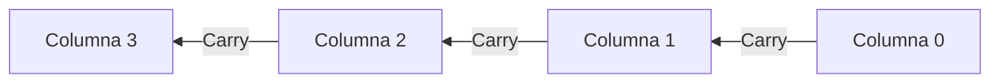
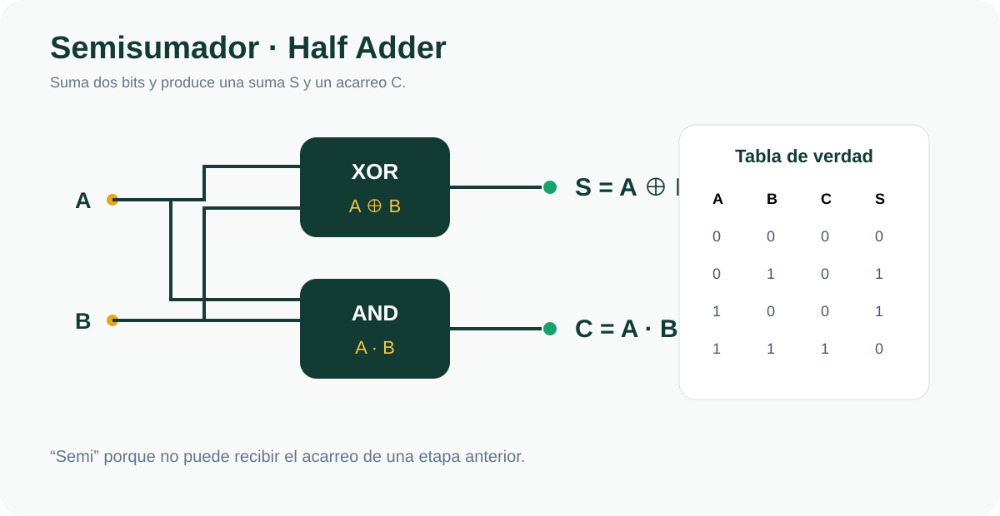
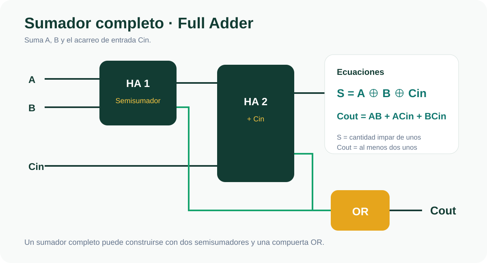
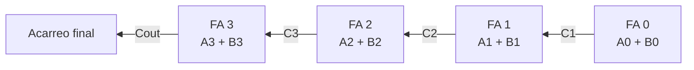
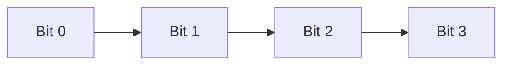
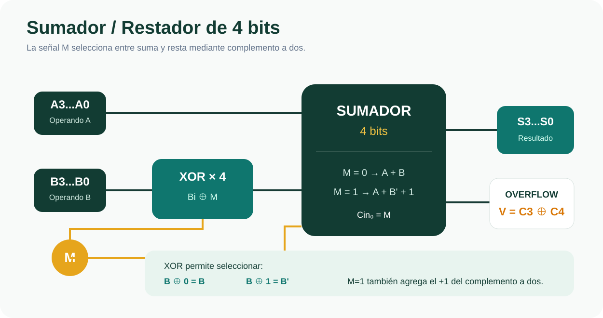
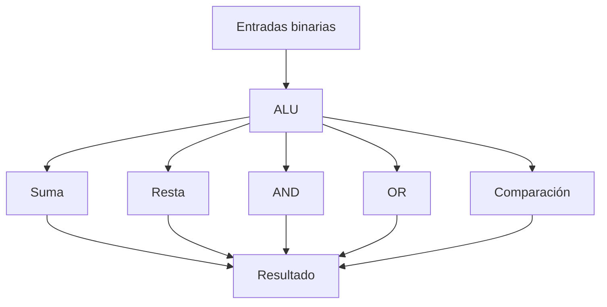
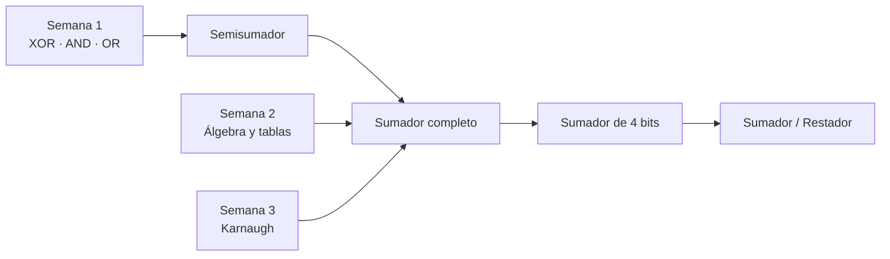
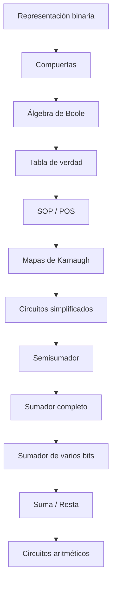

<div align="center">

# 🔴 SEMANA 4

## Circuitos aritméticos

### Semisumador · Sumador completo · Sumador de 4 bits · Resta · Overflow

**Unidad 1 · Diseño de Circuitos**

</div>

---

| ⬅️ Anterior | 🏠 Inicio | ➡️ Siguiente |
|:---:|:---:|:---:|
| [**Semana 3**](../semana-3/README.md) | [**Índice general**](../README.md) | — |

---

<a id="contenido"></a>

# 📑 Contenido

1. [Suma binaria](#suma)
2. [Acarreo](#acarreo)
3. [Semisumador](#semisumador)
4. [Sumador completo](#completo)
5. [Ecuaciones del sumador completo](#ecuaciones)
6. [Sumador de 4 bits](#cuatrobits)
7. [Ripple Carry](#ripple)
8. [Retardo de propagación](#retardo)
9. [Resta mediante complemento a dos](#resta)
10. [Sumador/restador](#sumadorrestador)
11. [Overflow](#overflow)
12. [Comparador](#comparador)
13. [Relación con la ALU](#alu)
14. [Síntesis final](#sintesis)

---

# 🎯 Objetivo de la Semana 4

Comprender cómo los principios de lógica combinacional pueden utilizarse para
construir circuitos capaces de realizar operaciones aritméticas.

Durante esta semana se estudian:

- suma binaria;
- acarreo;
- semisumadores;
- sumadores completos;
- sumadores de varios bits;
- resta mediante complemento a dos;
- overflow;
- retardo de propagación;
- comparación.

---

<a id="suma"></a>

# 1. ➕ Suma binaria

Para sumar dos bits existen únicamente cuatro posibilidades.

| Operación | Resultado | S | C |
|:---:|:---:|:---:|:---:|
| `0+0` | `0` | 0 | 0 |
| `0+1` | `1` | 1 | 0 |
| `1+0` | `1` | 1 | 0 |
| `1+1` | `10₂` | 0 | 1 |

Donde:

```text
S = Sum
```

representa:

```text
el bit que escribimos
```

Mientras:

```text
C = Carry
```

representa:

```text
el bit que llevamos a la siguiente columna
```

---

## Analogía con decimal

En decimal:

```text
7 + 5 = 12
```

Escribimos:

```text
2
```

y llevamos:

```text
1
```

En binario ocurre exactamente el mismo principio.

Cuando:

```text
1 + 1
```

obtenemos:

```text
10₂
```

Entonces:

```text
S = 0
C = 1
```

---

<a id="acarreo"></a>

# 2. 🔁 Acarreo

Consideremos:

```text
   0110
 + 0111
 -------
   1101
```

En decimal:

```text
6 + 7 = 13
```

Al sumar cada columna pueden aparecer acarreos.

Un acarreo producido en una columna debe utilizarse en la siguiente.



---

# 🧠 Dos tipos de columnas

La primera columna solamente suma:

```text
A
B
```

Por tanto utiliza un:

```text
SEMISUMADOR
```

Las columnas siguientes deben sumar:

```text
A
B
Cin
```

Por tanto utilizan:

```text
SUMADORES COMPLETOS
```

---

[⬆️ Volver al contenido](#contenido)

---

<a id="semisumador"></a>

# 3. 🟢 Semisumador

Un semisumador, también llamado:

```text
Half Adder
```

es un circuito capaz de sumar:

```text
2 bits
```

Entradas:

```text
A
B
```

Salidas:

```text
S
C
```

---

## Tabla de verdad

| A | B | C | S |
|:---:|:---:|:---:|:---:|
| 0 | 0 | 0 | 0 |
| 0 | 1 | 0 | 1 |
| 1 | 0 | 0 | 1 |
| 1 | 1 | 1 | 0 |

<p align="center">
  
</p>

---

## Analizando S

Observamos:

```text
A B → S

0 0 → 0
0 1 → 1
1 0 → 1
1 1 → 0
```

La salida vale `1` cuando las entradas son:

```text
DIFERENTES
```

Esta es exactamente la tabla de una XOR.

Por tanto:

```text
S = A ⊕ B
```

---

## Analizando C

El acarreo vale `1` solamente cuando:

```text
A = 1
B = 1
```

Esta es la operación AND.

Por tanto:

```text
C = A·B
```

---

## Ecuaciones del semisumador

```text
S = A ⊕ B
```

```text
C = A·B
```

---

## ¿Por qué se llama «semi»?

Porque no puede recibir:

```text
acarreo de entrada
```

Solamente trabaja con:

```text
A
B
```

Por eso conceptualmente corresponde a la primera columna de una suma.

---

<a id="completo"></a>

# 4. 🔵 Sumador completo

Un sumador completo, o:

```text
Full Adder
```

debe sumar:

```text
A
B
Cin
```

Donde:

```text
Cin = Carry In
```

es el acarreo procedente de la etapa anterior.

Las salidas son:

```text
S
Cout
```

Donde:

```text
Cout = Carry Out
```

es el acarreo que se enviará a la siguiente etapa.

---

## Tabla de verdad

| A | B | Cin | Cout | S |
|:---:|:---:|:---:|:---:|:---:|
| 0 | 0 | 0 | 0 | 0 |
| 0 | 0 | 1 | 0 | 1 |
| 0 | 1 | 0 | 0 | 1 |
| 0 | 1 | 1 | 1 | 0 |
| 1 | 0 | 0 | 0 | 1 |
| 1 | 0 | 1 | 1 | 0 |
| 1 | 1 | 0 | 1 | 0 |
| 1 | 1 | 1 | 1 | 1 |

---

# 🧠 Truco: contar los unos

No es necesario memorizar toda la tabla.

Podemos contar:

```text
cuántos unos existen
```

en:

```text
A
B
Cin
```

| Cantidad de unos | Resultado binario | Cout | S |
|:---:|:---:|:---:|:---:|
| 0 | `00` | 0 | 0 |
| 1 | `01` | 0 | 1 |
| 2 | `10` | 1 | 0 |
| 3 | `11` | 1 | 1 |

Entonces podemos recordar:

```text
S = 1 cuando existe una cantidad impar de unos
```

y:

```text
Cout = 1 cuando existen al menos dos unos
```

---

<a id="ecuaciones"></a>

# 5. 🧮 Ecuaciones del sumador completo

## Suma

La suma corresponde a:

```text
S = A ⊕ B ⊕ Cin
```

---

## Acarreo

Una expresión posible es:

```text
Cout = AB + ACin + BCin
```

---

# Construcción con dos semisumadores

Un sumador completo también puede construirse utilizando:

```text
2 semisumadores
```

y:

```text
1 compuerta OR
```

<p align="center">
  
</p>

---

## Primera etapa

```text
S1 = A ⊕ B
```

```text
C1 = A·B
```

---

## Segunda etapa

Se suma:

```text
S1
```

con:

```text
Cin
```

Entonces:

```text
S = S1 ⊕ Cin
```

y:

```text
C2 = S1·Cin
```

---

## Acarreo final

Finalmente:

```text
Cout = C1 + C2
```

---

[⬆️ Volver al contenido](#contenido)

---

<a id="cuatrobits"></a>

# 6. 4️⃣ Sumador de 4 bits

Para sumar dos números:

```text
A3 A2 A1 A0
```

y:

```text
B3 B2 B1 B0
```

se conectan varias etapas.

La regla fundamental es:

```text
Cout de una etapa → Cin de la siguiente
```

Representación conceptual:



Las salidas serán:

```text
S3 S2 S1 S0
```

más:

```text
Cout
```

---

<a id="ripple"></a>

# 7. 🌊 Ripple Carry

La arquitectura anterior recibe el nombre:

```text
Ripple Carry Adder
```

porque el acarreo avanza:

```text
etapa por etapa
```

como una onda.



La etapa siguiente necesita esperar el acarreo producido por la anterior.

---

## Consecuencia

Cuantos más bits tenga el sumador:

```text
más etapas debe atravesar el acarreo
```

Por tanto:

```text
mayor será el tiempo necesario
```

para que el resultado completo se estabilice.

---

<a id="retardo"></a>

# 8. ⏱️ Retardo de propagación

Las compuertas digitales reales no responden instantáneamente.

Cada compuerta posee un tiempo de propagación:

```text
tpd
```

En los ejercicios se puede utilizar aproximadamente:

```text
tpd ≈ 10 ns
```

Si el acarreo atraviesa aproximadamente:

```text
2 compuertas por etapa
```

podemos estimar:

```text
Retardo ≈ 2 · n · 10 ns
```

donde:

```text
n = número de bits
```

---

## Ejemplos

| Bits | Compuertas aproximadas | Retardo aproximado |
|:---:|:---:|---:|
| 4 | 8 | 80 ns |
| 16 | 32 | 320 ns |
| 32 | 64 | 640 ns |

Entonces:

```text
más bits → más retardo
```

---

[⬆️ Volver al contenido](#contenido)

---

<a id="resta"></a>

# 9. ➖ Resta mediante complemento a dos

Una resta:

```text
A - B
```

puede transformarse en:

```text
A + (-B)
```

Sabemos que mediante complemento a dos:

```text
-B = B' + 1
```

Entonces:

```text
A - B
```

equivale a:

```text
A + B' + 1
```

Esto permite reutilizar un circuito sumador para realizar también restas.

---

<a id="sumadorrestador"></a>

# 10. 🔀 Sumador / Restador

Para seleccionar entre suma y resta se utiliza una señal de control:

```text
M
```

---

## Tabla de control

| M | B entra como | Cin inicial | Operación |
|:---:|---|:---:|---|
| 0 | `B` | 0 | `A+B` |
| 1 | `B'` | 1 | `A-B` |

<p align="center">
  
</p>

---

## Cuando M = 0

Cada bit de `B` pasa por una XOR.

```text
Bi ⊕ 0 = Bi
```

Por tanto:

```text
B no cambia
```

Además:

```text
Cin₀ = 0
```

Entonces el circuito realiza:

```text
A+B
```

---

## Cuando M = 1

Tenemos:

```text
Bi ⊕ 1 = Bi'
```

Por tanto:

```text
B se invierte
```

Además:

```text
Cin₀ = 1
```

Obtenemos:

```text
B' + 1
```

que corresponde al complemento a dos.

Entonces:

```text
A + B' + 1
```

equivale a:

```text
A-B
```

---

## ¿Por qué XOR y no NOT?

Una compuerta NOT:

```text
siempre invierte
```

No permite seleccionar entre los dos modos.

En cambio XOR cumple:

```text
B ⊕ 0 = B
```

y:

```text
B ⊕ 1 = B'
```

Por tanto:

```text
M
```

controla si `B` debe conservarse o invertirse.

---

<a id="overflow"></a>

# 11. ⚠️ Overflow

El overflow o desbordamiento ocurre cuando el resultado de una operación con
signo queda fuera del rango que puede representarse con la cantidad disponible
de bits.

En el circuito estudiado:

```text
V = C3 ⊕ C4
```

Donde:

```text
C3 = acarreo que entra al bit más significativo
```

y:

```text
C4 = acarreo que sale del bit más significativo
```

---

## Interpretación

```text
V = 0
```

significa:

```text
no existe overflow
```

Mientras:

```text
V = 1
```

significa:

```text
existe overflow
```

---

## ⚠️ Cout no es overflow

No debemos confundir:

```text
Cout
```

con:

```text
Overflow
```

Para números con signo, la condición estudiada es:

```text
V = C3 ⊕ C4
```

---

<a id="comparador"></a>

# 12. ⚖️ Comparador

Un comparador lógico permite determinar la relación entre dos números.

Por ejemplo:

```text
A > B
```

```text
A = B
```

```text
A < B
```

---

## Igualdad de un bit

La compuerta XNOR es útil para detectar igualdad porque:

| A | B | A XNOR B |
|:---:|:---:|:---:|
| 0 | 0 | 1 |
| 0 | 1 | 0 |
| 1 | 0 | 0 |
| 1 | 1 | 1 |

Entonces:

```text
XNOR = 1
```

cuando:

```text
A = B
```

---

<a id="alu"></a>

# 13. 🧠 Relación con la ALU

Los circuitos aritméticos son fundamentales para comprender la:

```text
ALU
```

que significa:

```text
Arithmetic Logic Unit
```

o:

```text
Unidad Aritmético-Lógica
```

Una ALU puede realizar operaciones como:

- suma;
- resta;
- AND;
- OR;
- comparación;
- otras operaciones lógicas.



---

# 🔗 Relación con las semanas anteriores

Los circuitos aritméticos combinan prácticamente todo lo estudiado durante la
Unidad 1.



---

<a id="sintesis"></a>

# 14. ✅ Síntesis de la Semana 4

| Concepto | Idea esencial |
|---|---|
| `S` | Bit que se escribe |
| `C` | Bit que se lleva |
| Semisumador | `S=XOR`, `C=AND` |
| Sumador completo | Suma `A`, `B` y `Cin` |
| `S` del Full Adder | Cantidad impar de unos |
| `Cout` | Al menos dos unos |
| Sumador de 4 bits | Etapas conectadas mediante acarreo |
| Ripple Carry | El acarreo avanza etapa por etapa |
| Resta | `A+B'+1` |
| `M=0` | Suma |
| `M=1` | Resta |
| Overflow | `V=C3⊕C4` |
| Retardo | Aumenta con el número de bits |

---

# 🧠 Mapa final de la Unidad 1



---

# 🎓 Conclusión de la Unidad 1

Durante la Unidad 1 se recorrió progresivamente el proceso de diseño de lógica
combinacional.

Primero se estudió cómo los sistemas digitales representan información mediante
los estados `0` y `1`.

Posteriormente se analizaron las compuertas lógicas y su representación mediante
álgebra de Boole.

A continuación se aprendió a construir tablas de verdad y funciones canónicas,
para luego simplificarlas mediante mapas de Karnaugh.

Finalmente, estos conocimientos se aplicaron al desarrollo de circuitos
aritméticos capaces de realizar operaciones de suma, resta y comparación.

La metodología general puede resumirse como:

```text
ESPECIFICAR
     ↓
REPRESENTAR
     ↓
SIMPLIFICAR
     ↓
IMPLEMENTAR
     ↓
VERIFICAR
```

---

# 🏁 Resultado final

Al terminar esta unidad se dispone de las bases necesarias para comprender cómo
operaciones aparentemente complejas realizadas por una computadora pueden
construirse a partir de bloques simples de lógica digital.

---

## 🧭 Navegación

| ⬅️ | 🏠 |
|:---:|:---:|
| [**Semana 3**](../semana-3/README.md) | [**Índice principal**](../README.md) |

<div align="center">

# 🎉 UNIDAD 1 COMPLETADA

### Diseño de Circuitos

**Universidad Nacional de Loja**

**Carrera de Computación**

**Sdier Emanuel Roblez Roblez**

<br>

[⬆️ Volver al contenido](#contenido)

</div>
