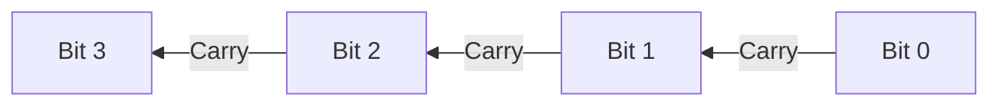
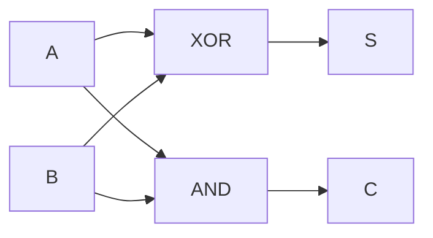
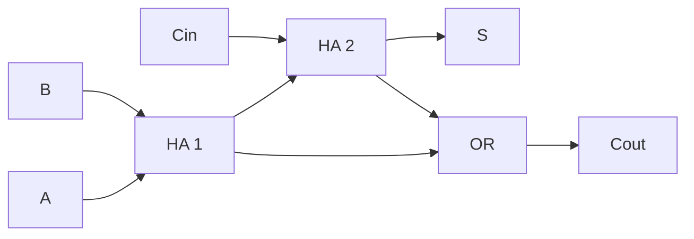
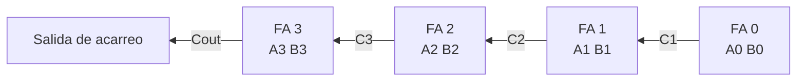
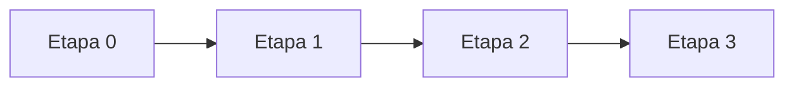
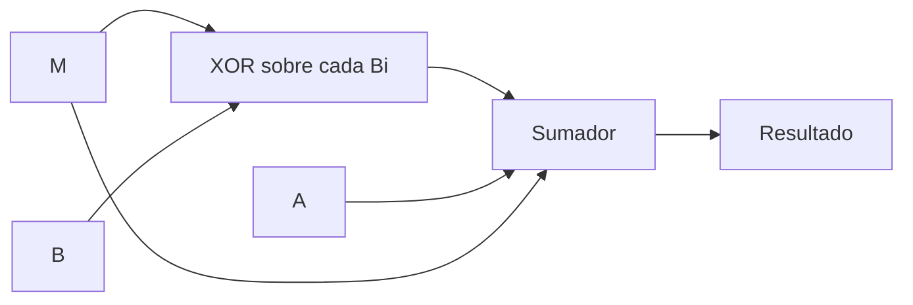
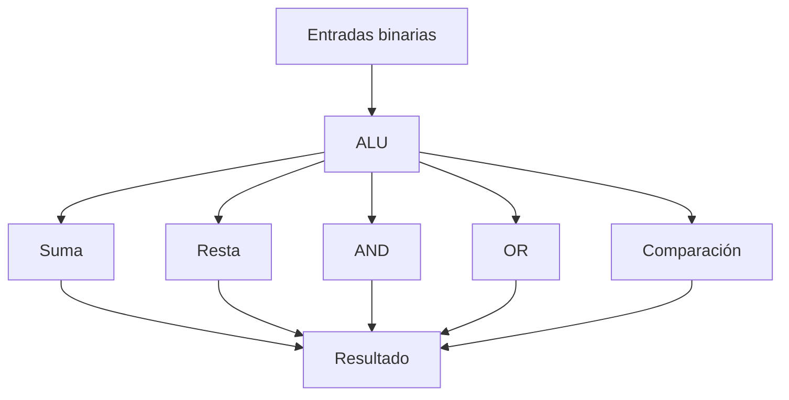
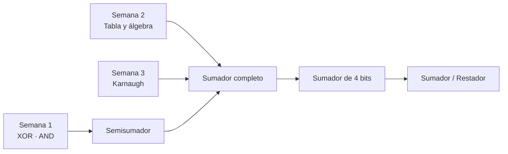
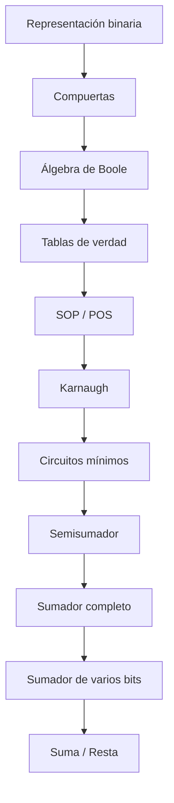

<div align="center">

# 🔴 SEMANA 4

## Circuitos aritméticos

### Semisumador · Sumador completo · Sumador de 4 bits · Resta · Overflow

**Unidad 1 · Diseño de Circuitos**

</div>

---

| ⬅️ Anterior | 🏠 Inicio | ➡️ Siguiente |
|:---:|:---:|:---:|
| [**Semana 3**](../semana-3/README.md) | [**Índice general**](../README.md) | — |

---

<a id="contenido"></a>

# 📑 Contenido

1. [Suma binaria](#suma)
2. [Acarreo](#acarreo)
3. [Semisumador](#semisumador)
4. [Sumador completo](#completo)
5. [Ecuaciones](#ecuaciones)
6. [Sumador de 4 bits](#cuatrobits)
7. [Ripple Carry](#ripple)
8. [Retardo](#retardo)
9. [Resta](#resta)
10. [Sumador/restador](#sumadorrestador)
11. [Overflow](#overflow)
12. [Comparador](#comparador)
13. [Relación con la ALU](#alu)
14. [Síntesis final](#sintesis)

---

<a id="suma"></a>

# 1. ➕ Suma binaria

Para sumar un solo bit existen únicamente cuatro casos.

| Operación | Resultado | S | C |
|:---:|:---:|:---:|:---:|
| `0+0` | `0` | 0 | 0 |
| `0+1` | `1` | 1 | 0 |
| `1+0` | `1` | 1 | 0 |
| `1+1` | `10₂` | 0 | 1 |

Donde:

```text
S = Sum
```

representa el bit que se escribe.

Y:

```text
C = Carry
```

representa el bit que se lleva a la siguiente columna.

---

## Analogía decimal

En decimal:

```text
7 + 5 = 12
```

se escribe:

```text
2
```

y se lleva:

```text
1
```

En binario ocurre exactamente la misma idea.

---

<a id="acarreo"></a>

# 2. 🔁 Acarreo

Ejemplo:

```text
   0110
 + 0111
 -------
   1101
```

En decimal:

```text
6 + 7 = 13
```

Cada columna puede producir un acarreo hacia la siguiente.

Un acarreo puede provocar otro:



---

# Dos tipos de columna

## Primera columna

Suma solamente:

```text
A
B
```

Por tanto utiliza un:

```text
SEMISUMADOR
```

---

## Columnas siguientes

Deben sumar:

```text
A
B
Cin
```

Por tanto utilizan:

```text
SUMADORES COMPLETOS
```

---

<a id="semisumador"></a>

# 3. 🟢 Semisumador

El semisumador o **Half Adder** suma dos bits.

Entradas:

```text
A
B
```

Salidas:

```text
S
C
```

---

## Tabla de verdad

| A | B | C | S |
|:---:|:---:|:---:|:---:|
| 0 | 0 | 0 | 0 |
| 0 | 1 | 0 | 1 |
| 1 | 0 | 0 | 1 |
| 1 | 1 | 1 | 0 |

---

## Analizando S

`S` vale `1` cuando:

```text
A ≠ B
```

Eso corresponde a XOR:

```text
S = A ⊕ B
```

---

## Analizando C

`C` vale `1` solamente cuando:

```text
A = 1
B = 1
```

Eso corresponde a AND:

```text
C = A·B
```

---

## Circuito



---

## ¿Por qué se llama «semi»?

Porque no posee una entrada para recibir el acarreo de una columna anterior.

Por eso resulta apropiado conceptualmente para la primera columna de una suma
simple.

---

[⬆️ Volver al contenido](#contenido)

---

<a id="completo"></a>

# 4. 🔵 Sumador completo

Un **Full Adder** suma tres bits:

```text
A
B
Cin
```

donde:

```text
Cin = Carry in
```

El circuito produce:

```text
S
Cout
```

donde:

```text
Cout = Carry out
```

---

## Tabla de verdad

| A | B | Cin | Cout | S |
|:---:|:---:|:---:|:---:|:---:|
| 0 | 0 | 0 | 0 | 0 |
| 0 | 0 | 1 | 0 | 1 |
| 0 | 1 | 0 | 0 | 1 |
| 0 | 1 | 1 | 1 | 0 |
| 1 | 0 | 0 | 0 | 1 |
| 1 | 0 | 1 | 1 | 0 |
| 1 | 1 | 0 | 1 | 0 |
| 1 | 1 | 1 | 1 | 1 |

---

# 🧠 Truco para comprender la tabla

No es necesario memorizarla.

Podemos contar cuántos `1` existen en cada fila.

| Cantidad de `1` | Resultado binario | Cout | S |
|:---:|:---:|:---:|:---:|
| 0 | `00` | 0 | 0 |
| 1 | `01` | 0 | 1 |
| 2 | `10` | 1 | 0 |
| 3 | `11` | 1 | 1 |

De aquí surgen dos ideas:

```text
S = 1 cuando hay una cantidad impar de unos
```

y:

```text
Cout = 1 cuando existen al menos dos unos
```

---

<a id="ecuaciones"></a>

# 5. 🧮 Ecuaciones del sumador completo

## Suma

```text
S = A ⊕ B ⊕ Cin
```

---

## Acarreo

Una forma equivalente es:

```text
Cout = AB + ACin + BCin
```

También puede construirse mediante dos semisumadores y una OR.

---

# Construcción con dos semisumadores

Primero:

```text
S1 = A ⊕ B
C1 = A·B
```

Después:

```text
S = S1 ⊕ Cin
C2 = S1·Cin
```

Finalmente:

```text
Cout = C1 + C2
```

Representación:



---

<a id="cuatrobits"></a>

# 6. 4️⃣ Sumador de 4 bits

Para sumar:

```text
A3 A2 A1 A0
```

con:

```text
B3 B2 B1 B0
```

pueden conectarse cuatro etapas.

El acarreo de una etapa alimenta a la siguiente.



La regla esencial es:

```text
Cout de una etapa → Cin de la siguiente
```

---

<a id="ripple"></a>

# 7. 🌊 Ripple Carry

Esta arquitectura se denomina:

```text
Ripple Carry Adder
```

porque el acarreo se propaga de una etapa a otra como una onda.



Una etapa no puede conocer completamente su resultado hasta recibir el acarreo
procedente de la anterior.

---

<a id="retardo"></a>

# 8. ⏱️ Retardo de propagación

Las compuertas físicas no responden instantáneamente.

Supongamos aproximadamente:

```text
tpd ≈ 10 ns
```

Si el acarreo atraviesa aproximadamente dos niveles de compuertas por etapa:

```text
Retardo ≈ 2 · n · 10 ns
```

donde:

```text
n = número de bits
```

---

## Ejemplos

| Bits | Compuertas aproximadas | Retardo |
|:---:|:---:|---:|
| 4 | 8 | ≈ 80 ns |
| 16 | 32 | ≈ 320 ns |
| 32 | 64 | ≈ 640 ns |

Conclusión:

```text
más bits → más etapas de acarreo → mayor retardo
```

---

[⬆️ Volver al contenido](#contenido)

---

<a id="resta"></a>

# 9. ➖ Resta mediante complemento a dos

Una resta:

```text
A - B
```

puede escribirse como:

```text
A + (-B)
```

En complemento a dos:

```text
-B = B' + 1
```

Entonces:

```text
A - B = A + B' + 1
```

Esto permite utilizar prácticamente el mismo circuito que ya sabemos utilizar
para sumar.

---

<a id="sumadorrestador"></a>

# 10. 🔀 Sumador / Restador

Se introduce una señal de control:

```text
M
```

---

## Cuando M = 0

Queremos sumar:

```text
A + B
```

Cada bit de B pasa por una XOR:

```text
Bi ⊕ 0 = Bi
```

Por tanto, B no cambia.

Y:

```text
Cin inicial = 0
```

Resultado:

```text
A + B
```

---

## Cuando M = 1

Queremos restar:

```text
A - B
```

Entonces:

```text
Bi ⊕ 1 = Bi'
```

Los bits de B se invierten.

Además:

```text
Cin inicial = 1
```

Así obtenemos:

```text
B' + 1
```

que es el complemento a dos de B.

Finalmente:

```text
A + B' + 1
```

equivale a:

```text
A - B
```

---

## Tabla de control

| M | B pasa como | Cin inicial | Operación |
|:---:|---|:---:|---|
| 0 | `B` | 0 | `A+B` |
| 1 | `B'` | 1 | `A-B` |

---

## Arquitectura conceptual



---

# 🤔 ¿Por qué XOR y no NOT?

Una NOT:

```text
siempre invierte
```

En cambio XOR permite controlar la inversión.

```text
B ⊕ 0 = B
```

```text
B ⊕ 1 = B'
```

Por eso XOR permite seleccionar entre suma y resta.

---

<a id="overflow"></a>

# 11. ⚠️ Overflow

El **overflow** ocurre cuando el resultado de una operación con signo queda
fuera del rango representable con la cantidad disponible de bits.

En el diseño estudiado:

```text
V = C3 ⊕ C4
```

donde:

- `C3` es el acarreo que entra al bit más significativo;
- `C4` es el acarreo que sale de ese bit.

---

## Regla

```text
V = 0 → no existe overflow
V = 1 → existe overflow
```

---

# ⚠️ Cout no es lo mismo que overflow

No debemos utilizar simplemente:

```text
Cout
```

para determinar overflow en operaciones con signo.

La condición estudiada es:

```text
V = C3 ⊕ C4
```

---

<a id="comparador"></a>

# 12. ⚖️ Comparador

Un comparador lógico determina relaciones entre dos números.

Salidas típicas:

```text
A > B
A = B
A < B
```

---

## Igualdad de un bit

XNOR vale `1` cuando dos entradas son iguales.

| A | B | A XNOR B |
|:---:|:---:|:---:|
| 0 | 0 | 1 |
| 0 | 1 | 0 |
| 1 | 0 | 0 |
| 1 | 1 | 1 |

Por eso XNOR resulta útil para detectar igualdad.

---

<a id="alu"></a>

# 13. 🧠 Relación con la ALU

Los circuitos aritméticos constituyen una base para comprender la:

```text
ALU
```

**Arithmetic Logic Unit**

o:

```text
Unidad Aritmético-Lógica
```

La ALU puede realizar operaciones como:



---

# 🔗 Relación con las semanas anteriores

La Semana 4 utiliza prácticamente todo lo aprendido anteriormente.



---

<a id="sintesis"></a>

# 14. ✅ Síntesis de la Semana 4

| Concepto | Idea esencial |
|---|---|
| `S` | Bit que se escribe |
| `C` | Bit de acarreo |
| Semisumador | `S=XOR`, `C=AND` |
| Sumador completo | Suma `A`, `B` y `Cin` |
| `S` del FA | Cantidad impar de unos |
| `Cout` del FA | Al menos dos unos |
| Ripple Carry | El acarreo avanza etapa por etapa |
| Resta | `A+B'+1` |
| `M=0` | Suma |
| `M=1` | Resta |
| Overflow | `V=C3⊕C4` |
| Retardo | Crece con el número de etapas |

---

# 🧠 Mapa final de la Unidad 1



---

# 🎓 Conclusión de la Unidad 1

La lógica combinacional permite construir sistemas complejos a partir de
operaciones simples.

Durante la unidad se comenzó estudiando la representación mediante `0` y `1`,
posteriormente se analizaron las compuertas lógicas, se utilizó el álgebra de
Boole para describir circuitos, se aprendió a minimizar funciones mediante
Karnaugh y finalmente se aplicaron estos conocimientos al diseño de circuitos
aritméticos.

La idea fundamental puede resumirse como:

```text
ESPECIFICAR → REPRESENTAR → SIMPLIFICAR → IMPLEMENTAR → VERIFICAR
```

---

## 🧭 Navegación

| ⬅️ | 🏠 |
|:---:|:---:|
| [**Semana 3**](../semana-3/README.md) | [**Índice principal**](../README.md) |

<div align="center">

# 🎉 Unidad 1 completada

**Diseño de Circuitos**

**Universidad Nacional de Loja**

**Sdier Emanuel Roblez Roblez**

<br>

[⬆️ Volver al contenido](#contenido)

</div>
